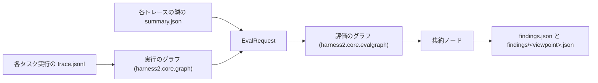

# 評価

評価は、タスク実行が残したものから問題を読み取り、それを示すイベントへの参照を添えて報告します。実行を変えることも、採点することもしません。実行がトレースを書き、トレースがグラフになり、評価者がグラフを読み、評価のグラフが所見を 1 つの一覧にまとめます。

コードは `harness2/core/graph.py`（実行のグラフ）、`harness2/core/evaluate.py`（評価者の契約と観点）、`harness2/core/evalgraph.py`（評価のグラフ）、`harness2/evaluators/rules.py`（同梱の評価者）、`harness2/cli/evaluate.py`（`harness2-evaluate` コマンド）にあります。標準ライブラリだけで動きます。

## 概要

1 周は 4 つの段階です。トレース、実行のグラフ、評価のグラフ、所見です。



1. **トレース。** 各タスク実行は、`summary.json` のあるタスクの実行ディレクトリに `trace.jsonl` を書きます。イベントの種類と親子のつなぎ方は[トレースのシンク](TRACE.ja.md)にあります。ここで重要なのは span（`task`、`mode`、`rollout`、`stage`、`selection`、`reflection`）と point event（`tree.diff`、`memory.*`、`model.*`、`cost`、`error`）です。
2. **実行のグラフ。** `graph.load_runs(root)` が `root` の下の `trace.jsonl` をすべて読み、span の開始と終了を 1 つのノードにまとめ、親から子へ辺を張ります。隣の `summary.json` も読みます。結果は `Graph` と summary の `dict` です。
3. **評価のグラフ。** `evalgraph.run(config, request)` が評価者のノード、反論のノード、1 つの集約ノードを DAG として動かします。評価者のノードはグラフの一部を `Finding` に変え、反論のノードは受け取った所見に立場を足し、集約ノードが届いたものを落とし・まとめ・並べます。
4. **所見。** `harness2-evaluate` が `findings.json`（集約の後。落とした数、実行中のエラー、グラフを作るときの警告つき）と、観点ごとの `findings/<viewpoint>.json`（集約の前）を書きます。

## 評価を回す

```bash
harness2-evaluate --runs runs/jb/adapt/jb-oc-agg1
```

このコマンドは `--runs` の下のトレースをすべて読み、既定では `<runs>/evaluation` の下に出力を書きます。コマンドはパッケージと一緒に入ります。`uv pip install -e .`（またはリポジトリの通常のインストール）のあと、`harness2-evaluate` がパスに載ります。

| 引数 | 意味 |
|---|---|
| `--runs DIR` | `trace.jsonl` を探すディレクトリ。必須 |
| `--evaluators a,b` | 既定のグラフの評価者名。名前ごとに 1 ノードを作り、すべて集約へつなぐ。既定は `rules` |
| `--graph FILE` | JSON のグラフ設定。`--evaluators` より優先する |
| `--out DIR` | 出力ディレクトリ。既定は `<runs>/evaluation` |
| `--allow-scores` | 評価に `judge.*` のイベントと採点スコアを見せる（後述） |

終了コードは、所見があっても実行が終われば `0`、引数の誤り・グラフ設定の誤り・知らない評価者名・トレースが 1 つも無いディレクトリなら `2` です。何を評価するかの細かい選択はグラフ設定の仕事で、コマンドはタスクや実行で絞り込みません。

### 何を書くか

`findings.json` には、集約後の一覧と、その回の記録が入ります:

```json
{
  "findings": [
    {
      "viewpoint": "cost",
      "viewpoints": ["cost"],
      "severity": "major",
      "claim": "The ledger of task t1 records 0.040000 USD of rollouts but the executor records hold 0.000000 USD",
      "evidence": [{"run_id": "...", "span_id": "...", "note": ""}],
      "suggestion": "Record each rollout's cost in both the ledger and the executor records so the two totals agree.",
      "key": "rules:cost:...",
      "evaluator": "rules",
      "evaluators": ["rules"]
    }
  ],
  "dropped": {"no_evidence": 0, "denied": 0},
  "errors": [],
  "warnings": [],
  "traces": 4,
  "runs": 4
}
```

| キー | 値 |
|---|---|
| `findings` | 集約後の所見。重い順 |
| `dropped` | 集約が落とした所見の数。理由（`no_evidence`、`denied`）ごと |
| `errors` | 名前が解決したあとに失敗したノードの 1 行。実行は続く |
| `warnings` | グラフを作るときの問題の 1 行。読めないトレースや summary、JSON オブジェクトでない summary、親 span の無いノード。飛ばした検査はここに出て、実行は止まらない |
| `traces` | 読んだ `trace.jsonl` の数 |
| `runs` | グラフが持つ `task` ノードの数 |

警告は標準エラーにも 1 行ずつ `warning: ...` で出るので、`findings.json` を開かなくても入力の問題に気づけます。

`findings/<viewpoint>.json` には、その観点の評価者が書いた所見を、集約ノードが触る前の形で JSON のリストとして入れます。選ばれた観点には、リストが空でもファイルができます。ファイル名が観点名になるので、観点名は必ず `[a-z][a-z0-9_]*` です。回し直すとディレクトリの中身は入れ替わります。新しいグラフが選ばない観点のファイルは消えるので、`findings/` は最後の回の内容になります。

## 実行のグラフ

`Graph` は、トレースが語る「何が起きたか」です。`task` の根より先の harness2 の種類は知らないので、評価者が読む種類を名指しします。

| メンバー | 値 |
|---|---|
| `Node.key` | `(run_id, span_id)` |
| `Node.kind` | イベントの種類。例えば `"stage"` |
| `Node.attrs` | 開始と終了の attrs を合わせたもの。終了が勝ち、`phase` は無い |
| `Node.start_ts`、`Node.end_ts` | 開始と終了の時刻。point event は `start_ts` だけを持つ |
| `Node.status` | 終了イベントの `status`（`"ok"` または `"error"`）。point event は `None` |
| `Node.dur_s` | 終了イベントの `dur_s`。point event は `None` |
| `Node.parent` | 親のキー。根では `None` |
| `Node.source` | ノードの出どころの `trace.jsonl` |
| `Edge.src`、`Edge.dst`、`Edge.kind` | 親、子、`"contains"` |

`Graph` は評価者が尋ねることに答えます:

| メソッド | 値 |
|---|---|
| `roots()` | `task` のノード。並べたもの |
| `children(key)` | そのノードが直接含んでいたノード。並べたもの |
| `parent(key)`、`ancestors(key)` | 含んでいたノードと、その上の鎖 |
| `of_kind(*kinds)` | そのどれかの種類のノード。並べたもの |
| `runs()` | `run_id` からその実行の `task` ノードへ |
| `subgraph(kinds=None, run_ids=None)` | 条件に合うノード。残った最も近い祖先につなぎ直す |
| `find(run_id, span_id)` | そのノード。無ければ `None` |

`graph.build(paths)` はファイルを明示して作り、`graph.load_runs(root)` は `root` の下の `trace.jsonl` をすべて探し、同じディレクトリの `summary.json` を読みます。読めないトレースは警告になり、読めない summary も警告になり、summary の無いディレクトリは省かれます。親 span が無いノードは根として残り警告が加わるので、読み込みが失敗することはありません。`trace.JUDGE_PREFIX`（`judge.`）で始まる種類は `include_judge=True` のときだけ入り、既定は手法側の見え方です。

```python
from pathlib import Path

from harness2.core import graph, trace

level, summaries = graph.load_runs(Path("runs/jb/adapt/jb-oc-agg1"))
for node in level.of_kind(trace.Kind.MODE):
    print(node.run_id, node.attrs.get("mode"), node.status, node.dur_s)
```

## 観点

観点は評価の 1 つの角度で、短い名前、英語 1 文の説明、読む種類を持ちます。次の 6 つが `evaluate.VIEWPOINTS` です。評価者はそのうちどれを裁くかを宣言し、グラフ設定はその一部を選べます。

| 観点 | 問い | 読む種類 |
|---|---|---|
| `cost` | 実行が使った費用。cost のイベントとその背後のモデル | `task`、`cost`、`rollout`、`model.route`、`model.switch` |
| `budget` | 各モードの台帳が、回したロールアウトと段の数に合うか | `task`、`mode`、`rollout`、`stage` |
| `effect` | 実行が加えた変更がツリーを良くしたか | `rollout`、`stage`、`tree.diff`、`selection` |
| `safety` | 柵と選択が危ない候補を外し続けたか | `model.fence`、`selection`、`error` |
| `reproducibility` | 実行を繰り返せるか。再試行、モデルの切り替え、エラー | `model.switch`、`stage`、`error` |
| `generalization` | 実行が学んだことが他のタスクにも効くか | `reflection`、`memory.recall`、`memory.store`、`selection` |

同梱の `rules` 評価者が裁くのは `cost`、`budget`、`safety`、`reproducibility` です。`effect` と `generalization` はトレースだけでは決まらない判断なので、パッケージが足す評価者を待ちます。それまでは、それらを選んだ設定は、それを宣言する評価者が動くだけです。

## 同梱の `rules` 評価者

`RulesEvaluator` はモデルを使いません。リクエストのグラフと、各トレースの隣の `summary.json` だけを読むので、同じリクエストからは同じ所見が出ます。名前 `rules` で登録されています。

| 検査 | 観点 | 重さ | 根拠 |
|---|---|---|---|
| 台帳の恒等式: モードごとの `ledger` が `R = 4k` と `P = 3k` を記録し、`R == expected_R` と `P == expected_P` であること | `budget` | `major` | `mode` の span とその `cost` の子。無ければ `task` のノード |
| `R`、`P`、`expected_R`、`expected_P` のどれかが無いか int でない台帳 | `budget` | `major` | `mode` の span とその `cost` の子。無ければ `task` のノード |
| 同じ恒等式をトレースで: モードの `candidate` と `final` のロールアウトに共有のベースのロールアウトを足して `4k`、段が `3k` であること | `budget` | `major` | `mode` の span と、最大 2 つのロールアウトと段 |
| 再開でない run で、`task` の span の `modes` が名指すモードに `MODE` の span も台帳も無い | `budget` | `major` | `task` のノード |
| 費用の一致: モードの台帳の `rollout_usd` の合計（共有のベースは 1 回だけ数える）と、`summary.json` の `models.executor[].cost_usd` の合計 | `cost` | `major` | `task` のノードと `cost` のイベント |
| 1 タスクのモデルの切り替えが `max_switches` を超える | `reproducibility` | `minor` | そのタスクの全 `model.switch` |
| `attempts` が `max_attempts` を超える段 | `reproducibility` | `minor` | その段の span |
| 柵で外したモデル候補（`fenced` が false の `model.fence`）があり、回復していない柵が 1 つでもある | `safety` | `major` | 柵のイベント |
| 同じ柵で、そのタスクの柵がすべて回復した | `safety` | `info` | 柵のイベント |
| エラーの集計: `error` のイベント、失敗した span、`status` が `"ok"` でも `error` か `ok: false` を持つ span を、`where`（無ければ種類）ごとに数える | `reproducibility` | 2 タスク以上なら `minor`、1 つなら `info` | その組のノード（最大 10 件） |

恒等式が `4k` と `3k` なのは、予算がモードごとに再帰 `k` 回分のロールアウト 4 つと改善段 3 つに固定されているからです。`k` は `summary.json`、無ければ `task` の span の attrs から取ります。古い summary はモードを `modes` ではなく `arms` に持つことがあり、台帳と費用の検査はどちらも読みます。`R`、`P`、`expected_R`、`expected_P` のどれかが無いか int でないときは、そのモードをそのまま通さずに所見を出します。`k` が無いときは、台帳の検査が記録値と `expected_*` を比べ、トレースの数の検査は飛ばします。

トレースの数の検査は run ごとに行い、再開したモードの span は数から外します。ベースのロールアウトはモードごとではなく 1 回だけ数えます。再開でない run では、`task` の span の `modes` が名指すモードに `MODE` の span も台帳も無ければ、そのモードが動かなかったものとして budget の所見を出します。

summary を根拠にする 2 つの検査（台帳の恒等式と費用の一致）は、タスクの実行ディレクトリごとに 1 回だけ行います。再開したタスクは同じトレースに 2 つ目の run を足し、同じ `summary.json` を読むからです。根拠にするグラフは、そのトレースの再開でない run（`task` の span の終了の attrs が `resumed` でないもの）のうち最後のもの、再開でない run が無ければ最後の run です。キーはタスクとタスクの実行ディレクトリ（summary の辞書のキーの Path を文字列にしたもの）を名指す（`rules:cost:...` など）ので、1 つの台帳の誤りは、トレースに run がいくつあっても 1 件の所見になり、別の実験の同じタスクは別々の所見のままです。

費用の検査は、`cost_tolerance_usd` と `cost_tolerance_ratio` × 2 つの合計の大きい方の、大きい方を許します。片方が `0.0` でもう片方が 0 でない場合も報告します。その差は許容で埋まらないからです。

柵のあとに成功があったとみなすのは、同じ run の `stage` が `status == "ok"` で、`error` の attr が無く、`ok` の attr が `false` でなく、`fell_back` も無く、しかもその段が柵のイベントの祖先（柵を出して重なって動いた並列の段）か、柵のイベントより後に始まったものであるときです。`selection` は数えません。`k=1` の選択は、改善段がすべてフォールバックしても成功で終わるからです。判定はタスク単位で、回復していない柵が 1 つでもあれば `major`、すべて回復していれば `info` です。

span は、`status: "error"` で終わったときだけでなく、`status: "ok"` で終わっても `error` か `ok: false` を持つとき（失敗したロールアウトや失敗したモードなど）も失敗として数えます。失敗したモードは 1 回だけ数えます。`mode:<mode>` の `ERROR` イベントがそれを表し、その `MODE` の span は数えません。

`rules` は `request.scores` を読みません。オプションはファクトリーのキーワード引数です:

| オプション | 既定 | 意味 |
|---|---|---|
| `max_switches` | `3` | 1 タスクがモデルを切り替えてよい回数。超えたら所見 |
| `max_attempts` | `2` | 段が達してよい試行回数。超えたら所見 |
| `cost_tolerance_usd` | `0.01` | 費用の検査の固定の許容。USD |
| `cost_tolerance_ratio` | `0.01` | 費用の検査の相対の許容 |

## 評価のグラフ

グラフ設定は `nodes`、`edges`、`allow_scores` の 3 つのキーを持つ JSON です。これは評価者 2 つを 1 つの集約へ流します:

```json
{
  "nodes": [
    {
      "id": "rules",
      "type": "evaluator",
      "evaluator": "rules",
      "viewpoints": ["cost", "budget", "safety", "reproducibility"],
      "options": {"max_switches": 3}
    },
    {
      "id": "checks",
      "type": "evaluator",
      "evaluator": "my_package.checks:make_checks"
    },
    {"id": "aggregate", "type": "aggregate"}
  ],
  "edges": [
    ["rules", "aggregate"],
    ["checks", "aggregate"]
  ],
  "allow_scores": false
}
```

`eval-graph.json` として保存し、`harness2-evaluate --runs runs/jb/adapt/jb-oc-agg1 --graph eval-graph.json` で回します。設定は遅延ではなく読んだ時点で検査されるので、`my_package.checks:make_checks` は実行前に、インストール済みで解決できる名前に置き換えてください。

ノードのキーは次のとおりです:

| キー | ノードの種類 | 意味 |
|---|---|---|
| `id` | すべて | 重複しない空でない文字列。辺はこの id でノードを名指す |
| `type` | すべて | `evaluator`、`rebut`、`aggregate` |
| `evaluator` | `evaluator` | 評価者の名前。後述の順に解決する |
| `rebutter` | `rebut` | 反論の名前。グループ `harness2.rebutters` から解決する |
| `viewpoints` | `evaluator`、`rebut` | 知っている観点名の空でないリスト。評価者のノードはこれらの観点の所見だけを残す |
| `options` | すべて | ファクトリーに `factory(**options)` で渡すマッピング |

評価者の `options` はそのノードの評価者の設定です。`EvalRequest` の `options` は実行全体の自由な設定で、別のものです。

設定の決まりは、どのノードも動く前に検査され、違反は `ValueError`（CLI では終了コード `2`）になります:

- 最上位のキーはちょうど `nodes`、`edges`、`allow_scores`。`allow_scores` は真偽値で、既定は `false`。
- id は重複せず、ノードはその種類が許すキーだけを持ち、辺は知っている id の組で、自分への辺も繰り返しも無い。
- グラフは DAG。`aggregate` のノードはちょうど 1 つで、出る辺を持たず、すべてのノードがそこへ届く。
- `evaluator` のノードは入る辺を持たず、`rebut` のノードは 1 つ要る。
- 観点名は `[a-z][a-z0-9_]*` に一致し、`VIEWPOINTS` のどれか。
- 評価者と反論の名前はすべて解決する。知らない名前は所見ではなく設定の誤り。その検査のあとでファクトリー、`viewpoints()`、`evaluate()`、`rebut()` が投げた例外は `errors` に 1 行加わり、実行は続く。そのノードは何も出さず、失敗した反論のノードは受け取った所見をそのまま通す。

`--evaluators` が作る既定のグラフも同じ形です。名前ごとに 1 つの評価者のノード（id は名前）、それぞれからノード `aggregate` への辺、そしてフラグで決まる `allow_scores`。

### 反論のノードを足す

反論のノードは評価者と集約の間に置きます。届いたすべての所見を受け取り、`Rebutter` に渡し、判定の立場を残します。例に足すとこうなります:

```json
{
  "nodes": [
    {"id": "rules", "type": "evaluator", "evaluator": "rules"},
    {"id": "rebut", "type": "rebut", "rebutter": "my_package.rebut:make_rebutter"},
    {"id": "aggregate", "type": "aggregate"}
  ],
  "edges": [
    ["rules", "rebut"],
    ["rebut", "aggregate"]
  ],
  "allow_scores": false
}
```

判定は `Verdict(key, stance)` で、`key` は入ってきた所見のどれかの `dedupe_key()`、`stance` は `support`、`deny`、`hold` のどれかです。`deny` は集約で所見を落とし、あとの 2 つは残します。入ってきた所見のどれにも合わないキーの判定はエラーの 1 行になり、`Verdict` のリストでない戻り値も同じです。所見は判定が付いたかどうかに関わらず反論のノードを通るので、別々の経路に複数の反論のノードを置けます。

## 集約

集約ノードは、グラフ全体の所見が出会う場所です。次の決まりを順に当てます:

1. **同じ出どころを落とす。** 同じ所見、つまり同じ評価者のノードと同じ出力の位置のものは、2 つの経路から届いても 1 回だけ数えます。
2. **根拠の無い所見を落とす。** リクエストのグラフに無い span を指す根拠は取り除き、根拠が空になった所見は落として `dropped["no_evidence"]` に数えます。採点を許さない実行でグラフが削られたときの `judge.` のノードの根拠も、これと同じ扱いです。
3. **deny された所見を落とす。** 所見の `dedupe_key()` に `deny` の立場が付いていれば、落として `dropped["denied"]` に数えます。
4. **残りを重複のキーでまとめる。** `dedupe_key()` は所見の `key`、空なら `"<viewpoint>:<claim>"` です。まとめた所見は、最初の所見の `viewpoint`、`claim`、`suggestion` を取り、観点・根拠（最初に出た順）・評価者名の和集合と、最も重い重さを取ります。自身の `key` は重複のキーになります。
5. **並べる。** `Severity.rank`（critical が先）、次に観点の数（多いほうが先）、次に `key` の順です。

まとめた結果は `AggregatedFinding` で、`Finding` の 7 つのフィールドに `viewpoints` と `evaluators` が加わったものです。`findings.json` に出るのはこれです。`EvalResult.by_viewpoint` は観点ごとの集約前の所見を持ち、`findings/<viewpoint>.json` に入るのはこちらです。

`Severity` の名前は `critical`、`major`、`minor`、`info` の 4 つで、重い順です。`Severity.rank` は critical に `0`、info に `3` を返し、知らない名前では `ValueError` を送出します。

## 評価者を作る

評価者は 2 つのメンバーを持つ任意のオブジェクトです:

- `viewpoints()` は空でない `Viewpoint` の列を返します。名前は設定が選ぶものになり、ファイル名になるので `[a-z][a-z0-9_]*` に一致しなければなりません。
- `evaluate(request)` は 1 つの `EvalRequest` を読み、`Finding` のリストを返します。根拠はリクエストのグラフの span を指さなければならず、そうでない所見は集約が落とします。

`Finding` は観点、重さ、1 文の主張、`Evidence` のタプル（`run_id`、`span_id`、任意のメモ）、任意の提案、任意の `key` を持ちます。`key` があると実行をまたいで重複のまとめが安定します（例えば `rules:cost:<run_id>`）。無ければ重複のキーは観点と主張から作られます。

```python
from harness2.core import trace
from harness2.core.evaluate import EvalRequest, Evidence, Finding, Severity, Viewpoint


class SlowModes:
    """A finding for every mode that ran longer than `max_seconds`."""

    def __init__(self, *, max_seconds: float = 600.0) -> None:
        self.max_seconds = float(max_seconds)

    def viewpoints(self) -> list[Viewpoint]:
        return [
            Viewpoint(
                name="cost",
                description="What the run spent: the cost events and the models behind them.",
                reads=(trace.Kind.MODE,),
            )
        ]

    def evaluate(self, request: EvalRequest) -> list[Finding]:
        findings = []
        for node in request.graph.of_kind(trace.Kind.MODE):
            if node.dur_s is not None and node.dur_s > self.max_seconds:
                findings.append(
                    Finding(
                        viewpoint="cost",
                        severity=Severity.MINOR,
                        claim=(
                            f"Mode {node.attrs.get('mode')} of run {node.run_id} took "
                            f"{node.dur_s:.0f} s, more than the {self.max_seconds:.0f} allowed."
                        ),
                        evidence=(Evidence(run_id=node.run_id, span_id=node.span_id),),
                        suggestion="Shorten the mode, or raise max_seconds when the time is expected.",
                        key=f"slow-mode:{node.run_id}:{node.attrs.get('mode')}",
                    )
                )
        return findings


def make_checks(**options) -> SlowModes:
    return SlowModes(**options)
```

名前はトレースのシンクと同じ順に解決します:

1. 組み込みの登録（`evaluate.register(name, factory)`）
2. グループ `harness2.evaluators` にある、その名前の entry point
3. `:` を含む名前なら、`module:Attr` の import パス（`Attr` はドットでつないだ鎖でもよい）

ファクトリーは `factory(**options)` の形で呼ばれ、`Evaluator` を返さなければなりません。それ以外は `TypeError` です。`evaluate.names()` は登録名と entry point 名を並べ、`evaluate.evaluator_for(name, options={...})` は 1 つ作ります。

パッケージは entry point で評価者を導入します:

```toml
[project.entry-points."harness2.evaluators"]
my-checks = "my_package.checks:make_checks"
```

インストールしたあとは `--evaluators` かグラフ設定で名前を渡します。インストールする前は `module:Attr` のパスを直接渡します: `--evaluators rules,my_package.checks:make_checks`。この解決に環境変数はありません。呼ぶ側が評価者を名指しします。

自分のテストを持つ評価者は、harness2 のテスト一式を使わずに契約を確かめられます:

```python
import unittest

from harness2.testing.evaluator_contract import EvaluatorContractTests


class MyChecksContractTest(EvaluatorContractTests, unittest.TestCase):
    def make_evaluator(self):
        return make_checks()
```

`EvaluatorContractTests` は `setUp` で `make_request(root)` を使って `self.request` を作ります。1 つのタスクと、ロールアウト 1 つ・段 1 つの小さなグラフなので、`make_evaluator` はそれを読んで根拠をその span に向けられます。`check_evaluator(my_evaluator, request)` は同じ検査を単独で実行し、`scores=None` の回の所見を返します。`contract_request(root)` はそのリクエストを作り、`FixedEvaluator` は評価者ではなくグラフを試すテストのために決まった所見のリストを返します。検査は、`viewpoints()` が使える名前の `Viewpoint` の空でない列であること、`evaluate()` が `Finding` のリストを返すこと、どの所見も評価者の観点のどれかを名指すこと、どの根拠もリクエストのグラフの span であること、`scores=None` と `scores={}` の両方で動くことです。

評価者は自分で採点のファイルを開いてはいけません。スコアは `request.scores` としてだけ届き、実行が許したときだけ届きます。

## 反論を作る

反論は `rebut(findings, request)` を持ち、`Verdict` のリストを返す任意のオブジェクトです。ノードに届いた所見と、評価者が見たのと同じリクエストを受け取ります。判定のキーは入ってきた所見の `dedupe_key()` で、ほかのキーへの判定はエラーです。

```python
from harness2.core.evaluate import EvalRequest, Finding
from harness2.core.evalgraph import Verdict


class KeepFenceFindings:
    """Deny every cost finding; leave the rest to the aggregate."""

    def __init__(self, *, viewpoint: str = "cost") -> None:
        self.viewpoint = viewpoint

    def rebut(self, findings: list[Finding], request: EvalRequest) -> list[Verdict]:
        return [
            Verdict(key=finding.dedupe_key(), stance="deny")
            for finding in findings
            if finding.viewpoint == self.viewpoint
        ]


def make_rebutter(**options) -> KeepFenceFindings:
    return KeepFenceFindings(**options)
```

解決は評価者と同じで、別のグループ `harness2.rebutters` を使います。登録（`evalgraph.register_rebutter`）、その名前の entry point、`module:Attr` の順です。`evalgraph.rebutter_names()` は存在する名前を並べ、`evalgraph.rebutter_for(name, options={...})` は 1 つ作ります。同梱の反論はありません。`rebut` のノードを持つグラフは、インストールか import で解決できる名前を名指します。

## 採点スコア

スコアは採点側のもので、評価が見るのは実行が許したときだけです:

- `--allow-scores` が無ければ、`judge.*` のノードは 1 つもグラフに入らず（`include_judge` は false のまま）、`request.scores` は `None` です。スコアを要る評価者は取れません。
- `--graph` のときは、`--allow-scores` だけでは足りません。設定にも `"allow_scores": true` が要ります。無ければスコアは `None` のままで、グラフも削られたままです。
- `--evaluators` の既定のグラフでは、フラグだけが決めます。フラグが設定の `allow_scores` になるからです。

スコアを許したとき、`EvalRequest.scores` は `run_id` からその実行の `judge.*` ノードの attrs への辞書になり、グラフはそのノードを保ちます。設定がスコアを許さないとき、`evalgraph.run` は評価者が見る前にグラフを `trace.JUDGE_PREFIX` で始まらないノードへ削るので、`judge.` のノードへの根拠は、ほかの無い span と同じように落ちます。

## トラブルシューティング

- **`error: no trace.jsonl under ...`（終了コード 2）。** `--runs` の下に `trace.jsonl` がありません。パスを確かめ、トレースがオンだったか（`HARNESS2_TRACE` が `0` でないか）も確かめてください。[トレースを止める](TRACE.ja.md#トレースを止める)を参照。
- **`error: unknown evaluator '...'`（終了コード 2）。** その名前が登録でも、`harness2.evaluators` のインストール済み entry point でも、`module:Attr` のパスでもありません。メッセージに登録名と entry point 名が並ぶので、つづりを直すか、パッケージをインストールするか、足りない属性を足してください。
- **`error: graph config ...`（終了コード 2）。** メッセージが最初の問題を名指しします。知らないキー、重複した id、集約に届かないノード、2 つ目の集約ノード、知らない観点、解決しない名前のどれかです。設定を直して回し直してください。ノードは 1 つも動いていません。
- **所見が消えた。** `dropped` を見てください。`no_evidence` は根拠がリクエストのグラフの span を指していなかったこと（`--allow-scores` 無しの `judge.` の span がよくある原因）、`denied` は反論がキーを deny したことです。観点ごとのファイルには、評価者が書いたものが残っています。
- **`errors` が空でない。** 名前が解決したあとにノードが失敗しています。1 行がノード、名前、例外を名指しし、残りのグラフは動いています。評価者か反論か、それが期待したデータを直してください。
- **`warnings` が空でない。** 不完全な入力からグラフを作っています。読めないトレースや summary、JSON オブジェクトでない summary、親 span の無いノードのどれかです。所見は読めた範囲を説明したままで、警告が省いたものを名指しします。
- **同じ問題が 2 回出る。** 所見に、文面ではなく問題を名指す `key` を付けてください。集約が 2 つをまとめます。

## 関連項目

- `harness2/core/graph.py`: `Node`、`Edge`、`Graph`、`build`、`load_runs`。
- `harness2/core/evaluate.py`: `Severity`、`Viewpoint`、`VIEWPOINTS`、`Evidence`、`Finding`、`EvalRequest`、`Evaluator` のプロトコル、登録。
- `harness2/core/evalgraph.py`: グラフ設定、`Rebutter`、`Verdict`、`EvalResult`、集約、`run`。
- `harness2/evaluators/rules.py`: 同梱の `rules` 評価者。
- `harness2/cli/evaluate.py`: `harness2-evaluate` コマンド。
- `harness2/testing/evaluator_contract.py`: 契約テストと `FixedEvaluator`。
- [トレースのシンク](TRACE.ja.md): 実行のグラフの元になるイベントと、本文を入れない決まり。
- `docs/specs/eval-graph.md`: この実装が従う設計メモ。
