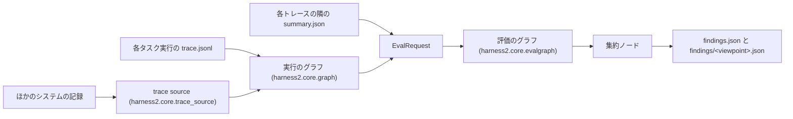

# 評価

評価は、タスク実行が残したものから問題を読み取り、それを示すイベントへの参照を添えて報告します。実行を変えることも、採点することもしません。実行がトレースを書き、トレースがグラフになり、評価者がグラフを読み、評価のグラフが所見を 1 つの一覧にまとめます。ほかのシステムの記録も trace source を通して同じグラフに入り、同じ評価者と同じ集約にかかります。

コードは `harness2/core/graph.py`（実行のグラフ）、`harness2/core/trace_source.py`（trace source）、`harness2/core/evaluate.py`（評価者の契約と観点）、`harness2/core/evalgraph.py`（評価のグラフ）、`harness2/evaluators/rules.py`（同梱の評価者）、`harness2/cli/evaluate.py`（`harness2-evaluate` コマンド）にあります。標準ライブラリだけで動きます。

## 概要

1 周は 4 つの段階です。トレース、実行のグラフ、評価のグラフ、所見です。



1. **トレース。** 各タスク実行は、`summary.json` のあるタスクの実行ディレクトリに `trace.jsonl` を書きます。イベントの種類と親子のつなぎ方は[トレースのシンク](TRACE.ja.md)にあります。ここで重要なのは span（`task`、`mode`、`rollout`、`stage`、`selection`、`reflection`）と point event（`tree.diff`、`memory.*`、`model.*`、`cost`、`error`）です。[trace source](#trace-source) はほかのシステムの記録を同じ形のイベントに変え、その run は [external run](TRACE.ja.md#external-run) になります。
2. **実行のグラフ。** `graph.load_runs(root, sources=...)` が `root` の下の `trace.jsonl` と trace source のイベントをすべて読み、span の開始と終了を 1 つのノードにまとめ、親から子へ辺を張ります。隣の `summary.json` も読みます。結果は `Graph` と summary の `dict` です。external run は summary を持ちません。
3. **評価のグラフ。** `evalgraph.run(config, request)` が評価者のノード、反論のノード、1 つの集約ノードを DAG として動かします。評価者のノードはグラフの一部を `Finding` に変え、反論のノードは受け取った所見に立場を足し、集約ノードが届いたものを落とし・まとめ・並べます。
4. **所見。** `harness2-evaluate` が `findings.json`（集約の後。落とした数、実行中のエラー、グラフを作るときの警告つき）と、観点ごとの `findings/<viewpoint>.json`（集約の前）を書きます。

## 評価を回す

```bash
harness2-evaluate --runs runs/jb/adapt/jb-oc-agg1
harness2-evaluate --source orchestrator=records/
harness2-evaluate --runs runs/jb/adapt/jb-oc-agg1 --source orchestrator=records/
```

1 つ目は `--runs` の下のトレースをすべて読み、既定では `<runs>/evaluation` の下に出力を書きます。2 つ目は `records/` を `orchestrator`（架空の名前。[trace source](#trace-source) を参照）という trace source で読み、`records/evaluation` の下に書きます。3 つ目は両方を 1 つの実行のグラフにまとめ、`<runs>/evaluation` の下に書きます。コマンドはパッケージと一緒に入ります。`uv pip install -e .`（またはリポジトリの通常のインストール）のあと、`harness2-evaluate` がパスに載ります。

| 引数 | 意味 |
|---|---|
| `--runs DIR` | `trace.jsonl` を探すディレクトリ。`--source trace=DIR` と同じ。必須ではないが、`--runs` と `--source` の少なくとも一方が要る |
| `--source NAME=LOCATION` | `LOCATION` を trace source `NAME` で読み、その run を実行のグラフに足す。繰り返し渡せる。最初の `=` で名前と場所を分け、どちらも空にできない |
| `--evaluators a,b` | 既定のグラフの評価者名。名前ごとに 1 ノードを作り、すべて集約へつなぐ。既定は `rules` |
| `--graph FILE` | JSON のグラフ設定。`--evaluators` より優先する |
| `--out DIR` | 出力ディレクトリ。既定は `<runs>/evaluation`。`--runs` が無ければ、最初の `--source` の `<LOCATION>/evaluation`（`LOCATION` がファイルなら、そのファイルの隣） |
| `--allow-scores` | 評価に `judge.*` のイベントと採点スコアを見せる（後述） |

`--runs DIR` と `--source trace=DIR` は同じ意味です。`trace` は組み込みの trace source で、どちらも `DIR` の下の `trace.jsonl` をすべて、隣の `summary.json` と一緒に読みます。trace source の名前は何かを読む前にすべて解決するので、知らない名前があれば最初に止まります。

終了コードは、所見があっても実行が終われば `0`、引数の誤り（`=` の無い `--source`、空の名前か場所、`--runs` も `--source` も無い）・グラフ設定の誤り・知らない評価者名か trace source 名・トレースも trace source の run も 1 つも無い入力なら `2` です。trace source がその場所で失敗しても（`OSError`、`read` のほかの例外、`(events, warnings)` の組でない結果）、実行は止まりません。1 つの警告になり、その trace source からは run が出ません。何を評価するかの細かい選択はグラフ設定の仕事で、コマンドはタスクや実行で絞り込みません。

### 何を書くか

`findings.json` には、集約後の一覧と、その回の記録が入ります:

```json
{
  "findings": [
    {
      "viewpoint": "cost",
      "viewpoints": ["cost"],
      "severity": "major",
      "claim": "The ledger of task t1 records 0.040000 USD of rollouts but the executor records hold 0.000000 USD",
      "evidence": [{"run_id": "...", "span_id": "...", "note": ""}],
      "suggestion": "Record each rollout's cost in both the ledger and the executor records so the two totals agree.",
      "key": "rules:cost:...",
      "evaluator": "rules",
      "evaluators": ["rules"]
    }
  ],
  "dropped": {"no_evidence": 0, "denied": 0},
  "errors": [],
  "warnings": [],
  "traces": 4,
  "runs": 6,
  "sources": {"orchestrator": 2}
}
```

| キー | 値 |
|---|---|
| `findings` | 集約後の所見。重い順 |
| `dropped` | 集約が落とした所見の数。理由（`no_evidence`、`denied`）ごと |
| `errors` | 名前が解決したあとに失敗したノードの 1 行。実行は続く |
| `warnings` | グラフを作るときの問題の 1 行。読めないトレースや summary、JSON オブジェクトでない summary、親 span の無いノード、trace source が読めなかった記録、[external run の決まり](TRACE.ja.md#external-run)を破るイベント、2 つの入力が両方出した span。飛ばした検査はここに出て、実行は止まらない |
| `traces` | 読んだ `trace.jsonl` の数（`--runs` か `--source trace=...` で読んだもの） |
| `runs` | グラフが持つ `task` ノードの数。harness2 の run と external run を合わせたもの |
| `sources` | external run の数を、それを読んだ trace source の名前ごとに数えたもの。無ければ `{}`。組み込みの `trace` の run はここではなく `traces` に数える |

警告は標準エラーにも 1 行ずつ `warning: ...` で出るので、`findings.json` を開かなくても入力の問題に気づけます。

`findings/<viewpoint>.json` には、その観点の評価者が書いた所見を、集約ノードが触る前の形で JSON のリストとして入れます。選ばれた観点には、リストが空でもファイルができます。ファイル名が観点名になるので、観点名は必ず `[a-z][a-z0-9_]*` です。回し直すとディレクトリの中身は入れ替わります。新しいグラフが選ばない観点のファイルは消えるので、`findings/` は最後の回の内容になります。

## 実行のグラフ

`Graph` は、トレースが語る「何が起きたか」です。`task` の根より先の harness2 の種類は知らないので、評価者が読む種類を名指しします。

| メンバー | 値 |
|---|---|
| `Node.key` | `(run_id, span_id)` |
| `Node.kind` | イベントの種類。例えば `"stage"` |
| `Node.attrs` | 開始と終了の attrs を合わせたもの。終了が勝ち、`phase` は無い |
| `Node.start_ts`、`Node.end_ts` | 開始と終了の時刻。point event は `start_ts` だけを持つ |
| `Node.status` | 終了イベントの `status`（`"ok"` または `"error"`）。point event は `None` |
| `Node.dur_s` | 終了イベントの `dur_s`。point event は `None` |
| `Node.parent` | 親のキー。根では `None` |
| `Node.source` | ノードの出どころ。トレースのノードでは `trace.jsonl` のパス、external run のノードでは `trace_source.Origin`（trace source の名前・ファイル・ノードの最初のイベントの行） |
| `Edge.src`、`Edge.dst`、`Edge.kind` | 親、子、`"contains"` |

`Graph` は評価者が尋ねることに答えます:

| メソッド | 値 |
|---|---|
| `roots()` | `task` のノード。並べたもの |
| `children(key)` | そのノードが直接含んでいたノード。並べたもの |
| `parent(key)`、`ancestors(key)` | 含んでいたノードと、その上の鎖 |
| `of_kind(*kinds)` | そのどれかの種類のノード。並べたもの |
| `runs()` | `run_id` からその実行の `task` ノードへ |
| `subgraph(kinds=None, run_ids=None)` | 条件に合うノード。残った最も近い祖先につなぎ直す |
| `find(run_id, span_id)` | そのノード。無ければ `None` |

`graph.build(paths, sources=...)` はファイルと trace source の結果を明示して作り、`graph.load_runs(root, sources=...)` は `root`（ディレクトリ 1 つ、複数、または無しの `None`）の下の `trace.jsonl` をすべて探し、同じディレクトリの `summary.json` を読みます。`sources` は各 trace source が読んだもの（`trace_source.read_from(source, location)`）のリストです。読めないトレースは警告になり、読めない summary も警告になり、summary の無いディレクトリは省かれ、external run もすべて省かれます。親 span が無いノードは根として残り警告が加わるので、読み込みが失敗することはありません。`trace.JUDGE_PREFIX`（`judge.`）で始まる種類は `include_judge=True` のときだけ入り、既定は手法側の見え方です。

```python
from pathlib import Path

from harness2.core import graph, trace

level, summaries = graph.load_runs(Path("runs/jb/adapt/jb-oc-agg1"))
for node in level.of_kind(trace.Kind.MODE):
    print(node.run_id, node.attrs.get("mode"), node.status, node.dur_s)
```

## trace source

trace source は、あるシステムの記録をトレースのイベントに変える、名前の付いた読み手です。その run が harness2 自身の run と並んで実行のグラフに入ります。記録は元の場所に置いたままで、変換した写しをディスクに書くことはなく、所見の根拠から元の記録の行までたどれます。

trace source は `read(location)` という 1 つのメンバーを持つ任意のオブジェクトです。`location` は `--source` の `=` のあとの文字列で、trace source がそれを解釈します（多くはディレクトリかファイル）。`read` はイベントと警告を、`trace_source.SourceRead` か任意の `(events, warnings)` の組で返します:

- 各イベントは `SourcedEvent(event, origin)` です。いつもの 6 つのフィールドを持つ `trace.TraceEvent` と、それを読んだ場所の `Origin(name, file, line)`（trace source の名前・ファイル・1 から数えた行）です。
- 各警告は、読めなかった記録についての 1 行です。壊れた記録は例外ではなく警告なので、残りの記録はグラフに届きます。

trace source が読んだ run は [external run](TRACE.ja.md#external-run) で、その決まりに従います。run ごとに 1 つの根の `task` span を持ち、その attrs が `system` を名乗ること、ほかの種類はすべて `<system>.<種類>` の名前空間を持つこと、harness2 の組み込みの種類を出さないことです。実行のグラフはどのイベントもこの決まりで検査し、破ったイベントは警告を 1 つ足して飛ばし、評価は続きます。

### trace source を選ぶ

名前は評価者と同じ順に解決します:

1. 組み込みの登録（`trace_source.register(name, factory)`）
2. グループ `harness2.trace_sources` にある、その名前の entry point
3. `:` を含む名前なら、`module:Attr` の import パス（`Attr` はドットでつないだ鎖でもよい）

ファクトリーは `factory(**options)` の形で呼ばれ、`TraceSource` を返さなければなりません。それ以外は `TypeError` です。`trace_source.names()` は登録名と entry point 名を並べ、`trace_source.trace_source_for(name, options={...})` は 1 つ作ります。`harness2-evaluate` はオプションを渡さないので、コマンドから使う trace source は既定の設定で動かなければなりません。

組み込みの trace source は `trace`（`TraceFiles`）の 1 つで、場所の下の `trace.jsonl` を `--runs` と同じ読み方ですべて読みます。その run は harness2 の run なので、コマンドはその場所をトレースの根として、各トレースの隣の `summary.json` と一緒に読み、external run の決まりは当てません。

パッケージは entry point で trace source を導入します:

```toml
[project.entry-points."harness2.trace_sources"]
orchestrator = "my_package.trace_source:make_trace_source"
```

インストールしたあとは `harness2-evaluate --source orchestrator=records/` で回します。インストールする前は `module:Attr` のパスを直接渡します: `harness2-evaluate --source my_package.trace_source:make_trace_source=records/`。最初の `=` で名前と場所を分けるので、名前に `=` は入りません。

### trace source を作る

次の例は、`orchestrator` という架空のシステムを読みます。このシステムは run ごとに `records.jsonl` を 1 つ書き、記録は次のような形です。種類が `run` の記録がその run の根です。

```json
{"run": "r1", "id": "s2", "parent": "s1", "type": "question.asked", "at": "2026-01-01T00:00:00+00:00", "attrs": {}}
```

```python
import json
from pathlib import Path

from harness2.core.trace import TraceEvent
from harness2.core.trace_source import Origin, SourcedEvent, SourceRead

SYSTEM = "orchestrator"


class OrchestratorRecords:
    """Every records.jsonl under the location, as the events of external runs."""

    def __init__(self, *, name: str = SYSTEM) -> None:
        self.name = name

    def read(self, location: str) -> SourceRead:
        events, warnings = [], []
        for path in sorted(Path(location).rglob("records.jsonl")):
            lines = path.read_text(encoding="utf-8").split("\n")
            for number, line in enumerate(lines, start=1):
                if not line.strip():
                    continue
                try:
                    record = json.loads(line)
                    kind, attrs = record["type"], dict(record.get("attrs") or {})
                    if kind == "run":
                        kind, attrs["system"] = "task", SYSTEM
                    else:
                        kind = f"{SYSTEM}.{kind}"
                    event = TraceEvent(
                        run_id=record["run"],
                        span_id=record["id"],
                        parent_id=record.get("parent"),
                        kind=kind,
                        ts=record["at"],
                        attrs=attrs,
                    )
                except (KeyError, TypeError, ValueError) as exc:
                    warnings.append(f"{path}:{number}: cannot read the record: {exc}")
                    continue
                events.append(SourcedEvent(event, Origin(self.name, path, number)))
        return SourceRead(events, warnings)


def make_trace_source(**options) -> OrchestratorRecords:
    return OrchestratorRecords(**options)
```

span は、ここでも同じ `span_id` を持つ 2 つのイベントで、`attrs.phase` が `"start"` と `"end"` です。1 回きりの出来事の記録は `phase` を持たず、point event になります。各 `Origin` の `name` は trace source の名前です。`findings.json` の `sources` はこの名前で数え、所見をたどる人もこの名前を見ます。

### 所見から元の記録へたどる

所見の根拠は `run_id` と `span_id` です。そのキーを持つ実行のグラフのノードは `source` を持ちます。external run なら、そのノードの最初のイベント（span なら開始イベント）の `Origin` なので、根拠から trace source の名前・ファイル・元の記録の行にたどり着けます。トレースのノードなら、`source` は `trace.jsonl` のパスです。

```python
import json
from pathlib import Path

from harness2.core import graph, trace_source

source = trace_source.trace_source_for("orchestrator")
level, _ = graph.load_runs(None, sources=[trace_source.read_from(source, "records/")])
findings = json.loads(Path("records/evaluation/findings.json").read_text(encoding="utf-8"))
for finding in findings["findings"]:
    for evidence in finding["evidence"]:
        node = level.find(evidence["run_id"], evidence["span_id"])
        if node is not None:
            # For example: records/r1/records.jsonl:12 (orchestrator)
            print(finding["claim"], "->", node.source)
```

`Origin` は `<file>:<line> (<name>)` と表示され、フィールドは `name`、`file`（`Path`）、`line` です。

### 複数の入力を 1 つのグラフに

トレースのファイル（`--runs` とすべての `--source trace=...`）で 1 つの入力、ほかの `--source` はそれぞれ 1 つの入力で、渡した順に読みます。2 つの入力が同じ `(run_id, span_id)` を出したら、後の入力のその span のイベントは捨て、両方の場所を名指す警告を足します。trace source の run が harness2 の run を上書きすることはなく、同じ記録を読む 2 つの trace source からは各 span が 1 つずつ残ります。

### trace source を契約テストで確かめる

`harness2.testing.trace_source_contract` には、trace source の作者が自分のテストから実行する検査があります。評価者の契約テストと同じ作りです:

```python
import unittest

from harness2.testing.trace_source_contract import TraceSourceContractTests


class OrchestratorContractTest(TraceSourceContractTests, unittest.TestCase):
    trace_source_name = "orchestrator"

    def make_location(self, root):
        (root / "r1").mkdir()
        (root / "r1" / "records.jsonl").write_text(
            '{"run": "r1", "id": "s1", "parent": null, "type": "run",'
            ' "at": "2026-01-01T00:00:00+00:00", "attrs": {"phase": "start"}}\n'
            '{"run": "r1", "id": "s1", "parent": null, "type": "run",'
            ' "at": "2026-01-01T00:00:01+00:00", "attrs": {"phase": "end", "status": "ok"}}\n',
            encoding="utf-8",
        )
        return str(root)

    def make_trace_source(self):
        return make_trace_source()
```

`setUp` は一時ディレクトリを作り、`make_location(root)` で記録を書いて場所を受け取り、`make_trace_source()` を呼びます。検査は、実行のグラフでは警告で済むものを失敗にします。オブジェクトが `TraceSource` であること、`read` がイベントを 1 つ以上含む `(events, warnings)` の組を返すこと、どのイベントも external run の決まりを守ること、どの origin も trace source（`trace_source_name` があればその名前）・ファイル・1 以上の行を名指すこと、どの run も根の `task` span をただ 1 つ持ち、親の無いイベントを持たないことです。`check_trace_source(source, location, name=...)` は同じ検査を単独で実行し、`contract_events(system="orchestrator")` は決まりを守る小さな external run を作り、`FixedTraceSource` は trace source ではなくグラフを試すテストのために、渡したイベントをそのまま返します。

## 観点

観点は評価の 1 つの角度で、短い名前、英語 1 文の説明、読む種類を持ちます。次の 6 つの組み込みの観点が `evaluate.VIEWPOINTS` です。評価者はそのうちどれを裁くかを宣言し、グラフ設定はその一部を選べます。評価者は自分の観点、[declared viewpoint](#declared-viewpoint) を宣言することもできます。

| 観点 | 問い | 読む種類 |
|---|---|---|
| `cost` | 実行が使った費用。cost のイベントとその背後のモデル | `task`、`cost`、`rollout`、`model.route`、`model.switch` |
| `budget` | 各モードの台帳が、回したロールアウトと段の数に合うか | `task`、`mode`、`rollout`、`stage` |
| `effect` | 実行が加えた変更がツリーを良くしたか | `rollout`、`stage`、`tree.diff`、`selection` |
| `safety` | 柵と選択が危ない候補を外し続けたか | `model.fence`、`selection`、`error` |
| `reproducibility` | 実行を繰り返せるか。再試行、モデルの切り替え、エラー | `model.switch`、`stage`、`error` |
| `generalization` | 実行が学んだことが他のタスクにも効くか | `reflection`、`memory.recall`、`memory.store`、`selection` |

同梱の `rules` 評価者が裁くのは `cost`、`budget`、`safety`、`reproducibility` です。`effect` と `generalization` はトレースだけでは決まらない判断なので、パッケージが足す評価者を待ちます。それまでは、それらを選んだ設定は、それを宣言する評価者が動くだけです。

### declared viewpoint

組み込みの観点のどれにも当てはまらない問いがあります。例えば、external run が工程や問いかけの順番を守ったか、です。評価者はそうした問いを declared viewpoint で問います。declared viewpoint は、評価者が `viewpoints()` で返す `Viewpoint` のうち、名前が組み込みに無いものです。`Viewpoint` そのものは組み込みと同じ 3 つのフィールドを持ちます。

```python
Viewpoint(
    name="ordering",
    description="Whether the run kept the order of its steps and its questions.",
    reads=("task", "orchestrator.step", "orchestrator.question.asked"),
)
```

決まり:

- 宣言する名前は組み込みと同じ `[a-z][a-z0-9_]*` に従います。ファイル名にもなるからです。
- declared viewpoint は組み込みの名前を名乗れません。組み込みの名前で、別の説明か別の `reads` を返す評価者は設定の誤りです。組み込みの観点をそのまま返す（`evaluate.viewpoint("cost")` のように）のが、組み込みの観点を裁く方法です。
- グラフ設定が選べるのは、組み込みの観点と、同じグラフのどれかの評価者が宣言した declared viewpoint です。グラフの誰も宣言していない名前は設定の誤りです。
- 2 つの評価者が同じ名前を宣言したら、ノードの順で最初の宣言を使います。
- declared viewpoint にも、組み込みと同じように `findings/<viewpoint>.json` ができます。

観点の名前の検査は 2 段で、どちらの違反も、どのノードも評価する前の設定の誤り（コマンドでは終了コード `2`）です。設定を読んだ時点では、各名前の形だけを検査します。評価者を作ったあと、どれかが評価する前に、組み込みに無い名前がグラフのどれかの評価者に宣言されていること、組み込みの名前を違う形で宣言する評価者が無いことを検査します。したがって、設定の中の組み込みの名前は、いつも組み込みの観点を指します。

## 同梱の `rules` 評価者

`RulesEvaluator` はモデルを使いません。リクエストのグラフと、各トレースの隣の `summary.json` だけを読むので、同じリクエストからは同じ所見が出ます。`harness2.evaluators` を import すると名前 `rules` で登録され、`harness2-evaluate` はそのパッケージを import します。インストール済みの harness2 では、グループ `harness2.evaluators` の entry point `rules` からも名前で解決できます（[評価者を作る](#評価者を作る)を参照）。

`rules` が検査するのは harness2 の run だけです。`task` の attrs に `system` が無いか、`system: "harness2"` の run です。ほかの run、つまり trace source が読んだ external run（や、`task` がほかのシステムを名乗る `trace.jsonl`）のノードは、エラーの集計も含めて下の検査のどれにも入らないので、ほかのシステムの run に、台帳やモードが無いという `rules` の所見が付くことはありません。

| 検査 | 観点 | 重さ | 根拠 |
|---|---|---|---|
| 台帳の恒等式: モードごとの `ledger` が `R = 4k` と `P = 3k` を記録し、`R == expected_R` と `P == expected_P` であること | `budget` | `major` | `mode` の span とその `cost` の子。無ければ `task` のノード |
| `R`、`P`、`expected_R`、`expected_P` のどれかが無いか int でない台帳 | `budget` | `major` | `mode` の span とその `cost` の子。無ければ `task` のノード |
| 同じ恒等式をトレースで: モードの `candidate` と `final` のロールアウトに共有のベースのロールアウトを足して `4k`、段が `3k` であること | `budget` | `major` | `mode` の span と、最大 2 つのロールアウトと段 |
| 再開でない run で、`task` の span の `modes` が名指すモードに `MODE` の span も台帳も無い | `budget` | `major` | `task` のノード |
| 費用の一致: モードの台帳の `rollout_usd` の合計（共有のベースは 1 回だけ数える）と、`summary.json` の `models.executor[].cost_usd` の合計 | `cost` | `major` | `task` のノードと `cost` のイベント |
| 1 タスクのモデルの切り替えが `max_switches` を超える | `reproducibility` | `minor` | そのタスクの全 `model.switch` |
| `attempts` が `max_attempts` を超える段 | `reproducibility` | `minor` | その段の span |
| 柵で外したモデル候補（`fenced` が false の `model.fence`）があり、回復していない柵が 1 つでもある | `safety` | `major` | 柵のイベント |
| 同じ柵で、そのタスクの柵がすべて回復した | `safety` | `info` | 柵のイベント |
| エラーの集計: `error` のイベント、失敗した span、`status` が `"ok"` でも `error` か `ok: false` を持つ span を、`where`（無ければ種類）ごとに数える | `reproducibility` | 2 タスク以上なら `minor`、1 つなら `info` | その組のノード（最大 10 件） |

恒等式が `4k` と `3k` なのは、予算がモードごとに再帰 `k` 回分のロールアウト 4 つと改善段 3 つに固定されているからです。`k` は `summary.json`、無ければ `task` の span の attrs から取ります。古い summary はモードを `modes` ではなく `arms` に持つことがあり、台帳と費用の検査はどちらも読みます。`R`、`P`、`expected_R`、`expected_P` のどれかが無いか int でないときは、そのモードをそのまま通さずに所見を出します。`k` が無いときは、台帳の検査が記録値と `expected_*` を比べ、トレースの数の検査は飛ばします。

トレースの数の検査は run ごとに行い、再開したモードの span は数から外します。ベースのロールアウトはモードごとではなく 1 回だけ数えます。再開でない run では、`task` の span の `modes` が名指すモードに `MODE` の span も台帳も無ければ、そのモードが動かなかったものとして budget の所見を出します。

summary を根拠にする 2 つの検査（台帳の恒等式と費用の一致）は、タスクの実行ディレクトリごとに 1 回だけ行います。再開したタスクは同じトレースに 2 つ目の run を足し、同じ `summary.json` を読むからです。根拠にするグラフは、そのトレースの再開でない run（`task` の span の終了の attrs が `resumed` でないもの）のうち最後のもの、再開でない run が無ければ最後の run です。キーはタスクとタスクの実行ディレクトリ（summary の辞書のキーの Path を文字列にしたもの）を名指す（`rules:cost:...` など）ので、1 つの台帳の誤りは、トレースに run がいくつあっても 1 件の所見になり、別の実験の同じタスクは別々の所見のままです。

費用の検査は、`cost_tolerance_usd` と `cost_tolerance_ratio` × 2 つの合計の大きい方の、大きい方を許します。片方が `0.0` でもう片方が 0 でない場合も報告します。その差は許容で埋まらないからです。

柵のあとに成功があったとみなすのは、同じ run の `stage` が `status == "ok"` で、`error` の attr が無く、`ok` の attr が `false` でなく、`fell_back` も無く、しかもその段が柵のイベントの祖先（柵を出して重なって動いた並列の段）か、柵のイベントより後に始まったものであるときです。`selection` は数えません。`k=1` の選択は、改善段がすべてフォールバックしても成功で終わるからです。判定はタスク単位で、回復していない柵が 1 つでもあれば `major`、すべて回復していれば `info` です。

span は、`status: "error"` で終わったときだけでなく、`status: "ok"` で終わっても `error` か `ok: false` を持つとき（失敗したロールアウトや失敗したモードなど）も失敗として数えます。失敗したモードは 1 回だけ数えます。`mode:<mode>` の `ERROR` イベントがそれを表し、その `MODE` の span は数えません。

`rules` は `request.scores` を読みません。オプションはファクトリーのキーワード引数です:

| オプション | 既定 | 意味 |
|---|---|---|
| `max_switches` | `3` | 1 タスクがモデルを切り替えてよい回数。超えたら所見 |
| `max_attempts` | `2` | 段が達してよい試行回数。超えたら所見 |
| `cost_tolerance_usd` | `0.01` | 費用の検査の固定の許容。USD |
| `cost_tolerance_ratio` | `0.01` | 費用の検査の相対の許容 |

## 評価のグラフ

グラフ設定は `nodes`、`edges`、`allow_scores` の 3 つのキーを持つ JSON です。これは評価者 2 つを 1 つの集約へ流します:

```json
{
  "nodes": [
    {
      "id": "rules",
      "type": "evaluator",
      "evaluator": "rules",
      "viewpoints": ["cost", "budget", "safety", "reproducibility"],
      "options": {"max_switches": 3}
    },
    {
      "id": "checks",
      "type": "evaluator",
      "evaluator": "my_package.checks:make_checks"
    },
    {"id": "aggregate", "type": "aggregate"}
  ],
  "edges": [
    ["rules", "aggregate"],
    ["checks", "aggregate"]
  ],
  "allow_scores": false
}
```

`eval-graph.json` として保存し、`harness2-evaluate --runs runs/jb/adapt/jb-oc-agg1 --graph eval-graph.json` で回します。設定は遅延ではなく読んだ時点で検査されるので、`my_package.checks:make_checks` は実行前に、インストール済みで解決できる名前に置き換えてください。

ノードのキーは次のとおりです:

| キー | ノードの種類 | 意味 |
|---|---|---|
| `id` | すべて | 重複しない空でない文字列。辺はこの id でノードを名指す |
| `type` | すべて | `evaluator`、`rebut`、`aggregate` |
| `evaluator` | `evaluator` | 評価者の名前。後述の順に解決する |
| `rebutter` | `rebut` | 反論の名前。グループ `harness2.rebutters` から解決する |
| `viewpoints` | `evaluator`、`rebut` | 観点名の空でないリスト。組み込みか、グラフのどれかの評価者が宣言したもの。評価者のノードはこれらの観点の所見だけを残す |
| `options` | すべて | ファクトリーに `factory(**options)` で渡すマッピング |

評価者の `options` はそのノードの評価者の設定です。`EvalRequest` の `options` は実行全体の自由な設定で、別のものです。

設定の決まりは、どのノードも評価する前に検査され、違反は `ValueError`（CLI では終了コード `2`）になります:

- 最上位のキーはちょうど `nodes`、`edges`、`allow_scores`。`allow_scores` は真偽値で、既定は `false`。
- id は重複せず、ノードはその種類が許すキーだけを持ち、辺は知っている id の組で、自分への辺も繰り返しも無い。
- グラフは DAG。`aggregate` のノードはちょうど 1 つで、出る辺を持たず、すべてのノードがそこへ届く。
- `evaluator` のノードは入る辺を持たず、`rebut` のノードは 1 つ要る。
- 観点名は `[a-z][a-z0-9_]*` に一致し（設定を読んだ時点で検査）、`VIEWPOINTS` のどれかか、グラフのどれかの評価者の [declared viewpoint](#declared-viewpoint)（評価者を作ったあと、どれかが評価する前に検査）。組み込みの名前を、別の説明か別の `reads` で宣言する評価者も設定の誤り。
- 評価者と反論の名前はすべて解決する。知らない名前は所見ではなく設定の誤り。その検査のあとでファクトリー、`viewpoints()`、`evaluate()`、`rebut()` が投げた例外は `errors` に 1 行加わり、実行は続く。そのノードは何も出さず、失敗した反論のノードは受け取った所見をそのまま通す。

`--evaluators` が作る既定のグラフも同じ形です。名前ごとに 1 つの評価者のノード（id は名前）、それぞれからノード `aggregate` への辺、そしてフラグで決まる `allow_scores`。

### 反論のノードを足す

反論のノードは評価者と集約の間に置きます。届いたすべての所見を受け取り、`Rebutter` に渡し、判定の立場を残します。例に足すとこうなります:

```json
{
  "nodes": [
    {"id": "rules", "type": "evaluator", "evaluator": "rules"},
    {"id": "rebut", "type": "rebut", "rebutter": "my_package.rebut:make_rebutter"},
    {"id": "aggregate", "type": "aggregate"}
  ],
  "edges": [
    ["rules", "rebut"],
    ["rebut", "aggregate"]
  ],
  "allow_scores": false
}
```

判定は `Verdict(key, stance)` で、`key` は入ってきた所見のどれかの `dedupe_key()`、`stance` は `support`、`deny`、`hold` のどれかです。`deny` は集約で所見を落とし、あとの 2 つは残します。入ってきた所見のどれにも合わないキーの判定はエラーの 1 行になり、`Verdict` のリストでない戻り値も同じです。所見は判定が付いたかどうかに関わらず反論のノードを通るので、別々の経路に複数の反論のノードを置けます。

## 集約

集約ノードは、グラフ全体の所見が出会う場所です。次の決まりを順に当てます:

1. **同じ出どころを落とす。** 同じ所見、つまり同じ評価者のノードと同じ出力の位置のものは、2 つの経路から届いても 1 回だけ数えます。
2. **根拠の無い所見を落とす。** リクエストのグラフに無い span を指す根拠は取り除き、根拠が空になった所見は落として `dropped["no_evidence"]` に数えます。採点を許さない実行でグラフが削られたときの `judge.` のノードの根拠も、これと同じ扱いです。
3. **deny された所見を落とす。** 所見の `dedupe_key()` に `deny` の立場が付いていれば、落として `dropped["denied"]` に数えます。
4. **残りを重複のキーでまとめる。** `dedupe_key()` は所見の `key`、空なら `"<viewpoint>:<claim>"` です。まとめた所見は、最初の所見の `viewpoint`、`claim`、`suggestion` を取り、観点・根拠（最初に出た順）・評価者名の和集合と、最も重い重さを取ります。自身の `key` は重複のキーになります。
5. **並べる。** `Severity.rank`（critical が先）、次に観点の数（多いほうが先）、次に `key` の順です。

まとめた結果は `AggregatedFinding` で、`Finding` の 7 つのフィールドに `viewpoints` と `evaluators` が加わったものです。`findings.json` に出るのはこれです。`EvalResult.by_viewpoint` は観点ごとの集約前の所見を持ち、`findings/<viewpoint>.json` に入るのはこちらです。

`Severity` の名前は `critical`、`major`、`minor`、`info` の 4 つで、重い順です。`Severity.rank` は critical に `0`、info に `3` を返し、知らない名前では `ValueError` を送出します。

## 評価者を作る

評価者は 2 つのメンバーを持つ任意のオブジェクトです:

- `viewpoints()` は空でない `Viewpoint` の列を返します。名前は設定が選ぶものになり、ファイル名になるので `[a-z][a-z0-9_]*` に一致しなければなりません。組み込みの観点を裁くならそれをそのまま返し（`evaluate.viewpoint("cost")`）、自分の観点を宣言するなら自分の名前の `Viewpoint` を返します（[declared viewpoint](#declared-viewpoint) を参照）。
- `evaluate(request)` は 1 つの `EvalRequest` を読み、`Finding` のリストを返します。根拠はリクエストのグラフの span を指さなければならず、そうでない所見は集約が落とします。

`Finding` は観点、重さ、1 文の主張、`Evidence` のタプル（`run_id`、`span_id`、任意のメモ）、任意の提案、任意の `key` を持ちます。`key` があると実行をまたいで重複のまとめが安定します（例えば `rules:cost:<run_id>`）。無ければ重複のキーは観点と主張から作られます。

```python
from harness2.core import trace
from harness2.core.evaluate import EvalRequest, Evidence, Finding, Severity, Viewpoint


class SlowModes:
    """A finding for every mode that ran longer than `max_seconds`."""

    def __init__(self, *, max_seconds: float = 600.0) -> None:
        self.max_seconds = float(max_seconds)

    def viewpoints(self) -> list[Viewpoint]:
        return [
            Viewpoint(
                name="cost",
                description="What the run spent: the cost events and the models behind them.",
                reads=(trace.Kind.MODE,),
            )
        ]

    def evaluate(self, request: EvalRequest) -> list[Finding]:
        findings = []
        for node in request.graph.of_kind(trace.Kind.MODE):
            if node.dur_s is not None and node.dur_s > self.max_seconds:
                findings.append(
                    Finding(
                        viewpoint="cost",
                        severity=Severity.MINOR,
                        claim=(
                            f"Mode {node.attrs.get('mode')} of run {node.run_id} took "
                            f"{node.dur_s:.0f} s, more than the {self.max_seconds:.0f} allowed."
                        ),
                        evidence=(Evidence(run_id=node.run_id, span_id=node.span_id),),
                        suggestion="Shorten the mode, or raise max_seconds when the time is expected.",
                        key=f"slow-mode:{node.run_id}:{node.attrs.get('mode')}",
                    )
                )
        return findings


def make_checks(**options) -> SlowModes:
    return SlowModes(**options)
```

名前はトレースのシンクと同じ順に解決します:

1. 組み込みの登録（`evaluate.register(name, factory)`）
2. グループ `harness2.evaluators` にある、その名前の entry point
3. `:` を含む名前なら、`module:Attr` の import パス（`Attr` はドットでつないだ鎖でもよい）

ファクトリーは `factory(**options)` の形で呼ばれ、`Evaluator` を返さなければなりません。それ以外は `TypeError` です。`evaluate.names()` は登録名と entry point 名を並べ、`evaluate.evaluator_for(name, options={...})` は 1 つ作ります。

`harness2.core.evaluate` は自分では何も登録しません。同梱の `rules` は `harness2.evaluators` を import したときに登録され、`harness2-evaluate` はそれを import します。`evaluators` は上の層にあるので、`core` はそれを import しません。そのため、ライブラリとして `evaluate.evaluator_for("rules")`（や `rules` のノードを持つ `evalgraph.run`）を呼ぶ側は、先にパッケージを import します:

```python
import harness2.evaluators  # noqa: F401  (registers rules)
from harness2.core import evaluate

rules = evaluate.evaluator_for("rules")
```

この import が無いと、名前はグループ `harness2.evaluators` の entry point `rules` からしか解決できません。この entry point は harness2 をインストールすると（例えば `uv pip install -e .` のあと）できます。import も entry point も無いとき、例えば一度もインストールしていないソースの木から動かすとき、`evaluator_for("rules")` は `ValueError: unknown evaluator 'rules'` を送出します。

パッケージは entry point で評価者を導入します:

```toml
[project.entry-points."harness2.evaluators"]
my-checks = "my_package.checks:make_checks"
```

インストールしたあとは `--evaluators` かグラフ設定で名前を渡します。インストールする前は `module:Attr` のパスを直接渡します: `--evaluators rules,my_package.checks:make_checks`。この解決に環境変数はありません。呼ぶ側が評価者を名指しします。

自分のテストを持つ評価者は、harness2 のテスト一式を使わずに契約を確かめられます:

```python
import unittest

from harness2.testing.evaluator_contract import EvaluatorContractTests


class MyChecksContractTest(EvaluatorContractTests, unittest.TestCase):
    def make_evaluator(self):
        return make_checks()
```

`EvaluatorContractTests` は `setUp` で `make_request(root)` を使って `self.request` を作ります。1 つのタスクと、ロールアウト 1 つ・段 1 つの小さなグラフなので、`make_evaluator` はそれを読んで根拠をその span に向けられます。`check_evaluator(my_evaluator, request)` は同じ検査を単独で実行し、`scores=None` の回の所見を返します。`contract_request(root)` はそのリクエストを作り、`FixedEvaluator` は評価者ではなくグラフを試すテストのために決まった所見のリストを返します。検査は、`viewpoints()` が使える名前の `Viewpoint` の空でない列であること、`evaluate()` が `Finding` のリストを返すこと、どの所見も評価者の観点のどれかを名指すこと、どの根拠もリクエストのグラフの span であること、`scores=None` と `scores={}` の両方で動くことです。

評価者は自分で採点のファイルを開いてはいけません。スコアは `request.scores` としてだけ届き、実行が許したときだけ届きます。

## 反論を作る

反論は `rebut(findings, request)` を持ち、`Verdict` のリストを返す任意のオブジェクトです。ノードに届いた所見と、評価者が見たのと同じリクエストを受け取ります。判定のキーは入ってきた所見の `dedupe_key()` で、ほかのキーへの判定はエラーです。

```python
from harness2.core.evaluate import EvalRequest, Finding
from harness2.core.evalgraph import Verdict


class KeepFenceFindings:
    """Deny every cost finding; leave the rest to the aggregate."""

    def __init__(self, *, viewpoint: str = "cost") -> None:
        self.viewpoint = viewpoint

    def rebut(self, findings: list[Finding], request: EvalRequest) -> list[Verdict]:
        return [
            Verdict(key=finding.dedupe_key(), stance="deny")
            for finding in findings
            if finding.viewpoint == self.viewpoint
        ]


def make_rebutter(**options) -> KeepFenceFindings:
    return KeepFenceFindings(**options)
```

解決は評価者と同じで、別のグループ `harness2.rebutters` を使います。登録（`evalgraph.register_rebutter`）、その名前の entry point、`module:Attr` の順です。`evalgraph.rebutter_names()` は存在する名前を並べ、`evalgraph.rebutter_for(name, options={...})` は 1 つ作ります。同梱の反論はありません。`rebut` のノードを持つグラフは、インストールか import で解決できる名前を名指します。

## 採点スコア

スコアは採点側のもので、評価が見るのは実行が許したときだけです:

- `--allow-scores` が無ければ、`judge.*` のノードは 1 つもグラフに入らず（`include_judge` は false のまま）、`request.scores` は `None` です。スコアを要る評価者は取れません。
- `--graph` のときは、`--allow-scores` だけでは足りません。設定にも `"allow_scores": true` が要ります。無ければスコアは `None` のままで、グラフも削られたままです。
- `--evaluators` の既定のグラフでは、フラグだけが決めます。フラグが設定の `allow_scores` になるからです。

スコアを許したとき、`EvalRequest.scores` は `run_id` からその実行の `judge.*` ノードの attrs への辞書になり、グラフはそのノードを保ちます。設定がスコアを許さないとき、`evalgraph.run` は評価者が見る前にグラフを `trace.JUDGE_PREFIX` で始まらないノードへ削るので、`judge.` のノードへの根拠は、ほかの無い span と同じように落ちます。

## トラブルシューティング

- **`error: no trace.jsonl under ...`（終了コード 2）。** `--runs` の下に `trace.jsonl` がありません。パスを確かめ、トレースがオンだったか（`HARNESS2_TRACE` が `0` でないか）も確かめてください。[トレースを止める](TRACE.ja.md#トレースを止める)を参照。
- **`error: no trace.jsonl under ... and no trace source run`（終了コード 2）。** トレースの根からも、どの `--source` からも run が出ませんでした。その前に出る `warning:` の行が、trace source が読めなかったものや飛ばしたものを名指しします。よくある原因は、`task` が `system` を名乗らない external run です。その run のイベントがすべて落ちます。
- **`error: give --runs DIR or --source NAME=LOCATION`** または **`error: --source takes NAME=LOCATION, ...`（終了コード 2）。** 入力を少なくとも 1 つ渡し、各 `--source` を名前、`=`、場所の形で書いてください。
- **`error: unknown evaluator '...'`（終了コード 2）。** その名前が登録でも、`harness2.evaluators` のインストール済み entry point でも、`module:Attr` のパスでもありません。メッセージに登録名と entry point 名が並ぶので、つづりを直すか、パッケージをインストールするか、足りない属性を足してください。ライブラリのコードから `rules` を使うなら、先に `harness2.evaluators` を import してください（[評価者を作る](#評価者を作る)を参照）。
- **`error: unknown trace source '...'`（終了コード 2）。** trace source について同じです。その名前が登録でも、`harness2.trace_sources` のインストール済み entry point でも、`module:Attr` のパスでもありません。
- **`error: graph config ...`（終了コード 2）。** メッセージが最初の問題を名指しします。知らないキー、重複した id、集約に届かないノード、2 つ目の集約ノード、知らない観点（組み込みでも、グラフの評価者が宣言したものでもない名前）、評価者が違う形で宣言した組み込みの観点、解決しない名前のどれかです。設定か評価者を直して回し直してください。ノードは 1 つも評価していません。
- **所見が消えた。** `dropped` を見てください。`no_evidence` は根拠がリクエストのグラフの span を指していなかったこと（`--allow-scores` 無しの `judge.` の span がよくある原因）、`denied` は反論がキーを deny したことです。観点ごとのファイルには、評価者が書いたものが残っています。
- **`errors` が空でない。** 名前が解決したあとにノードが失敗しています。1 行がノード、名前、例外を名指しし、残りのグラフは動いています。評価者か反論か、それが期待したデータを直してください。
- **`warnings` が空でない。** 不完全な入力からグラフを作っています。読めないトレースや summary、JSON オブジェクトでない summary、親 span の無いノード、trace source が読めなかった記録、[external run の決まり](TRACE.ja.md#external-run)を破るイベント、2 つの入力が両方出した span のどれかです。所見は読めた範囲を説明したままで、警告が省いたものを名指しします。trace source のイベントなら、ファイルと行も名指しします。
- **external run に `rules` の所見が無い。** そういう作りです。`rules` は harness2 の run だけを検査します。external run は、その種類を読む評価者で、組み込みの観点か declared viewpoint の下で評価してください。
- **同じ問題が 2 回出る。** 所見に、文面ではなく問題を名指す `key` を付けてください。集約が 2 つをまとめます。

## 関連項目

- `harness2/core/graph.py`: `Node`、`Edge`、`Graph`、`build`、`load_runs`。
- `harness2/core/trace_source.py`: `TraceSource`、`SourcedEvent`、`Origin`、`SourceRead`、登録、組み込みの `trace`、external run の検査。
- `harness2/core/evaluate.py`: `Severity`、`Viewpoint`、`VIEWPOINTS`、`Evidence`、`Finding`、`EvalRequest`、`Evaluator` のプロトコル、登録。
- `harness2/core/evalgraph.py`: グラフ設定、`Rebutter`、`Verdict`、`EvalResult`、集約、`run`。
- `harness2/evaluators/rules.py`: 同梱の `rules` 評価者。
- `harness2/cli/evaluate.py`: `harness2-evaluate` コマンド。
- `harness2/testing/evaluator_contract.py`: 契約テストと `FixedEvaluator`。
- `harness2/testing/trace_source_contract.py`: trace source の契約テストと `FixedTraceSource`。
- [トレースのシンク](TRACE.ja.md): 実行のグラフの元になるイベント、本文を入れない決まり、external run の決まり。
- `docs/specs/eval-graph.md`: この実装が従う設計メモ。
- `docs/specs/trace-sources.md`: trace source と declared viewpoint の設計メモ。
