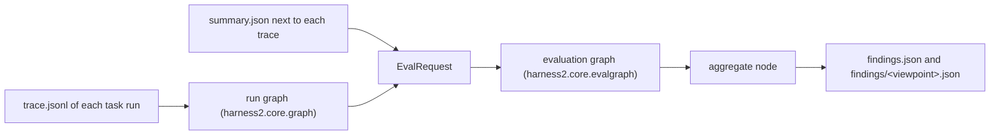

# Evaluation

Evaluation reads what a task run left behind and reports what looks wrong, with a pointer to the
event that shows it. It never changes a run and never scores one: a run writes a trace, the
trace becomes a graph, evaluators read the graph, and an evaluation graph turns their findings
into one list.

The code is in `harness2/core/graph.py` (the run graph), `harness2/core/evaluate.py` (the
evaluator contract and the viewpoints), `harness2/core/evalgraph.py` (the evaluation graph),
`harness2/evaluators/rules.py` (the bundled evaluator) and `harness2/cli/evaluate.py` (the
`harness2-evaluate` command). It uses the standard library only.

## Overview

One round has four steps: the trace, the run graph, the evaluation graph and the findings.



1. **The trace.** Every task run writes `trace.jsonl` in its task run directory, the one that
   holds `summary.json`. [Trace sinks](TRACE.md) describes the events, their kinds and their
   parent links. The kinds that matter here are the spans (`task`, `mode`, `rollout`, `stage`,
   `selection`, `reflection`) and the point events (`tree.diff`, `memory.*`, `model.*`, `cost`,
   `error`).
2. **The run graph.** `graph.load_runs(root)` reads every `trace.jsonl` under `root`, merges the
   start and end of each span into one node and links parent to child. It also reads the
   `summary.json` next to each trace. The result is a `Graph` and a `dict` of summaries.
3. **The evaluation graph.** `evalgraph.run(config, request)` runs evaluator nodes, rebut nodes
   and one aggregate node as a DAG. An evaluator node turns part of the graph into `Finding`
   objects; a rebut node adds a stance to the findings it receives; the aggregate node drops,
   merges and orders what reaches it.
4. **The findings.** `harness2-evaluate` writes `findings.json` (after aggregation, with the
   dropped counts and the errors of the run) and one `findings/<viewpoint>.json` per viewpoint
   (before aggregation).

## Running the evaluation

```bash
harness2-evaluate --runs runs/jb-oc-agg-k1
```

The command reads every trace under `--runs` and writes its output under
`<runs>/evaluation` by default. The command is installed with the package: after a
`uv pip install -e .` (or the repository's usual install) `harness2-evaluate` is on the path.

| Argument | Meaning |
|---|---|
| `--runs DIR` | The directory to search for `trace.jsonl` files; required |
| `--evaluators a,b` | The evaluator names of the default graph, one node per name, all wired to the aggregate; default `rules` |
| `--graph FILE` | A JSON graph config; wins over `--evaluators` |
| `--out DIR` | The output directory; default `<runs>/evaluation` |
| `--allow-scores` | Let the evaluation see the `judge.*` events and the scores (see below) |

The exit code is `0` when the run finished, findings or not, and `2` for a bad argument, a bad
graph config, an unknown evaluator name or a directory without any trace. A finer selection of
what to evaluate is the graph config's job: the command does not filter by task or run.

### What it writes

`findings.json` holds the aggregated list plus the bookkeeping of the round:

```json
{
  "findings": [
    {
      "viewpoint": "cost",
      "viewpoints": ["cost"],
      "severity": "major",
      "claim": "The ledger of task t1 records 0.040000 USD of rollouts but the executor records hold 0.000000 USD",
      "evidence": [{"run_id": "...", "span_id": "...", "note": ""}],
      "suggestion": "Record each rollout's cost in both the ledger and the executor records so the two totals agree.",
      "key": "rules:cost:...",
      "evaluator": "rules",
      "evaluators": ["rules"]
    }
  ],
  "dropped": {"no_evidence": 0, "denied": 0},
  "errors": [],
  "traces": 4,
  "runs": 4
}
```

| Key | Value |
|---|---|
| `findings` | The aggregated findings, heaviest first |
| `dropped` | How many findings the aggregate dropped, by reason (`no_evidence`, `denied`) |
| `errors` | One line per node that failed after its name resolved; the run kept going |
| `traces` | How many `trace.jsonl` files were read |
| `runs` | How many `task` nodes the graph holds |

`findings/<viewpoint>.json` holds the findings that viewpoint's evaluator wrote, before the
aggregate node touched them, as a JSON list of the plain seven-field findings. Every chosen
viewpoint gets a file, even when the list is empty; the file name is the viewpoint name, so a
viewpoint name is always `[a-z][a-z0-9_]*`.

## The run graph

A `Graph` is what the traces say happened. Nothing in it knows harness2's kinds beyond the
`task` root, so an evaluator names the kinds it reads.

| Member | Value |
|---|---|
| `Node.key` | `(run_id, span_id)` |
| `Node.kind` | The event kind, for example `"stage"` |
| `Node.attrs` | The start and end attrs together, the end winning, without `phase` |
| `Node.start_ts`, `Node.end_ts` | The start and end timestamps; a point event has only `start_ts` |
| `Node.status` | The end event's `status` (`"ok"` or `"error"`); `None` on a point event |
| `Node.dur_s` | The end event's `dur_s`; `None` on a point event |
| `Node.parent` | The parent's key, or `None` on a root |
| `Node.source` | The `trace.jsonl` the node came from |
| `Edge.src`, `Edge.dst`, `Edge.kind` | Parent, child and `"contains"` |

`Graph` answers the questions an evaluator asks:

| Method | Value |
|---|---|
| `roots()` | The `task` nodes, sorted |
| `children(key)` | The nodes the node contained directly, sorted |
| `parent(key)`, `ancestors(key)` | The containing node, and the chain above it |
| `of_kind(*kinds)` | The nodes of any of those kinds, sorted |
| `runs()` | `run_id` to the `task` node of that run |
| `subgraph(kinds=None, run_ids=None)` | The nodes that match, relinked to their nearest kept ancestor |
| `find(run_id, span_id)` | The node, or `None` |

`graph.build(paths)` builds from explicit files; `graph.load_runs(root)` finds every
`trace.jsonl` under `root` and reads the `summary.json` in the same directory. A summary that
cannot be read is a warning, and a directory without one is left out. A node whose parent span
is missing stays a root and adds a warning, so reading never fails. Kinds starting with
`trace.JUDGE_PREFIX` (`judge.`) are left out unless `include_judge=True`; the default view is
the method side.

```python
from pathlib import Path

from harness2.core import graph, trace

level, summaries = graph.load_runs(Path("runs/jb-oc-agg-k1"))
for node in level.of_kind(trace.Kind.MODE):
    print(node.run_id, node.attrs.get("mode"), node.status, node.dur_s)
```

## Viewpoints

A viewpoint is one angle of evaluation: a short name, one English sentence and the kinds it
reads. The six below are `evaluate.VIEWPOINTS`; an evaluator declares which of them it judges,
and a graph config may choose a subset.

| Viewpoint | Question | Reads (kinds) |
|---|---|---|
| `cost` | What the run spent: the cost events and the models behind them | `task`, `cost`, `rollout`, `model.route`, `model.switch` |
| `budget` | Whether each mode's ledger adds up to the rollouts and stages it ran | `task`, `mode`, `rollout`, `stage` |
| `effect` | Whether the change the run made improved the tree | `rollout`, `stage`, `tree.diff`, `selection` |
| `safety` | Whether the fences and the selection kept unsafe candidates out | `model.fence`, `selection`, `error` |
| `reproducibility` | Whether the run can be repeated: retries, model switches and errors | `model.switch`, `stage`, `error` |
| `generalization` | Whether what the run learned carries over to other tasks | `reflection`, `memory.recall`, `memory.store`, `selection` |

The bundled `rules` evaluator judges `cost`, `budget`, `safety` and `reproducibility`. `effect`
and `generalization` need a judgement the traces alone do not settle, so they wait for an
evaluator a package adds; until then a config that chooses them only runs whatever evaluator
declares them.

## The bundled `rules` evaluator

`RulesEvaluator` needs no model: it reads the request graph and the `summary.json` next to each
trace, so the same request gives the same findings. It is registered under the name `rules`.

| Check | Viewpoint | Severity | Evidence |
|---|---|---|---|
| The ledger identity: each mode's `ledger` must record `R = 4k` and `P = 3k`, with `R == expected_R` and `P == expected_P` | `budget` | `major` | The `mode` span and its `cost` children, else the `task` node |
| The same identity on the trace: a mode's `candidate` and `final` rollouts plus the shared base rollouts must number `4k`, and its stages `3k` | `budget` | `major` | The `mode` span and up to two rollouts and stages |
| The cost agreement: the sum of the modes' ledger `rollout_usd`, with the shared base rollouts counted once, against the sum of `summary.json`'s `models.executor[].cost_usd` | `cost` | `major` | The `task` node and the `cost` events |
| More model switches in one task than `max_switches` | `reproducibility` | `minor` | Every `model.switch` of the task |
| A stage whose `attempts` exceed `max_attempts` | `reproducibility` | `minor` | The stage spans |
| A fenced model candidate (`model.fence` with `fenced` false) while no stage succeeded after the fence | `safety` | `major` | The fence events |
| The same fence, when a stage that did not fall back succeeded after it | `safety` | `info` | The fence events |
| Errors: `error` events and failed spans, grouped by `where` (or the kind when `where` is absent) | `reproducibility` | `minor` for two or more tasks, else `info` | Up to ten nodes of the group |

The identity is `4k` and `3k` because the budget is fixed per mode at four rollouts and three
improvement stages for each of the `k` recursion steps. `k` comes from `summary.json`, else from
the `task` span's attrs; without it the ledger check compares the recorded values with the
`expected_*` ones and the trace-count check is skipped. The trace-count check runs per run and
skips a resumed mode's span, and the base rollouts are counted once, not once per mode.

The two checks that read the summary, the ledger identity and the cost agreement, run once per
task run directory, because a resumed task adds a second run to the same trace and reads the
same `summary.json`. They read the graph of the last run that is not a resume (a `task` span
whose end attrs do not say `resumed`), or the last run when every run is a resume. Their keys
name the task (`rules:cost:<task>`, `rules:budget:ledger:<task>:<mode>`), so one wrong ledger is
one finding however many runs the trace holds.

The cost check allows the larger of `cost_tolerance_usd` and `cost_tolerance_ratio` times the
larger of the two totals. It also reports a total of `0.0` on one side against a non-zero total
on the other, because no tolerance covers that.

A fence counts as followed by success when a `stage` of the same run has `status == "ok"`, no
`error` attr, an `ok` attr that is not `false`, `fell_back` not set, and a `start_ts` later than
the fence event. A `selection` does not count: a `k=1` selection succeeds even when every
improvement stage fell back.

`rules` never reads `request.scores`. The options are keyword arguments of the factory:

| Option | Default | Meaning |
|---|---|---|
| `max_switches` | `3` | A task may switch models this many times; more is a finding |
| `max_attempts` | `2` | A stage may reach this many attempts; more is a finding |
| `cost_tolerance_usd` | `0.01` | The fixed tolerance of the cost check, in USD |
| `cost_tolerance_ratio` | `0.01` | The relative tolerance of the cost check |

## The evaluation graph

A graph config is JSON with three keys: `nodes`, `edges` and `allow_scores`. This one runs two
evaluators into one aggregate:

```json
{
  "nodes": [
    {
      "id": "rules",
      "type": "evaluator",
      "evaluator": "rules",
      "viewpoints": ["cost", "budget", "safety", "reproducibility"],
      "options": {"max_switches": 3}
    },
    {
      "id": "checks",
      "type": "evaluator",
      "evaluator": "my_package.checks:make_checks"
    },
    {"id": "aggregate", "type": "aggregate"}
  ],
  "edges": [
    ["rules", "aggregate"],
    ["checks", "aggregate"]
  ],
  "allow_scores": false
}
```

Save it as `eval-graph.json` and run
`harness2-evaluate --runs runs/jb-oc-agg-k1 --graph eval-graph.json`. Replace
`my_package.checks:make_checks` with a name that resolves in your installation before running,
because the config is checked when it is read, not lazily.

A node has these keys:

| Key | Node types | Meaning |
|---|---|---|
| `id` | all | A unique, non-empty string; edges name nodes by it |
| `type` | all | `evaluator`, `rebut` or `aggregate` |
| `evaluator` | `evaluator` | The evaluator name, resolved as described below |
| `rebutter` | `rebut` | The rebutter name, in the group `harness2.rebutters` |
| `viewpoints` | `evaluator`, `rebut` | A non-empty list of known viewpoint names; an evaluator node keeps only the findings of these viewpoints |
| `options` | all | A mapping handed to the factory as `factory(**options)` |

The evaluator's `options` are the settings of that node's evaluator; the `options` of
`EvalRequest` are free settings for the whole run and a different thing.

The config rules are checked before any node runs, and a violation is a `ValueError` (the CLI
turns it into exit code `2`):

- The top-level keys are exactly `nodes`, `edges` and `allow_scores`; `allow_scores` is a
  boolean and defaults to `false`.
- Ids are unique, a node has only the keys its type allows, and each edge is a pair of known
  ids without a self loop or a repeat.
- The graph is a DAG. Exactly one `aggregate` node exists; it has no outgoing edge, and every
  node reaches it.
- An `evaluator` node has no incoming edge; a `rebut` node needs one.
- Every viewpoint name matches `[a-z][a-z0-9_]*` and is one of `VIEWPOINTS`.
- Every evaluator and rebutter name resolves. An unknown name is a config error, not a finding.
  After that check, an exception in a factory, `viewpoints()`, `evaluate()` or `rebut()` adds a
  line to `errors` and the run continues: that node contributes nothing, and a failed rebut
  node passes its findings through unchanged.

The default graph from `--evaluators` is the same shape: one evaluator node per name (its id is
the name), one edge from each to the node `aggregate`, and `allow_scores` set by the flag.

### Adding a rebut node

A rebut node sits between evaluators and the aggregate. It receives every finding that reaches
it, hands them to a `Rebutter`, and keeps the stances of the verdicts. Here it is added to the
example:

```json
{
  "nodes": [
    {"id": "rules", "type": "evaluator", "evaluator": "rules"},
    {"id": "rebut", "type": "rebut", "rebutter": "my_package.rebut:make_rebutter"},
    {"id": "aggregate", "type": "aggregate"}
  ],
  "edges": [
    ["rules", "rebut"],
    ["rebut", "aggregate"]
  ],
  "allow_scores": false
}
```

A verdict is `Verdict(key, stance)`, where `key` is the `dedupe_key()` of one of the incoming
findings and `stance` is `support`, `deny` or `hold`. A `deny` drops the finding at the
aggregate; the other two keep it. A verdict whose key matches no incoming finding is an error
line, and so is a result that is not a list of `Verdict`. Every finding passes through a rebut
node whether or not it drew a verdict, so several rebut nodes may sit on different paths.

## Aggregation

The aggregate node is where the findings of the whole graph meet. It applies these rules in
order:

1. **Drop a repeated origin.** The same finding, meaning the same evaluator node and index in
   its output, counts once even when two paths bring it.
2. **Drop a finding without evidence.** Evidence that points at a span not in the request graph
   is removed; a finding left with no evidence is dropped and counted in
   `dropped["no_evidence"]`. This is also what happens to evidence of a `judge.` node when the
   run does not allow scores, because the graph was cut down.
3. **Drop a denied finding.** A `deny` stance on the finding's `dedupe_key()` drops it and
   counts it in `dropped["denied"]`.
4. **Merge the rest by dedupe key.** `dedupe_key()` is the finding's `key`, or
   `"<viewpoint>:<claim>"` when `key` is empty. The merged finding takes the first finding's
   `viewpoint`, `claim` and `suggestion`; the union of the viewpoints, the evidence (in
   first-seen order) and the evaluator names; and the heaviest severity. Its own `key` becomes
   the dedupe key.
5. **Order them.** By `Severity.rank` (a critical first), then by the number of viewpoints (more
   first), then by `key`.

The merged result is an `AggregatedFinding`: the seven fields of a `Finding` plus `viewpoints`
and `evaluators`, which are what `findings.json` shows. `EvalResult.by_viewpoint` keeps the
pre-aggregation findings of each viewpoint, which is what the `findings/<viewpoint>.json` files
hold.

`Severity` has four names: `critical`, `major`, `minor`, `info`, from heaviest to lightest.
`Severity.rank` returns `0` for a critical and `3` for an info, and raises `ValueError` for an
unknown name.

## Writing an evaluator

An evaluator is any object with two members:

- `viewpoints()` returns a non-empty sequence of `Viewpoint`; the names are what a config can
  choose, and each must match `[a-z][a-z0-9_]*` because it becomes a file name.
- `evaluate(request)` reads one `EvalRequest` and returns a list of `Finding`. Its evidence must
  point at spans of the request graph, or the aggregate drops the finding.

A `Finding` carries a viewpoint, a severity, a one-sentence claim, a tuple of `Evidence`
(`run_id`, `span_id` and an optional note), an optional suggestion and an optional `key`. A key
makes the dedupe stable across runs, for example `rules:cost:<run_id>`; without one the
dedupe key is built from the viewpoint and the claim.

```python
from harness2.core import trace
from harness2.core.evaluate import EvalRequest, Evidence, Finding, Severity, Viewpoint


class SlowModes:
    """A finding for every mode that ran longer than `max_seconds`."""

    def __init__(self, *, max_seconds: float = 600.0) -> None:
        self.max_seconds = float(max_seconds)

    def viewpoints(self) -> list[Viewpoint]:
        return [
            Viewpoint(
                name="cost",
                description="What the run spent: the cost events and the models behind them.",
                reads=(trace.Kind.MODE,),
            )
        ]

    def evaluate(self, request: EvalRequest) -> list[Finding]:
        findings = []
        for node in request.graph.of_kind(trace.Kind.MODE):
            if node.dur_s is not None and node.dur_s > self.max_seconds:
                findings.append(
                    Finding(
                        viewpoint="cost",
                        severity=Severity.MINOR,
                        claim=(
                            f"Mode {node.attrs.get('mode')} of run {node.run_id} took "
                            f"{node.dur_s:.0f} s, more than the {self.max_seconds:.0f} allowed."
                        ),
                        evidence=(Evidence(run_id=node.run_id, span_id=node.span_id),),
                        suggestion="Shorten the mode, or raise max_seconds when the time is expected.",
                        key=f"slow-mode:{node.run_id}:{node.attrs.get('mode')}",
                    )
                )
        return findings


def make_checks(**options) -> SlowModes:
    return SlowModes(**options)
```

The name is resolved in this order, the same way as the trace sinks:

1. a built-in registration (`evaluate.register(name, factory)`);
2. an entry point of that name in the group `harness2.evaluators`;
3. for a name containing `:`, a `module:Attr` import path (`Attr` may be a dotted chain).

The factory is called as `factory(**options)` and must return an `Evaluator`; anything else is a
`TypeError`. `evaluate.names()` lists the registered and entry point names.
`evaluate.evaluator_for(name, options={...})` builds one.

A package installs an evaluator with an entry point:

```toml
[project.entry-points."harness2.evaluators"]
my-checks = "my_package.checks:make_checks"
```

After installing, name it in `--evaluators` or in a graph config. Before installing, pass the
`module:Attr` path directly: `--evaluators rules,my_package.checks:make_checks`. There is no
environment variable for this lookup: the caller names the evaluator.

An evaluator that bundles its own tests can check the contract without harness2's test suite:

```python
import unittest

from harness2.testing.evaluator_contract import EvaluatorContractTests


class MyChecksContractTest(EvaluatorContractTests, unittest.TestCase):
    def make_evaluator(self):
        return make_checks()
```

`EvaluatorContractTests` builds `self.request` in `setUp` with `make_request(root)`, a small
graph of one task with a rollout and a stage, so `make_evaluator` may read it and point evidence
at its spans. `check_evaluator(my_evaluator, request)` runs the same checks on its own and
returns the findings of the `scores=None` run; `contract_request(root)` builds that request, and
`FixedEvaluator` returns a fixed list of findings for a test of the graph rather than of an
evaluator. The checks are: `viewpoints()` is a non-empty sequence of `Viewpoint` with usable
names; `evaluate()` returns a list of `Finding`; every finding names one of the evaluator's
viewpoints; every piece of evidence is a span of the request graph; and the evaluator runs with
`scores=None` and with `scores={}`.

An evaluator must not open a scoring file itself. Scores reach it only as `request.scores`, and
only when the run allows them.

## Writing a rebutter

A rebutter is any object with `rebut(findings, request)`, which returns a list of `Verdict`. It
receives the findings that reached its node and the same request the evaluators saw. The key of
a verdict is the `dedupe_key()` of an incoming finding; a verdict on any other key is an error.

```python
from harness2.core.evaluate import EvalRequest, Finding
from harness2.core.evalgraph import Verdict


class KeepFenceFindings:
    """Deny every cost finding; leave the rest to the aggregate."""

    def __init__(self, *, viewpoint: str = "cost") -> None:
        self.viewpoint = viewpoint

    def rebut(self, findings: list[Finding], request: EvalRequest) -> list[Verdict]:
        return [
            Verdict(key=finding.dedupe_key(), stance="deny")
            for finding in findings
            if finding.viewpoint == self.viewpoint
        ]


def make_rebutter(**options) -> KeepFenceFindings:
    return KeepFenceFindings(**options)
```

The lookup is the same as for evaluators, in the separate group `harness2.rebutters`:
registrations (`evalgraph.register_rebutter`), then an entry point of that name, then
`module:Attr`. `evalgraph.rebutter_names()` lists what exists and
`evalgraph.rebutter_for(name, options={...})` builds one. No rebutter is bundled: a graph with a
`rebut` node names one that is installed or imported.

## Scores

Scores belong to the grading side, and the evaluation sees them only when the run says so:

- Without `--allow-scores`, no `judge.*` node enters the graph (`include_judge` stays false) and
  `request.scores` is `None`. An evaluator that needs a score cannot get one.
- With `--graph`, `--allow-scores` alone is not enough: the config must also have
  `"allow_scores": true`. Otherwise the scores stay `None` and the graph is still cut down.
- With the default graph from `--evaluators`, the flag alone decides, because the flag becomes
  the config's `allow_scores`.

When scores are allowed, `EvalRequest.scores` maps a run id to the attrs of that run's `judge.*`
nodes, and the graph keeps those nodes. When the config does not allow scores, `evalgraph.run`
cuts the graph to the nodes that do not start with `trace.JUDGE_PREFIX` before the evaluators
see it, so an evidence reference to a `judge.` node is dropped like any other missing span.

## Troubleshooting

- **`error: no trace.jsonl under ...`** (exit 2). `--runs` names a directory with no
  `trace.jsonl` below it. Check the path, and check that tracing was on (`HARNESS2_TRACE` is not
  `0`); see [Tracing off](TRACE.md#turning-tracing-off).
- **`error: unknown evaluator '...'`** (exit 2). The name is not registered, not an installed
  entry point in `harness2.evaluators`, and not a `module:Attr` path. The message lists the
  registered and entry point names; check the spelling, install the package, or add the missing
  attribute.
- **`error: graph config ...`** (exit 2). The message names the first problem: an unknown key, a
  duplicate id, a node that does not reach the aggregate, a second aggregate node, an unknown
  viewpoint, or a name that does not resolve. Fix the config and run again; no node ran.
- **A finding vanished.** Look in `dropped`: `no_evidence` means its evidence did not point at a
  span of the request graph (a `judge.` span without `--allow-scores` is the usual cause), and
  `denied` means a rebutter denied its key. The per-viewpoint files still hold what the
  evaluator wrote.
- **`errors` is not empty.** A node failed after its name resolved. The line names the node, the
  name and the exception; the rest of the graph still ran. Fix the evaluator or rebutter, or the
  data it expected.
- **The same problem appears twice.** Give the finding a `key` that names the problem, not the
  wording, so the aggregate merges the two.

## See also

- `harness2/core/graph.py`: `Node`, `Edge`, `Graph`, `build` and `load_runs`.
- `harness2/core/evaluate.py`: `Severity`, `Viewpoint`, `VIEWPOINTS`, `Evidence`, `Finding`,
  `EvalRequest`, the `Evaluator` protocol and the registry.
- `harness2/core/evalgraph.py`: the graph config, `Rebutter`, `Verdict`, `EvalResult`, the
  aggregate, and `run`.
- `harness2/evaluators/rules.py`: the bundled `rules` evaluator.
- `harness2/cli/evaluate.py`: the `harness2-evaluate` command.
- `harness2/testing/evaluator_contract.py`: the contract checks and `FixedEvaluator`.
- [Trace sinks](TRACE.md): the events the run graph is built from, and the rules that keep bodies
  out.
- `docs/specs/eval-graph.md`: the design note this implementation follows.
