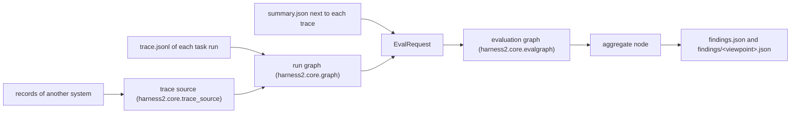

# Evaluation

Evaluation reads what a task run left behind and reports what looks wrong, with a pointer to the
event that shows it. It never changes a run and never scores one: a run writes a trace, the
trace becomes a graph, evaluators read the graph, and an evaluation graph turns their findings
into one list. The records of another system can join the same graph through a trace source,
so the same evaluators and the same aggregation read them too.

The code is in `harness2/core/graph.py` (the run graph), `harness2/core/trace_source.py` (the
trace sources), `harness2/core/evaluate.py` (the evaluator contract and the viewpoints),
`harness2/core/evalgraph.py` (the evaluation graph), `harness2/evaluators/rules.py` (the bundled
evaluator) and `harness2/cli/evaluate.py` (the `harness2-evaluate` command). It uses the
standard library only.

## Overview

One round has four steps: the trace, the run graph, the evaluation graph and the findings.



1. **The trace.** Every task run writes `trace.jsonl` in its task run directory, the one that
   holds `summary.json`. [Trace sinks](TRACE.md) describes the events, their kinds and their
   parent links. The kinds that matter here are the spans (`task`, `mode`, `rollout`, `stage`,
   `selection`, `reflection`) and the point events (`tree.diff`, `memory.*`, `model.*`, `cost`,
   `error`). A [trace source](#trace-sources) turns the records of another system into events
   of the same shape; its runs are [external runs](TRACE.md#external-runs).
2. **The run graph.** `graph.load_runs(root, sources=...)` reads every `trace.jsonl` under
   `root` and the events of the trace sources, merges the start and end of each span into one
   node and links parent to child. It also reads the `summary.json` next to each trace. The
   result is a `Graph` and a `dict` of summaries; an external run has no summary.
3. **The evaluation graph.** `evalgraph.run(config, request)` runs evaluator nodes, rebut nodes
   and one aggregate node as a DAG. An evaluator node turns part of the graph into `Finding`
   objects; a rebut node adds a stance to the findings it receives; the aggregate node drops,
   merges and orders what reaches it.
4. **The findings.** `harness2-evaluate` writes `findings.json` (after aggregation, with the
   dropped counts, the errors of the run and the warnings from building the graph) and one
   `findings/<viewpoint>.json` per viewpoint (before aggregation).

## Running the evaluation

```bash
harness2-evaluate --runs runs/jb/adapt/jb-oc-agg1
harness2-evaluate --source orchestrator=records/
harness2-evaluate --runs runs/jb/adapt/jb-oc-agg1 --source orchestrator=records/
```

The first command reads every trace under `--runs` and writes its output under
`<runs>/evaluation` by default. The second reads `records/` with the trace source named
`orchestrator` (a made-up name; see [Trace sources](#trace-sources)) and writes under
`records/evaluation`. The third puts both into one run graph and writes under
`<runs>/evaluation`. The command is installed with the package: after a `uv pip install -e .`
(or the repository's usual install) `harness2-evaluate` is on the path.

| Argument | Meaning |
|---|---|
| `--runs DIR` | The directory to search for `trace.jsonl` files; the same as `--source trace=DIR`. Optional, but at least one of `--runs` and `--source` is needed |
| `--source NAME=LOCATION` | Read `LOCATION` with the trace source `NAME` and add its runs to the run graph; may be repeated. The first `=` splits the name from the location, and neither may be empty |
| `--evaluators a,b` | The evaluator names of the default graph, one node per name, all wired to the aggregate; default `rules` |
| `--graph FILE` | A JSON graph config; wins over `--evaluators` |
| `--out DIR` | The output directory; default `<runs>/evaluation`, or, without `--runs`, `<LOCATION>/evaluation` of the first `--source` (next to the file when `LOCATION` is a file) |
| `--allow-scores` | Let the evaluation see the `judge.*` events and the scores (see below) |

`--runs DIR` and `--source trace=DIR` mean the same: `trace` is the built-in trace source, and
both read every `trace.jsonl` under `DIR` with the `summary.json` next to it. Every trace source
name is resolved before anything is read, so an unknown name stops the run first.

The exit code is `0` when the run finished, findings or not, and `2` for a bad argument (a
`--source` without `=`, an empty name or location, neither `--runs` nor `--source`), a bad
graph config, an unknown evaluator or trace source name, or inputs without any trace and any
trace source run. A trace source that fails on its location (an `OSError`, any other exception
of its `read`, or a result that is not an `(events, warnings)` pair) does not stop the run: it is
one warning, and that source gives no runs. A finer selection of what to evaluate is the graph config's job: the command
does not filter by task or run.

### What it writes

`findings.json` holds the aggregated list plus the bookkeeping of the round:

```json
{
  "findings": [
    {
      "viewpoint": "cost",
      "viewpoints": ["cost"],
      "severity": "major",
      "claim": "The ledger of task t1 records 0.040000 USD of rollouts but the executor records hold 0.000000 USD",
      "evidence": [{"run_id": "...", "span_id": "...", "note": ""}],
      "suggestion": "Record each rollout's cost in both the ledger and the executor records so the two totals agree.",
      "key": "rules:cost:...",
      "evaluator": "rules",
      "evaluators": ["rules"]
    }
  ],
  "dropped": {"no_evidence": 0, "denied": 0},
  "errors": [],
  "warnings": [],
  "traces": 4,
  "runs": 6,
  "sources": {"orchestrator": 2}
}
```

| Key | Value |
|---|---|
| `findings` | The aggregated findings, heaviest first |
| `dropped` | How many findings the aggregate dropped, by reason (`no_evidence`, `denied`) |
| `errors` | One line per node that failed after its name resolved; the run kept going |
| `warnings` | One line per problem while building the graph: a trace or summary that could not be read, a summary that is not a JSON object, a node whose parent span is missing, a record a trace source could not read, an event of an external run that breaks [its rules](TRACE.md#external-runs), or a span that two inputs both gave. A skipped check is visible here instead of failing the run |
| `traces` | How many `trace.jsonl` files were read, through `--runs` or `--source trace=...` |
| `runs` | How many `task` nodes the graph holds: the harness2 runs and the external runs together |
| `sources` | The number of external runs, by the name of the trace source that read them; `{}` when there are none. The runs of the built-in `trace` source are counted in `traces`, not here |

The warnings are also printed to standard error, one `warning: ...` line each, so a problem in
the input shows up without opening `findings.json`.

`findings/<viewpoint>.json` holds the findings that viewpoint's evaluator wrote, before the
aggregate node touched them, as a JSON list of the plain seven-field findings. Every chosen
viewpoint gets a file, even when the list is empty; the file name is the viewpoint name, so a
viewpoint name is always `[a-z][a-z0-9_]*`. A rerun replaces the directory's contents: a file
of a viewpoint the new graph no longer chooses is removed, so `findings/` matches the last run.

## The run graph

A `Graph` is what the traces say happened. Nothing in it knows harness2's kinds beyond the
`task` root, so an evaluator names the kinds it reads.

| Member | Value |
|---|---|
| `Node.key` | `(run_id, span_id)` |
| `Node.kind` | The event kind, for example `"stage"` |
| `Node.attrs` | The start and end attrs together, the end winning, without `phase` |
| `Node.start_ts`, `Node.end_ts` | The start and end timestamps; a point event has only `start_ts` |
| `Node.status` | The end event's `status` (`"ok"` or `"error"`); `None` on a point event |
| `Node.dur_s` | The end event's `dur_s`; `None` on a point event |
| `Node.parent` | The parent's key, or `None` on a root |
| `Node.source` | Where the node came from: the `trace.jsonl` path for a node of a trace, and a `trace_source.Origin` (the trace source's name, the file and the line of the node's first event) for a node of an external run |
| `Edge.src`, `Edge.dst`, `Edge.kind` | Parent, child and `"contains"` |

`Graph` answers the questions an evaluator asks:

| Method | Value |
|---|---|
| `roots()` | The `task` nodes, sorted |
| `children(key)` | The nodes the node contained directly, sorted |
| `parent(key)`, `ancestors(key)` | The containing node, and the chain above it |
| `of_kind(*kinds)` | The nodes of any of those kinds, sorted |
| `runs()` | `run_id` to the `task` node of that run |
| `subgraph(kinds=None, run_ids=None)` | The nodes that match, relinked to their nearest kept ancestor |
| `find(run_id, span_id)` | The node, or `None` |

`graph.build(paths, sources=...)` builds from explicit files and trace source results;
`graph.load_runs(root, sources=...)` finds every `trace.jsonl` under `root` (one directory,
several, or `None` for none) and reads the `summary.json` in the same directory. `sources` is a
list of what each trace source read (`trace_source.read_from(source, location)`). A trace that
cannot be read is a warning, and so is a summary that cannot be read; a directory without a
summary is left out, and so is every external run. A node whose parent span is missing stays a
root and adds a warning, so reading never fails. Kinds starting with `trace.JUDGE_PREFIX`
(`judge.`) are left out unless `include_judge=True`; the default view is the method side.

```python
from pathlib import Path

from harness2.core import graph, trace

level, summaries = graph.load_runs(Path("runs/jb/adapt/jb-oc-agg1"))
for node in level.of_kind(trace.Kind.MODE):
    print(node.run_id, node.attrs.get("mode"), node.status, node.dur_s)
```

## Trace sources

A trace source is a named reader that turns the records of some system into trace events, so
that its runs enter the run graph next to harness2's own. The records stay where they are: no
converted copy is written to disk, and the evidence of a finding leads back to the line of the
original record.

A trace source is any object with one member, `read(location)`. `location` is the string after
the `=` of `--source`, which the trace source interprets (usually a directory or a file).
`read` returns the events and the warnings, as a `trace_source.SourceRead` or any
`(events, warnings)` pair:

- each event is a `SourcedEvent(event, origin)`: a `trace.TraceEvent` of the usual six fields
  and the `Origin(name, file, line)` it was read from, with the trace source's name, the file
  and the 1-based line;
- each warning is one line about a record that could not be read. A broken record is a
  warning, not an exception, so the rest of the records still reach the graph.

The runs a trace source reads are [external runs](TRACE.md#external-runs) and follow their
rules: one root `task` span per run whose attrs name the `system`, the namespace
`<system>.<kind>` on every other kind, and none of harness2's built-in kinds. The run graph
checks every event against them: an event that breaks a rule is skipped with one warning, and
the evaluation goes on.

### Choosing a trace source

The name is resolved in the same order as an evaluator's:

1. a built-in registration (`trace_source.register(name, factory)`);
2. an entry point of that name in the group `harness2.trace_sources`;
3. for a name containing `:`, a `module:Attr` import path (`Attr` may be a dotted chain).

The factory is called as `factory(**options)` and must return a `TraceSource`; anything else is
a `TypeError`. `trace_source.names()` lists the registered and entry point names, and
`trace_source.trace_source_for(name, options={...})` builds one. `harness2-evaluate` passes no
options, so a trace source used from the command must work with its defaults.

One trace source is built in: `trace` (`TraceFiles`), which reads every `trace.jsonl` under the
location the way `--runs` does. Its runs are harness2 runs, so the command reads its location
as a trace root, with the `summary.json` next to each trace, and does not apply the external run
rules to it.

A package installs a trace source with an entry point:

```toml
[project.entry-points."harness2.trace_sources"]
orchestrator = "my_package.trace_source:make_trace_source"
```

After installing, run `harness2-evaluate --source orchestrator=records/`. Before installing,
pass the `module:Attr` path directly:
`harness2-evaluate --source my_package.trace_source:make_trace_source=records/`. The first `=`
splits the name from the location, so a name never contains `=`.

### Writing a trace source

This one reads a made-up system called `orchestrator`, which writes one `records.jsonl` per run
with records like the one below. A record of type `run` is the run's root.

```json
{"run": "r1", "id": "s2", "parent": "s1", "type": "question.asked", "at": "2026-01-01T00:00:00+00:00", "attrs": {}}
```

```python
import json
from pathlib import Path

from harness2.core.trace import TraceEvent
from harness2.core.trace_source import Origin, SourcedEvent, SourceRead

SYSTEM = "orchestrator"


class OrchestratorRecords:
    """Every records.jsonl under the location, as the events of external runs."""

    def __init__(self, *, name: str = SYSTEM) -> None:
        self.name = name

    def read(self, location: str) -> SourceRead:
        events, warnings = [], []
        for path in sorted(Path(location).rglob("records.jsonl")):
            lines = path.read_text(encoding="utf-8").split("\n")
            for number, line in enumerate(lines, start=1):
                if not line.strip():
                    continue
                try:
                    record = json.loads(line)
                    kind, attrs = record["type"], dict(record.get("attrs") or {})
                    if kind == "run":
                        kind, attrs["system"] = "task", SYSTEM
                    else:
                        kind = f"{SYSTEM}.{kind}"
                    event = TraceEvent(
                        run_id=record["run"],
                        span_id=record["id"],
                        parent_id=record.get("parent"),
                        kind=kind,
                        ts=record["at"],
                        attrs=attrs,
                    )
                except (KeyError, TypeError, ValueError) as exc:
                    warnings.append(f"{path}:{number}: cannot read the record: {exc}")
                    continue
                events.append(SourcedEvent(event, Origin(self.name, path, number)))
        return SourceRead(events, warnings)


def make_trace_source(**options) -> OrchestratorRecords:
    return OrchestratorRecords(**options)
```

A span is still two events that share a `span_id`, with `attrs.phase` set to `"start"` and
`"end"`; a record that stands for a one-off event has no `phase` and becomes a point event.
The `name` in each `Origin` is the trace source's name: it is what `findings.json` counts under
`sources`, and what a reader sees when following a finding back.

### Following a finding back to the record

A finding's evidence is a `run_id` and a `span_id`. The node of the run graph with that key keeps
its `source`: for an external run, the `Origin` of the node's first event (for a span, its start
event), so the evidence leads to the trace source, the file and the line of the original
record. For a node of a trace, `source` is the `trace.jsonl` path.

```python
import json
from pathlib import Path

from harness2.core import graph, trace_source

source = trace_source.trace_source_for("orchestrator")
level, _ = graph.load_runs(None, sources=[trace_source.read_from(source, "records/")])
findings = json.loads(Path("records/evaluation/findings.json").read_text(encoding="utf-8"))
for finding in findings["findings"]:
    for evidence in finding["evidence"]:
        node = level.find(evidence["run_id"], evidence["span_id"])
        if node is not None:
            # For example: records/r1/records.jsonl:12 (orchestrator)
            print(finding["claim"], "->", node.source)
```

An `Origin` prints as `<file>:<line> (<name>)`, and its fields are `name`, `file` (a `Path`)
and `line`.

### Several inputs in one graph

The trace files (`--runs` and every `--source trace=...`) are one input, and each other
`--source` is another, read in the order given. When two inputs give the same
`(run_id, span_id)`, the later input's events of that span are dropped with a warning that names
both places. A run of a trace source therefore never overwrites a harness2 run, and two trace
sources that read the same records give one copy of each span.

### Checking a trace source against the contract

`harness2.testing.trace_source_contract` has the checks for a trace source author to run from
their own tests, built like the evaluator contract:

```python
import unittest

from harness2.testing.trace_source_contract import TraceSourceContractTests


class OrchestratorContractTest(TraceSourceContractTests, unittest.TestCase):
    trace_source_name = "orchestrator"

    def make_location(self, root):
        (root / "r1").mkdir()
        (root / "r1" / "records.jsonl").write_text(
            '{"run": "r1", "id": "s1", "parent": null, "type": "run",'
            ' "at": "2026-01-01T00:00:00+00:00", "attrs": {"phase": "start"}}\n'
            '{"run": "r1", "id": "s1", "parent": null, "type": "run",'
            ' "at": "2026-01-01T00:00:01+00:00", "attrs": {"phase": "end", "status": "ok"}}\n',
            encoding="utf-8",
        )
        return str(root)

    def make_trace_source(self):
        return make_trace_source()
```

`setUp` makes a temporary directory, calls `make_location(root)` to write the records and return
the location, then calls `make_trace_source()`. The checks make a failure of what the run graph
only warns about: the object is a `TraceSource`; `read` returns an `(events, warnings)` pair with
at least one event; every event keeps the external run rules; every origin names the trace
source (`trace_source_name` when set), a file and a line from 1 up; and every run has a single
root `task` span and no event whose parent is missing.
`check_trace_source(source, location, name=...)` runs the same checks on its own,
`contract_events(system="orchestrator")` builds a small external run that keeps the rules, and
`FixedTraceSource` returns the events it was given, for a test of the graph rather than of a
trace source.

## Viewpoints

A viewpoint is one angle of evaluation: a short name, one English sentence and the kinds it
reads. The six built-in viewpoints below are `evaluate.VIEWPOINTS`; an evaluator declares which
of them it judges, and a graph config may choose a subset. An evaluator may also declare a
viewpoint of its own, a [declared viewpoint](#declared-viewpoints).

| Viewpoint | Question | Reads (kinds) |
|---|---|---|
| `cost` | What the run spent: the cost events and the models behind them | `task`, `cost`, `rollout`, `model.route`, `model.switch` |
| `budget` | Whether each mode's ledger adds up to the rollouts and stages it ran | `task`, `mode`, `rollout`, `stage` |
| `effect` | Whether the change the run made improved the tree | `rollout`, `stage`, `tree.diff`, `selection` |
| `safety` | Whether the fences and the selection kept unsafe candidates out | `model.fence`, `selection`, `error` |
| `reproducibility` | Whether the run can be repeated: retries, model switches and errors | `model.switch`, `stage`, `error` |
| `generalization` | Whether what the run learned carries over to other tasks | `reflection`, `memory.recall`, `memory.store`, `selection` |

The bundled `rules` evaluator judges `cost`, `budget`, `safety` and `reproducibility`. `effect`
and `generalization` need a judgement the traces alone do not settle, so they wait for an
evaluator a package adds; until then a config that chooses them only runs whatever evaluator
declares them.

### Declared viewpoints

Some questions fit none of the built-in viewpoints, for example whether an external run kept
the order of its steps and its questions. An evaluator asks such a question under a declared
viewpoint: a `Viewpoint` it returns from `viewpoints()` whose name is not built in. The
`Viewpoint` itself has the same three fields as a built-in one.

```python
Viewpoint(
    name="ordering",
    description="Whether the run kept the order of its steps and its questions.",
    reads=("task", "orchestrator.step", "orchestrator.question.asked"),
)
```

The rules:

- A declared name follows the built-in rule `[a-z][a-z0-9_]*`, because it also becomes a file
  name.
- A declared viewpoint may not take a built-in name. An evaluator that returns a built-in name
  with another description or other `reads` is a config error; returning the built-in
  viewpoint unchanged (as `evaluate.viewpoint("cost")` does) is how an evaluator judges a
  built-in one.
- A graph config may choose a built-in viewpoint, or a declared viewpoint that some evaluator of
  the same graph declares. A name nobody in the graph declares is a config error.
- When two evaluators declare the same name, the first declaration in node order is used.
- A declared viewpoint gets its own `findings/<viewpoint>.json` like a built-in one.

The viewpoint names are checked in two steps, and either failure is a config error (exit code
`2` from the command) before any node evaluates. When the config is read, each name is checked
for its shape only. After the evaluators are built, and before any of them evaluates, every
name that is not built in must be declared by an evaluator of the graph, and no evaluator may
declare a built-in name differently. A built-in name in a config therefore always means the
built-in viewpoint.

## The bundled `rules` evaluator

`RulesEvaluator` needs no model: it reads the request graph and the `summary.json` next to each
trace, so the same request gives the same findings. Importing `harness2.evaluators` registers it
under the name `rules`, and `harness2-evaluate` imports that package; an installed harness2 also
names it through the entry point `rules` of the group `harness2.evaluators` (see
[Writing an evaluator](#writing-an-evaluator)).

`rules` checks harness2 runs only: a run whose `task` attrs have no `system`, or
`system: "harness2"`. The nodes of every other run, the external runs a trace source read (or a
`trace.jsonl` whose `task` names another system), are left out of every check below, the error
count included, so another system's run never gets a `rules` finding for a missing ledger or
mode.

| Check | Viewpoint | Severity | Evidence |
|---|---|---|---|
| The ledger identity: each mode's `ledger` must record `R = 4k` and `P = 3k`, with `R == expected_R` and `P == expected_P` | `budget` | `major` | The `mode` span and its `cost` children, else the `task` node |
| A ledger whose `R`, `P`, `expected_R` or `expected_P` is missing or not an integer | `budget` | `major` | The `mode` span and its `cost` children, else the `task` node |
| The same identity on the trace: a mode's `candidate` and `final` rollouts plus the shared base rollouts must number `4k`, and its stages `3k` | `budget` | `major` | The `mode` span and up to two rollouts and stages |
| A mode the `task` span's `modes` asks for that has neither a `MODE` span nor a ledger entry, in a run that is not a resume | `budget` | `major` | The `task` node |
| The cost agreement: the sum of the modes' ledger `rollout_usd`, with the shared base rollouts counted once, against the sum of `summary.json`'s `models.executor[].cost_usd` | `cost` | `major` | The `task` node and the `cost` events |
| More model switches in one task than `max_switches` | `reproducibility` | `minor` | Every `model.switch` of the task |
| A stage whose `attempts` exceed `max_attempts` | `reproducibility` | `minor` | The stage spans |
| A fenced model candidate (`model.fence` with `fenced` false) while at least one fence of the task was not recovered | `safety` | `major` | The fence events |
| The same fences, when every fence of the task was recovered | `safety` | `info` | The fence events |
| Errors: `error` events, failed spans, and spans that ended `status: "ok"` with an `error` or `ok: false`, grouped by `where` (or the kind when `where` is absent) | `reproducibility` | `minor` for two or more tasks, else `info` | Up to ten nodes of the group |

The identity is `4k` and `3k` because the budget is fixed per mode at four rollouts and three
improvement stages for each of the `k` recursion steps. `k` comes from `summary.json`, else from
the `task` span's attrs. A summary may keep its modes under the older key `arms` instead of
`modes`; the ledger and cost checks read either. If any of `R`, `P`, `expected_R` or
`expected_P` is missing or not an integer, the ledger check reports a finding instead of
passing the mode. Without `k` the check compares the recorded values with the `expected_*` ones
and the trace-count check is skipped.

The trace-count check runs per run and skips a resumed mode's span, and the base rollouts are
counted once, not once per mode. In a run that is not a resume, a mode named in the `task`
span's `modes` but with neither a `MODE` span nor a ledger entry gets a budget finding, because
the mode did not run.

The two checks that read the summary, the ledger identity and the cost agreement, run once per
task run directory, because a resumed task adds a second run to the same trace and reads the
same `summary.json`. They read the graph of the last run that is not a resume (a `task` span
whose end attrs do not say `resumed`), or the last run when every run is a resume. Their keys
name the task and the task run directory (the summary's path as a string), such as
`rules:cost:...`, so one wrong ledger is one finding however many runs the trace holds, while
the same task in two experiments stays two findings.

The cost check allows the larger of `cost_tolerance_usd` and `cost_tolerance_ratio` times the
larger of the two totals. It also reports a total of `0.0` on one side against a non-zero total
on the other, because no tolerance covers that.

A fence counts as recovered when a `stage` of the same run ended `ok` with no `error` attr, an
`ok` attr that is not `false` and no `fell_back`, and either that stage is an ancestor of the
fence (a parallel stage that emitted the fence and overlapped it) or it started after the fence
event. A `selection` does not count: a `k=1` selection succeeds even when every improvement
stage fell back. The task is judged as a whole: one unrecovered fence is a `major` finding, and
only the case where every fence is recovered is `info`.

A span is counted as a failure when it ended `status: "error"`, and also when it ended
`status: "ok"` but carries an `error` or `ok: false`, as a failed rollout or a failed mode does.
A failed mode is still counted once: its `mode:<mode>` `ERROR` event carries it, and its `MODE`
span is not counted again.

`rules` never reads `request.scores`. The options are keyword arguments of the factory:

| Option | Default | Meaning |
|---|---|---|
| `max_switches` | `3` | A task may switch models this many times; more is a finding |
| `max_attempts` | `2` | A stage may reach this many attempts; more is a finding |
| `cost_tolerance_usd` | `0.01` | The fixed tolerance of the cost check, in USD |
| `cost_tolerance_ratio` | `0.01` | The relative tolerance of the cost check |

## The evaluation graph

A graph config is JSON with three keys: `nodes`, `edges` and `allow_scores`. This one runs two
evaluators into one aggregate:

```json
{
  "nodes": [
    {
      "id": "rules",
      "type": "evaluator",
      "evaluator": "rules",
      "viewpoints": ["cost", "budget", "safety", "reproducibility"],
      "options": {"max_switches": 3}
    },
    {
      "id": "checks",
      "type": "evaluator",
      "evaluator": "my_package.checks:make_checks"
    },
    {"id": "aggregate", "type": "aggregate"}
  ],
  "edges": [
    ["rules", "aggregate"],
    ["checks", "aggregate"]
  ],
  "allow_scores": false
}
```

Save it as `eval-graph.json` and run
`harness2-evaluate --runs runs/jb/adapt/jb-oc-agg1 --graph eval-graph.json`. Replace
`my_package.checks:make_checks` with a name that resolves in your installation before running,
because the config is checked when it is read, not lazily.

A node has these keys:

| Key | Node types | Meaning |
|---|---|---|
| `id` | all | A unique, non-empty string; edges name nodes by it |
| `type` | all | `evaluator`, `rebut` or `aggregate` |
| `evaluator` | `evaluator` | The evaluator name, resolved as described below |
| `rebutter` | `rebut` | The rebutter name, in the group `harness2.rebutters` |
| `viewpoints` | `evaluator`, `rebut` | A non-empty list of viewpoint names, built-in or declared by an evaluator of the graph; an evaluator node keeps only the findings of these viewpoints |
| `options` | all | A mapping handed to the factory as `factory(**options)` |

The evaluator's `options` are the settings of that node's evaluator; the `options` of
`EvalRequest` are free settings for the whole run and a different thing.

The config rules are checked before any node evaluates, and a violation is a `ValueError` (the
CLI turns it into exit code `2`):

- The top-level keys are exactly `nodes`, `edges` and `allow_scores`; `allow_scores` is a
  boolean and defaults to `false`.
- Ids are unique, a node has only the keys its type allows, and each edge is a pair of known
  ids without a self loop or a repeat.
- The graph is a DAG. Exactly one `aggregate` node exists; it has no outgoing edge, and every
  node reaches it.
- An `evaluator` node has no incoming edge; a `rebut` node needs one.
- Every viewpoint name matches `[a-z][a-z0-9_]*` (checked when the config is read) and is
  either one of `VIEWPOINTS` or a [declared viewpoint](#declared-viewpoints) of an evaluator of
  the graph (checked after the evaluators are built, before any of them evaluates). An
  evaluator that declares a built-in name with another description or other `reads` is also a
  config error.
- Every evaluator and rebutter name resolves. An unknown name is a config error, not a finding.
  After that check, an exception in a factory, `viewpoints()`, `evaluate()` or `rebut()` adds a
  line to `errors` and the run continues: that node contributes nothing, and a failed rebut
  node passes its findings through unchanged.

The default graph from `--evaluators` is the same shape: one evaluator node per name (its id is
the name), one edge from each to the node `aggregate`, and `allow_scores` set by the flag.

### Adding a rebut node

A rebut node sits between evaluators and the aggregate. It receives every finding that reaches
it, hands them to a `Rebutter`, and keeps the stances of the verdicts. Here it is added to the
example:

```json
{
  "nodes": [
    {"id": "rules", "type": "evaluator", "evaluator": "rules"},
    {"id": "rebut", "type": "rebut", "rebutter": "my_package.rebut:make_rebutter"},
    {"id": "aggregate", "type": "aggregate"}
  ],
  "edges": [
    ["rules", "rebut"],
    ["rebut", "aggregate"]
  ],
  "allow_scores": false
}
```

A verdict is `Verdict(key, stance)`, where `key` is the `dedupe_key()` of one of the incoming
findings and `stance` is `support`, `deny` or `hold`. A `deny` drops the finding at the
aggregate; the other two keep it. A verdict whose key matches no incoming finding is an error
line, and so is a result that is not a list of `Verdict`. Every finding passes through a rebut
node whether or not it drew a verdict, so several rebut nodes may sit on different paths.

## Aggregation

The aggregate node is where the findings of the whole graph meet. It applies these rules in
order:

1. **Drop a repeated origin.** The same finding, meaning the same evaluator node and index in
   its output, counts once even when two paths bring it.
2. **Drop a finding without evidence.** Evidence that points at a span not in the request graph
   is removed; a finding left with no evidence is dropped and counted in
   `dropped["no_evidence"]`. This is also what happens to evidence of a `judge.` node when the
   run does not allow scores, because the graph was cut down.
3. **Drop a denied finding.** A `deny` stance on the finding's `dedupe_key()` drops it and
   counts it in `dropped["denied"]`.
4. **Merge the rest by dedupe key.** `dedupe_key()` is the finding's `key`, or
   `"<viewpoint>:<claim>"` when `key` is empty. The merged finding takes the first finding's
   `viewpoint`, `claim` and `suggestion`; the union of the viewpoints, the evidence (in
   first-seen order) and the evaluator names; and the heaviest severity. Its own `key` becomes
   the dedupe key.
5. **Order them.** By `Severity.rank` (a critical first), then by the number of viewpoints (more
   first), then by `key`.

The merged result is an `AggregatedFinding`: the seven fields of a `Finding` plus `viewpoints`
and `evaluators`, which are what `findings.json` shows. `EvalResult.by_viewpoint` keeps the
pre-aggregation findings of each viewpoint, which is what the `findings/<viewpoint>.json` files
hold.

`Severity` has four names: `critical`, `major`, `minor`, `info`, from heaviest to lightest.
`Severity.rank` returns `0` for a critical and `3` for an info, and raises `ValueError` for an
unknown name.

## Writing an evaluator

An evaluator is any object with two members:

- `viewpoints()` returns a non-empty sequence of `Viewpoint`; the names are what a config can
  choose, and each must match `[a-z][a-z0-9_]*` because it becomes a file name. Return a
  built-in viewpoint unchanged (`evaluate.viewpoint("cost")`) to judge it, or a `Viewpoint` with
  a name of its own to declare one (see [Declared viewpoints](#declared-viewpoints)).
- `evaluate(request)` reads one `EvalRequest` and returns a list of `Finding`. Its evidence must
  point at spans of the request graph, or the aggregate drops the finding.

A `Finding` carries a viewpoint, a severity, a one-sentence claim, a tuple of `Evidence`
(`run_id`, `span_id` and an optional note), an optional suggestion and an optional `key`. A key
makes the dedupe stable across runs, for example `rules:cost:<run_id>`; without one the
dedupe key is built from the viewpoint and the claim.

```python
from harness2.core import trace
from harness2.core.evaluate import EvalRequest, Evidence, Finding, Severity, Viewpoint


class SlowModes:
    """A finding for every mode that ran longer than `max_seconds`."""

    def __init__(self, *, max_seconds: float = 600.0) -> None:
        self.max_seconds = float(max_seconds)

    def viewpoints(self) -> list[Viewpoint]:
        return [
            Viewpoint(
                name="cost",
                description="What the run spent: the cost events and the models behind them.",
                reads=(trace.Kind.MODE,),
            )
        ]

    def evaluate(self, request: EvalRequest) -> list[Finding]:
        findings = []
        for node in request.graph.of_kind(trace.Kind.MODE):
            if node.dur_s is not None and node.dur_s > self.max_seconds:
                findings.append(
                    Finding(
                        viewpoint="cost",
                        severity=Severity.MINOR,
                        claim=(
                            f"Mode {node.attrs.get('mode')} of run {node.run_id} took "
                            f"{node.dur_s:.0f} s, more than the {self.max_seconds:.0f} allowed."
                        ),
                        evidence=(Evidence(run_id=node.run_id, span_id=node.span_id),),
                        suggestion="Shorten the mode, or raise max_seconds when the time is expected.",
                        key=f"slow-mode:{node.run_id}:{node.attrs.get('mode')}",
                    )
                )
        return findings


def make_checks(**options) -> SlowModes:
    return SlowModes(**options)
```

The name is resolved in this order, the same way as the trace sinks:

1. a built-in registration (`evaluate.register(name, factory)`);
2. an entry point of that name in the group `harness2.evaluators`;
3. for a name containing `:`, a `module:Attr` import path (`Attr` may be a dotted chain).

The factory is called as `factory(**options)` and must return an `Evaluator`; anything else is a
`TypeError`. `evaluate.names()` lists the registered and entry point names.
`evaluate.evaluator_for(name, options={...})` builds one.

`harness2.core.evaluate` registers nothing itself. The bundled `rules` is registered when
`harness2.evaluators` is imported, which `harness2-evaluate` does; `core` does not import it,
because `evaluators` sits on the layer above. A library caller of
`evaluate.evaluator_for("rules")` (or of `evalgraph.run` with a `rules` node) therefore imports
the package first:

```python
import harness2.evaluators  # noqa: F401  (registers rules)
from harness2.core import evaluate

rules = evaluate.evaluator_for("rules")
```

Without that import, the name resolves only through the entry point `rules` of the group
`harness2.evaluators`, which exists once harness2 is installed (for example after
`uv pip install -e .`). Without the import and without the entry point, for example when the
code runs from a source tree that was never installed, `evaluator_for("rules")` raises
`ValueError: unknown evaluator 'rules'`.

A package installs an evaluator with an entry point:

```toml
[project.entry-points."harness2.evaluators"]
my-checks = "my_package.checks:make_checks"
```

After installing, name it in `--evaluators` or in a graph config. Before installing, pass the
`module:Attr` path directly: `--evaluators rules,my_package.checks:make_checks`. There is no
environment variable for this lookup: the caller names the evaluator.

An evaluator that bundles its own tests can check the contract without harness2's test suite:

```python
import unittest

from harness2.testing.evaluator_contract import EvaluatorContractTests


class MyChecksContractTest(EvaluatorContractTests, unittest.TestCase):
    def make_evaluator(self):
        return make_checks()
```

`EvaluatorContractTests` builds `self.request` in `setUp` with `make_request(root)`, a small
graph of one task with a rollout and a stage, so `make_evaluator` may read it and point evidence
at its spans. `check_evaluator(my_evaluator, request)` runs the same checks on its own and
returns the findings of the `scores=None` run; `contract_request(root)` builds that request, and
`FixedEvaluator` returns a fixed list of findings for a test of the graph rather than of an
evaluator. The checks are: `viewpoints()` is a non-empty sequence of `Viewpoint` with usable
names; `evaluate()` returns a list of `Finding`; every finding names one of the evaluator's
viewpoints; every piece of evidence is a span of the request graph; and the evaluator runs with
`scores=None` and with `scores={}`.

An evaluator must not open a scoring file itself. Scores reach it only as `request.scores`, and
only when the run allows them.

## Writing a rebutter

A rebutter is any object with `rebut(findings, request)`, which returns a list of `Verdict`. It
receives the findings that reached its node and the same request the evaluators saw. The key of
a verdict is the `dedupe_key()` of an incoming finding; a verdict on any other key is an error.

```python
from harness2.core.evaluate import EvalRequest, Finding
from harness2.core.evalgraph import Verdict


class KeepFenceFindings:
    """Deny every cost finding; leave the rest to the aggregate."""

    def __init__(self, *, viewpoint: str = "cost") -> None:
        self.viewpoint = viewpoint

    def rebut(self, findings: list[Finding], request: EvalRequest) -> list[Verdict]:
        return [
            Verdict(key=finding.dedupe_key(), stance="deny")
            for finding in findings
            if finding.viewpoint == self.viewpoint
        ]


def make_rebutter(**options) -> KeepFenceFindings:
    return KeepFenceFindings(**options)
```

The lookup is the same as for evaluators, in the separate group `harness2.rebutters`:
registrations (`evalgraph.register_rebutter`), then an entry point of that name, then
`module:Attr`. `evalgraph.rebutter_names()` lists what exists and
`evalgraph.rebutter_for(name, options={...})` builds one. No rebutter is bundled: a graph with a
`rebut` node names one that is installed or imported.

## Scores

Scores belong to the grading side, and the evaluation sees them only when the run says so:

- Without `--allow-scores`, no `judge.*` node enters the graph (`include_judge` stays false) and
  `request.scores` is `None`. An evaluator that needs a score cannot get one.
- With `--graph`, `--allow-scores` alone is not enough: the config must also have
  `"allow_scores": true`. Otherwise the scores stay `None` and the graph is still cut down.
- With the default graph from `--evaluators`, the flag alone decides, because the flag becomes
  the config's `allow_scores`.

When scores are allowed, `EvalRequest.scores` maps a run id to the attrs of that run's `judge.*`
nodes, and the graph keeps those nodes. When the config does not allow scores, `evalgraph.run`
cuts the graph to the nodes that do not start with `trace.JUDGE_PREFIX` before the evaluators
see it, so an evidence reference to a `judge.` node is dropped like any other missing span.

## Troubleshooting

- **`error: no trace.jsonl under ...`** (exit 2). `--runs` names a directory with no
  `trace.jsonl` below it. Check the path, and check that tracing was on (`HARNESS2_TRACE` is not
  `0`); see [Tracing off](TRACE.md#turning-tracing-off).
- **`error: no trace.jsonl under ... and no trace source run`** (exit 2). Neither the trace
  roots nor any `--source` gave a run. The `warning:` lines printed before it name what the
  trace sources could not read or skipped; a common cause is an external run whose `task` names
  no `system`, which drops every event of the run.
- **`error: give --runs DIR or --source NAME=LOCATION`** or
  **`error: --source takes NAME=LOCATION, ...`** (exit 2). Give at least one input, and write
  each `--source` as a name, `=` and a location.
- **`error: unknown evaluator '...'`** (exit 2). The name is not registered, not an installed
  entry point in `harness2.evaluators`, and not a `module:Attr` path. The message lists the
  registered and entry point names; check the spelling, install the package, or add the missing
  attribute. For `rules` from library code, import `harness2.evaluators` first (see
  [Writing an evaluator](#writing-an-evaluator)).
- **`error: unknown trace source '...'`** (exit 2). The same, for a trace source: the name is
  not registered, not an installed entry point in `harness2.trace_sources`, and not a
  `module:Attr` path.
- **`error: graph config ...`** (exit 2). The message names the first problem: an unknown key, a
  duplicate id, a node that does not reach the aggregate, a second aggregate node, an unknown
  viewpoint (a name that is neither built in nor declared by an evaluator of the graph), a
  built-in viewpoint an evaluator declares differently, or a name that does not resolve. Fix
  the config or the evaluator and run again; no node evaluated.
- **A finding vanished.** Look in `dropped`: `no_evidence` means its evidence did not point at a
  span of the request graph (a `judge.` span without `--allow-scores` is the usual cause), and
  `denied` means a rebutter denied its key. The per-viewpoint files still hold what the
  evaluator wrote.
- **`errors` is not empty.** A node failed after its name resolved. The line names the node, the
  name and the exception; the rest of the graph still ran. Fix the evaluator or rebutter, or the
  data it expected.
- **`warnings` is not empty.** The graph was built from an incomplete input: a trace or summary
  that could not be read, a summary that is not a JSON object, a node whose parent span is
  missing, a record a trace source could not read, an event of an external run that breaks the
  [external run rules](TRACE.md#external-runs), or a span that two inputs both gave. The
  findings still describe what was read; the warning names what was left out, with the file
  and line for a trace source's event.
- **An external run has no `rules` findings.** That is by design: `rules` checks harness2 runs
  only. Judge external runs with an evaluator that reads their kinds, under a built-in or a
  declared viewpoint.
- **The same problem appears twice.** Give the finding a `key` that names the problem, not the
  wording, so the aggregate merges the two.

## See also

- `harness2/core/graph.py`: `Node`, `Edge`, `Graph`, `build` and `load_runs`.
- `harness2/core/trace_source.py`: `TraceSource`, `SourcedEvent`, `Origin`, `SourceRead`, the
  registry, the built-in `trace` source and the external run check.
- `harness2/core/evaluate.py`: `Severity`, `Viewpoint`, `VIEWPOINTS`, `Evidence`, `Finding`,
  `EvalRequest`, the `Evaluator` protocol and the registry.
- `harness2/core/evalgraph.py`: the graph config, `Rebutter`, `Verdict`, `EvalResult`, the
  aggregate, and `run`.
- `harness2/evaluators/rules.py`: the bundled `rules` evaluator.
- `harness2/cli/evaluate.py`: the `harness2-evaluate` command.
- `harness2/testing/evaluator_contract.py`: the contract checks and `FixedEvaluator`.
- `harness2/testing/trace_source_contract.py`: the trace source contract checks and
  `FixedTraceSource`.
- [Trace sinks](TRACE.md): the events the run graph is built from, the rules that keep bodies
  out, and the rules of external runs.
- `docs/specs/eval-graph.md`: the design note this implementation follows.
- `docs/specs/trace-sources.md`: the design note of trace sources and declared viewpoints.
