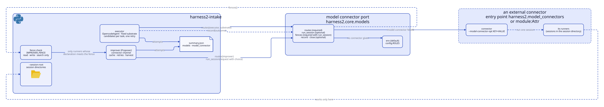
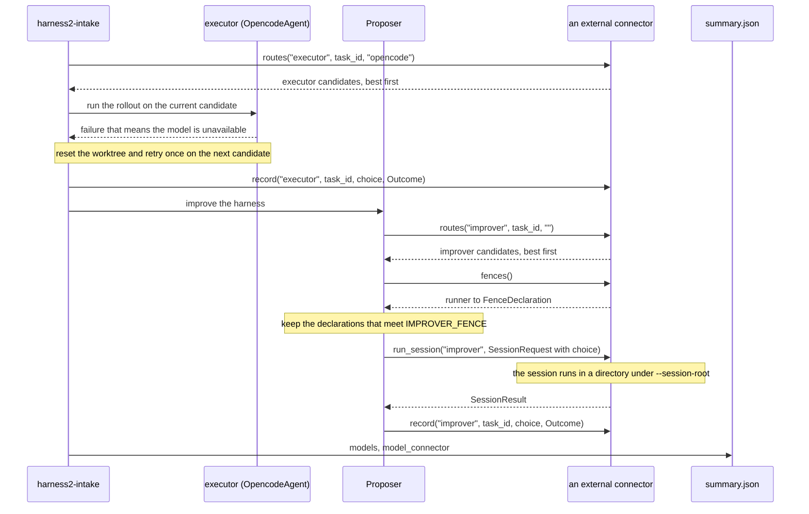

# モデルのコネクター

モデルのコネクターは、実行役と改善役が使うモデルを、役割ごと・タスクごとに供給します。`routes(role, *, task_id, substrate)` を持つ任意のオブジェクトで、ある役割の `ModelChoice` の候補を、良い順に返します。モデルの出どころを差し替えるもので、harness2 は変更なしに使えます。実行役はロールアウトを実行するエージェント、改善役はロールアウトの合間にハーネスを書き換えるエージェントです。

既定のコネクターは `env`（`harness2/core/models.py` の `EnvModelConnector`）で、環境がすでに選んでいるモデルを返します。パッケージは別のコネクターを登録でき、`harness2-intake` はその名前を指定できます。指定しなければ何も変わりません。コネクターが改善役のセッションを自分で回すこともでき、その場合は適用する柵を宣言します。

## 概要

図は、`harness2-intake` が 1 つのタスクでモデルのコネクターをどう呼ぶかを示します。

<p align="center">
  <picture>
    <source media="(prefers-color-scheme: dark)" srcset="../assets/model-connectors/model-connectors-dark.svg">
    
  </picture>
</p>

構成:

- `harness2-intake` がコネクターを組み立て、タスクを実行します。その中で実行役（`OpencodeAgent`）が実行役の候補を要求し、固定されたサブストレートの上のものだけを残して、ロールアウトを実行します。改善役の `Proposer` は、コネクターがセッションを回す場合は `connector` チャネルを使い、そうでなければ harness2 自身のチャネルを使います。
- `connector` チャネルは改善役の候補を要求し、宣言された柵が `IMPROVER_FENCE` を満たすランナーだけを残して、コネクターの `run_session` を呼ぶか、セッションを自分で回します。harness2 の `Proposer` が作業ディレクトリを用意してキャッシュし、再試行し、書き換えられたツリーを回収します。
- コネクターが `record` を定義しているとき、候補の使用ごとに 1 つの `Outcome` を受け取ります。候補の行は `model_connector` とともに `models` として `summary.json` に書かれます。
- 外部のコネクターは、契約を満たす harness2 の外のコードです。モデルを選び、セッションを回すこともできます。実行はコネクター自身のランナーが、harness2 が `--session-root` の下で渡す作業ディレクトリで行います。harness2 がそれらのランナーと直接やりとりすることはありません。

## 1 つのタスクを順を追って



1. `harness2-intake` がタスクにつき 1 回、コネクターに実行役の候補を要求します:
   `routes("executor", task_id=..., substrate="opencode")`。実行できるのは `runner` が
   `opencode` の候補だけで、それ以外は `skipped_reason` を持つサマリーの行として残ります。
2. ロールアウトは現在の候補の上で動きます。モデルを使えないことを意味する理由で失敗した
   ときは、worktree がベースコミットの状態に戻され、同じ実行ディレクトリの中で、次の候補で
   ロールアウトが 1 回だけ再試行されます。2 回目の使用不能の失敗でロールアウトは終了
   し、候補を使い切った場合も終了します。それ以外の失敗はその時点で終了します。
3. コネクターが `record` を定義しているとき、実行役の使用のたびに `Outcome` が渡されます。
4. `run_session` を持つコネクターでは、改善役が動くとき、`Proposer` がタスクごとに改善役の
   候補を要求します: `routes("improver", task_id=..., substrate="")`。`run_session` を持たない
   コネクターでは、`harness2-intake` が起動時に 1 回だけ `task_id=""` で要求し、先頭の候補の
   チャネルとモデルをすべてのタスクで使います。
5. `run_session` を持つコネクターでは、`fences()` が返す宣言が起動時に `IMPROVER_FENCE`
   と照らし合わせて検査されます。その条件を満たす宣言を持たないランナーの候補は飛ばされ、
   `skipped_reason` の `no fence` として記録されます。
6. `run_session` がある場合、コネクターが候補のランナーとモデルでセッションを自分で回します。
   `SessionRequest.choice` がその候補で、`cwd` は `--session-root` の下の新しいディレクトリ
   です。`run_session` がない場合、harness2 が自身のチャネルの 1 つでセッションを回します。
7. コネクターが `record` を定義しているとき、改善役の使用のたびに `Outcome` が渡されます。
   タスクの後、`summary.json` には候補の行が `models` として、コネクターの名前が
   `model_connector` として入ります。

## コネクターの導入と選択

コネクターはファクトリーです。コネクターのオプションをキーワード引数で受け取り、`routes` を持つオブジェクトを返す呼び出し可能なものです。パッケージは、グループ `harness2.model_connectors` の entry point を使って、ファクトリーを名前で登録します:

```toml
[project.entry-points."harness2.model_connectors"]
my-models = "my_package.models:make_connector"
```

`pip install` の後は、`--model-connector my-models` で使えます。インストールする前は、`module:Attr` の import パスを直接渡します: `--model-connector my_package.models:make_connector`。`Attr` はドットでつないだ鎖でもかまいません。

名前は、指定があれば `--model-connector`、なければ `HARNESS2_MODEL_CONNECTOR`、どちらもなければ既定の `env` です。名前は、組み込みの登録、その名前のグループ内の entry point、`:` を含む名前なら `module:Attr` の import パスの順に探します。組み込みは `env` だけです。

`--model-connector-opt KEY=VALUE` は 1 つずつファクトリーのキーワード引数になります。このフラグは繰り返せて、値はすべて文字列です。キーは実行が始まる前にファクトリーのシグネチャと照らし合わせて検査されます。

`--session-root DIR` は、改善役のセッションが作業ディレクトリを受け取る場所です。既定は `<work-root>/_sessions` です。セッションを回すコネクターは、このディレクトリを許可する必要があります。`harness2-intake` は起動時にこのルートを表示します。

`--model` が実行役のモデルを設定するのは、既定のコネクターを使う場合だけです。ほかのコネクターでは、実行役のモデルを選ぶのはコネクターなので、この 2 つは引数のエラーになります。

```bash
harness2-intake --repo /home/me/proj --work-root /home/me/h2 \
  --model-connector my-models \
  --model-connector-opt url=http://127.0.0.1:9000 \
  --session-root /home/me/h2/_sessions
```

## 改善役の柵

harness2 は、コネクターが回す改善役のセッションに 1 つの条件を課します: `models.IMPROVER_FENCE`。これはランナーの名前もプロバイダーの名前も挙げません。`capabilities` に含められるのは `read`、`write`、`search` だけで、`workdir_only` は true、`asks_human` と `harness_credentials` は false でなければなりません。

`run_session` を持つコネクターは、適用する柵を `fences()` で宣言します。これはランナーの名前から `FenceDeclaration` への対応付けです:

| フィールド | 意味 |
|---|---|
| `capabilities` | セッションが使えるツールの種類。`read`（ファイルを読む）、`write`（ファイルを書く・編集する）、`search`（ファイルやテキストを探す）、`commands`（コマンドを実行する）、`network`（Web からの取得など、外に届く）、`mcp`（MCP サーバーのツール）のいずれか |
| `workdir_only` | セッションは渡された作業ディレクトリの外のファイルに届かない。ほかのディレクトリは追加されない |
| `asks_human` | セッションが止まって人に確認を求めることがある |
| `harness_credentials` | harness2 自身の API の認証情報（環境変数）が子プロセスに届く |
| `runner` | 任意。コネクターが使うランナーの名前で、記録用。検査には使われない |

宣言は、型の正しいフィールドを持つ `FenceDeclaration` でなければなりません。6 つの名前の外の `capabilities` の値は問題で、許される 3 つを超える値も問題です。`models.satisfies` は宣言が条件を満たすかを返し、`models.fence_problems` は何がおかしいかを並べます。

検査に使うのは宣言だけです。ランナーの名前は候補（`ModelChoice.runner`）をその宣言に結びつけるだけで、検査には関わりません。宣言は信頼されます。harness2 はコネクターのプロセスを調べないので、柵を宣言したコネクターはそのとおりだと信じられます。

`run_session` を持つコネクターは `fences` も定義しなければなりません。これがないと `models.capabilities` が `TypeError` を送出し、実行は起動時に終了コード 2 で止まります。

harness2 自身が回すチャネル（`claude_cli` と `opencode`）は、自分のセッションに柵を掛けます。`claude_cli` はファイルのツールだけで、追加のディレクトリなしに動き、`opencode` は作業ディレクトリの外のディレクトリを拒みます。セッションを回すコネクターは、この責任を引き受けて、自分の振る舞いを宣言します。

## 記録される内容

`record(role, task_id, choice, outcome)` は、コネクターが定義しているとき、候補の使用ごとに 1 回呼ばれます。`Outcome` は `ok`、`unavailable`、`cost_usd`、`tokens`、`wall_s`、`error` を持ち、実行役なら `run_id`、改善役なら `label` も持ちます。飛ばされた候補は使用ではないので、`record` は呼ばれません。`record` が送出した例外は標準エラーへの警告になり、実行の失敗には決してなりません。

既定以外のコネクターを使うと、`summary.json` に `model_connector`（コネクターの名前）が加わり、行があるときは `models` も加わります。行がある役割（`executor`、`improver`）ごとに 1 つのリストです。リストは候補を最初に試した順に持ち、各候補は `runner`、`model`、`effort`、`ok`、`unavailable`、`cost_usd`、`tokens`（入力と出力）、`n`（試した回数）を含みます。`skipped_reason` を持つのは飛ばされた候補だけで、その `n` は 0 のままです。試された候補がこのキーを持つことはありません。

改善役の行は、コネクターがセッションを自分で回したときだけ現れます。既定のコネクターではどちらのキーも書かれないので、`summary.json` はこれまでどおりの形を保ちます。

## トラブルシューティング

- **実行役の候補がない。** 実行役の候補になるのは、コネクターが固定されたサブストレート `opencode` に対して返すものだけです。ほかのランナーの候補は実行されず、`skipped_reason` を持つ行として残ります。合う候補がないときはロールアウトが動かず、タスクは失敗し、理由はタスクコネクターの `fail` に渡されます。
- **起動時の終了コード 2。** `run_session` を定義しているのに、`IMPROVER_FENCE` を満たす柵を宣言したランナーがないコネクターは、どのタスクも始める前に止まります。メッセージは `models.fence_report` から組み立てられ、宣言したランナーごとにその宣言の問題が並びます。空のリストは受け入れられたことを意味し、`no fences declared` は `fences()` が何も返さなかったことを意味します。宣言を直すか、改善役の候補が使うランナーの宣言を足してください。
- **セッションのディレクトリが拒まれる。** harness2 は各セッションの作業ディレクトリを `--session-root` の下に作ります。自分のディレクトリだけを受け入れるコネクターは、このルートを許可しなければなりません。許可しないと `run_session` を始められません。`harness2-intake` は起動時にこのルートを表示します。
- **コネクターと `--model`。** 既定以外のコネクターを指す `--model-connector`（または `HARNESS2_MODEL_CONNECTOR`）と一緒に `--model` を渡すと引数のエラーになり、実行は始まりません。実行役のモデルを選ぶのはコネクターです。
- **再試行は 1 回だけ。** 使用不能の失敗は次の候補へ進み、worktree をベースコミットに戻したあと、同じ実行ディレクトリの中でロールアウトを 1 回だけ再試行します。2 回目の使用不能の失敗でロールアウトは終了し、候補を使い切った場合も終了します。それ以外の失敗はその時点で終了します。失敗した試行の `events.1.jsonl`、`opencode.1.stderr`、`trajectory.1.md` は、再試行のファイルの隣に残ります。

## 関連項目

- [モデルのコネクターを書く](BENCHMARKS.md#writing-a-model-connector): 契約、データクラス、登録の方法。
- `harness2.testing.model_contract`: 自分のテストから実行する契約テスト。
