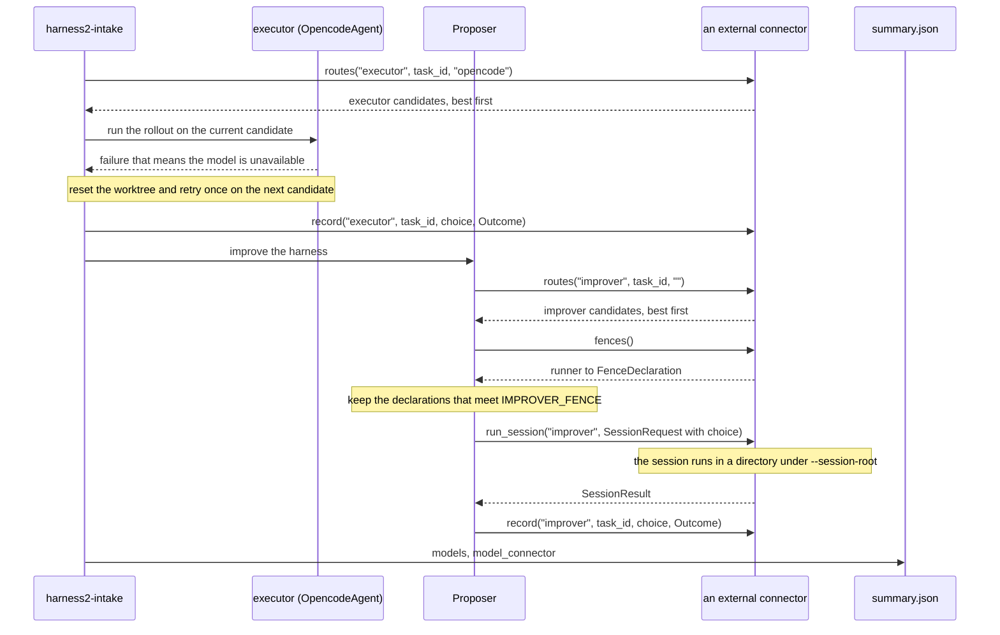

# Model connectors

A model connector supplies the models of the executor and the improver, per role and per task.
It is any object with `routes(role, *, task_id, substrate)`, which returns the `ModelChoice`
candidates for a role, best first. It replaces where those models come from, and harness2 needs
no change to use it. The executor is the agent that runs a rollout; the improver is the agent
that rewrites the harness between rollouts.

The default connector is `env` (`EnvModelConnector` in `harness2/core/models.py`), which
returns the models the environment already selects. A package can register another connector
and `harness2-intake` can name it; without one, nothing changes. A connector may also run the
improver sessions itself, in which case it declares the fence it applies.

## Overview

The diagram shows how `harness2-intake` calls a model connector for one task.

<p align="center">
  <picture>
    <source media="(prefers-color-scheme: dark)" srcset="../assets/model-connectors/model-connectors-dark.svg">
    
  </picture>
</p>

The parts:

- `harness2-intake` builds the connector and runs the task. Inside it, the executor
  (`OpencodeAgent`) asks for the executor candidates, keeps the ones on its fixed substrate,
  and runs the rollouts. The improver's `Proposer` uses the `connector` channel when the
  connector runs sessions; otherwise it uses a channel of harness2's own.
- The `connector` channel asks for the improver candidates, keeps only the runners whose
  declared fence meets `IMPROVER_FENCE`, and either calls the connector's `run_session` or runs
  the session itself. harness2's `Proposer` prepares and caches the working directory, retries,
  and harvests the rewritten tree.
- When the connector defines `record`, it receives one `Outcome` for each use of a candidate.
  The candidate rows go to `summary.json` as `models`, together with `model_connector`.
- An external connector is the code outside harness2 that meets the contract. It chooses the
  models and may run sessions; its own runners execute them, in the working directory harness2
  gives them under `--session-root`. harness2 never talks to those runners directly.

## One task, step by step



1. `harness2-intake` asks the connector for the executor candidates once for the task:
   `routes("executor", task_id=..., substrate="opencode")`. Only a candidate whose `runner` is
   `opencode` can run; the others are kept as summary rows with `skipped_reason`.
2. The rollout runs on the current candidate. When it fails for a reason that means the model
   cannot be used, the worktree is put back at the base commit and the rollout is retried once,
   in the same run directory, on the next candidate. A second unavailable failure ends the
   rollout, and so does running out of candidates. Any other failure ends it at once.
3. When the connector defines `record`, each executor use is handed to it as an `Outcome`.
4. For a connector with `run_session`, the `Proposer` asks for the improver candidates of
   each task when the improver runs: `routes("improver", task_id=..., substrate="")`. For a
   connector without `run_session`, `harness2-intake` asks only once, at start-up, with
   `task_id=""`, and uses the first candidate's channel and model for every task.
5. For a connector with `run_session`, the declarations from `fences()` are checked at
   start-up against `IMPROVER_FENCE`. A candidate whose runner has no declaration that meets
   it is skipped and noted with `skipped_reason` `no fence`.
6. With `run_session`, the connector runs the session itself on the candidate's runner and
   model. `SessionRequest.choice` is that candidate, and `cwd` is a fresh directory under
   `--session-root`. Without `run_session`, harness2 runs the session on one of its own
   channels.
7. When the connector defines `record`, each improver use is handed to it as an `Outcome`.
   After the task, `summary.json` holds the candidate rows as `models` and the connector's name
   as `model_connector`.

## Installing and selecting a connector

The connector is a factory: a callable that takes the connector options as keyword arguments
and returns an object with `routes`. A package registers the factory under a name with an entry
point in the group `harness2.model_connectors`:

```toml
[project.entry-points."harness2.model_connectors"]
my-models = "my_package.models:make_connector"
```

After `pip install`, `--model-connector my-models` uses it. Before installing, pass the
`module:Attr` import path directly: `--model-connector my_package.models:make_connector`;
`Attr` may be a dotted chain.

The name is `--model-connector` when given, else `HARNESS2_MODEL_CONNECTOR`, else the default
`env`. A name is looked up as a built-in registration, then an entry point of that name in the
group, then, for a name containing `:`, a `module:Attr` import path. Only `env` is built in.

Every `--model-connector-opt KEY=VALUE` becomes a keyword argument of the factory; the flag is
repeatable and every value is a string. The keys are checked against the factory's signature
before the run starts.

`--session-root DIR` is where the improver sessions get their working directories; the default
is `<work-root>/_sessions`. A connector that runs sessions must allow this directory.
`harness2-intake` prints the root at start-up.

`--model` sets the executor model only with the default connector. With any other connector
the two are an argument error, because the connector chooses the executor model.

```bash
harness2-intake --repo /home/me/proj --work-root /home/me/h2 \
  --model-connector my-models \
  --model-connector-opt url=http://127.0.0.1:9000 \
  --session-root /home/me/h2/_sessions
```

## The improver fence

harness2 puts one condition on an improver session run by a connector: `models.IMPROVER_FENCE`.
It names no runner and no provider. `capabilities` may contain only `read`, `write` and
`search`; `workdir_only` must be true; `asks_human` and `harness_credentials` must be false.

A connector with `run_session` declares the fence it applies with `fences()`, a mapping from a
runner name to a `FenceDeclaration`:

| Field | Meaning |
|---|---|
| `capabilities` | The kinds of tool the session has, each one of `read` (read files), `write` (write or edit files), `search` (find files or text), `commands` (run commands), `network` (reach outside, such as fetching from the Web) and `mcp` (tools from MCP servers) |
| `workdir_only` | The session cannot reach files outside the working directory it is given; no other directory is added |
| `asks_human` | The session may stop to ask a person for confirmation |
| `harness_credentials` | harness2's own API credentials (environment variables) reach the child process |
| `runner` | Optional. The name of the runner the connector uses, for the record; it is not checked |

The declaration must be a `FenceDeclaration` with well-typed fields. A `capabilities` value
outside the six names is a problem, and so is one beyond the allowed three.
`models.satisfies` returns whether a declaration meets the condition, and
`models.fence_problems` lists what is wrong.

The check uses only the declaration. The runner name ties a candidate (`ModelChoice.runner`) to
its declaration; it plays no part in the check. The declaration is trusted: harness2 does not
inspect the connector's processes, so a connector that declares the fence is believed.

A connector with `run_session` must also define `fences`. Without it, `models.capabilities`
raises `TypeError` and the run stops at start-up with exit code 2.

The channels harness2 runs itself (`claude_cli` and `opencode`) fence their own sessions:
`claude_cli` runs with file tools only and no added directory, and `opencode` denies
directories outside the working directory. A connector that runs sessions takes on that
responsibility and declares what it does.

## What is recorded

`record(role, task_id, choice, outcome)`, when the connector defines it, is called once for
each use of a candidate. The `Outcome` holds `ok`, `unavailable`, `cost_usd`, `tokens`,
`wall_s` and `error`, plus `run_id` for the executor or `label` for the improver. A skipped
candidate is not a use, so `record` is not called for it. A `record` that raises is a warning
on standard error, never a failed run.

With a connector other than the default, `summary.json` gains `model_connector`, the
connector's name, and, when there are rows, `models`: one list per role that has rows
(`executor`, `improver`). The list holds the candidates in the order they were first tried,
each with `runner`, `model`, `effort`, `ok`, `unavailable`, `cost_usd`, `tokens` (input and
output) and `n`, the number of times it was tried. Only a skipped candidate has
`skipped_reason`, and its `n` stays 0; a candidate that was tried never has that key.

The improver rows appear only when the connector ran the sessions itself. With the default
connector neither key is written, so `summary.json` keeps its old shape.

## Troubleshooting

- **No executor candidate.** The executor candidates are only those the connector returns for
  the fixed substrate, `opencode`. A candidate for another runner is not run; it is kept as a
  row with `skipped_reason`. When no candidate matches, no rollout runs and the task fails,
  with the reason handed to the task connector's `fail`.
- **Exit code 2 at start-up.** A connector that defines `run_session` but declares no runner
  whose fence meets `IMPROVER_FENCE` stops before any task is taken up. The message is built
  from `models.fence_report`: each declared runner with the problems of its declaration; an
  empty list means accepted, and `no fences declared` means `fences()` returned nothing. Fix
  the declaration, or add one for the runner the improver candidates use.
- **The session directory is refused.** harness2 creates each session's working directory under
  `--session-root`. A connector that accepts only its own directories must allow that root;
  otherwise its `run_session` cannot start. `harness2-intake` prints the root at start-up.
- **`--model` with a connector.** `--model` with `--model-connector` (or
  `HARNESS2_MODEL_CONNECTOR`) naming a connector other than the default is an argument error;
  the run does not start. The connector chooses the executor model.
- **The retry happens once.** An unavailable failure moves to the next candidate and retries
  the rollout once, in the same run directory, after the worktree is reset to the base commit.
  A second unavailable failure ends the rollout, and so does running out of candidates. Any
  other failure ends it at once. The failed attempt's `events.1.jsonl`, `opencode.1.stderr` and
  `trajectory.1.md` stay beside the retry's files.

## See also

- [Writing a model connector](BENCHMARKS.md#writing-a-model-connector): the contract, the
  dataclasses, and the registration.
- `harness2.testing.model_contract`: the contract checks to run from your own tests.
