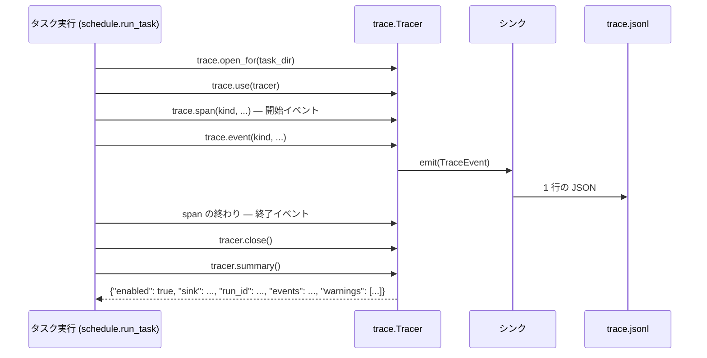

# トレースのシンク

トレースは、1 回のタスク実行が何をどの順に行ったかを残します。各実行は、タスクの実行ディレクトリ（`summary.json` と同じ場所）の `trace.jsonl` に 1 行 1 イベントで書き出すので、人や後から動く道具が、プロンプトや成果物を読まずに、段の順序・ロールアウト・モデルの選択・費用をたどれます。既定のシンクがこのファイルを書きます。パッケージはシンクを差し替えられ、harness2 は変更なしにそれを使えます。

トレースは既定でオンです。`HARNESS2_TRACE=0` で止まります。壊れたシンクで実行が止まることはなく、失敗は `summary.json` の `trace.warnings` に残ります。

コードは `harness2/core/trace.py`（イベント、シンクの契約、登録、実行ごとの `Tracer`）と `harness2/core/trace_file.py`（既定の `file` シンク。`trace.jsonl` を書き、読み戻す）にあります。

## 概要

タスク実行は自分のディレクトリの Tracer を開いてそれを現在のものにし、モジュール関数でイベントを出します。Tracer がイベントを整えてシンクに渡します。最後に実行は Tracer の summary を `summary.json` に読み込み、閉じます。



## 何が残るか

- **場所。** `summary.json` を持つタスクの実行ディレクトリに `trace.jsonl` ができます。再開したタスクは同じファイルに新しい `run_id` で追記し、ファイルを上書きすることはありません。
- **形式。** 1 行 1 つの JSON オブジェクトです。既定のシンクは `sort_keys=True, ensure_ascii=True` で書き出すので、ASCII 以外の文字はすべてエスケープされ、ファイルは ASCII のままです。行ごとに排他ロックを取って追記するので、別プロセス（並列のタスク）が書いたイベントでも行の中身が混ざりません。ファイルの最後の行が改行で終わっていなければ（クラッシュやディスクの満杯で書き切れなかった場合）、先にその改行を書くので、次のイベントが壊れた行につながることはありません。
- **読み方。** `harness2.core.trace_file.read` がイベントをファイルの順に返します。ファイルが無ければ空のリストで、完全なイベントでない行（例えば、別プロセスがまだ書いている行）は飛ばします。行は改行 (`\n`) だけで分けるので、値の中の行区切りの文字でイベントが分かれることはありません。

```python
from pathlib import Path

from harness2.core.trace_file import read

events = read(task_dir / "trace.jsonl")
```

各イベントは 6 つのフィールドを持つ `TraceEvent` です:

| フィールド | 型 | 意味 |
|---|---|---|
| `run_id` | `str` | タスク実行の ID。`Tracer` が uuid4 の hex を作り、その実行の全イベントが持つ |
| `span_id` | `str` | このイベントが属する span の ID（uuid4 の hex の先頭 16 文字） |
| `parent_id` | `str` または `null` | 親 span の ID。根であるタスクの span では `null` |
| `kind` | `str` | イベントの種類。`trace.Kind` のいずれか |
| `ts` | `str` | UTC の ISO 8601。`datetime.now(timezone.utc).isoformat()` の値 |
| `attrs` | `object` | JSON にできる属性。無ければ `{}` |

`TraceEvent.to_dict()` が 6 つのキーを返し、`TraceEvent.from_dict(d)` が読み戻します。`read` は後者を使います。

**span** は同じ `span_id` を持つ 2 つのイベントです。先頭が `attrs.phase == "start"`、2 つ目が `"end"` です。終了イベントには `status`（`"ok"` または `"error"`）、`dur_s`（秒、小数 3 桁に丸める）、`with` の本体が例外を投げたときは `error` が加わります。本体が `Span.set(...)` に渡した属性も入り、同じキーの後からの値が勝ちます。**point event** は 1 回きりの出来事で `phase` を持たず、自分の `span_id` は持ちますが 2 つ目のイベントはありません。

## 種類と属性

種類は `trace.Kind` の定数です。文字列の値を直書きしないでください。`judge.` で始まる種類は採点側の予約で（後述）、手法側は出しません。属性の列は、span では開始イベントに harness2 が書くもの、point event ではそのイベントが持つものです。span の終了イベントには必ず `status` と `dur_s` が入り、失敗したときは `error` も入ります。

| Kind | 値 | 形 | 属性 |
|---|---|---|---|
| `TASK` | `task` | span | `task_id`、`domain`、`k`、`seed`、`modes`。`resumed`（開始イベントでは `false`、再開した実行の終了イベントでは `true`） |
| `MODE` | `mode` | span | `mode`、再開したタスクのライブラリを書き戻す span では `resumed`（`true`）。モードの本体が例外を投げたときは終了イベントに `ok` と `error` が入り、`status` は `"ok"` のまま |
| `ROLLOUT` | `rollout` | span | `role`（`base` / `candidate` / `final`）、`mode`、`label`、`run_id`（トレースの run id ではなくロールアウトの run id）。終了イベントには `ok`、`delivered`、`usd`、`error` |
| `STAGE` | `stage` | span | `label`、`dim`（`INV` / `DOM` / `compose`）、`mode`。終了イベントには `kept_base`、`fell_back`、`attempts`、`cached`、`usd`、`error` |
| `TREE_DIFF` | `tree.diff` | point | `label`、`files`: `{path, sha256, change}` のリスト。`change` は `added`、`changed`、`removed` のいずれか |
| `SELECTION` | `selection` | span | `mode`、`pool`（候補のラベル）。終了イベントには `chosen_label`、`ok`、`usd`、`error` |
| `REFLECTION` | `reflection` | span | `mode`。終了イベントには `chosen_label`、`ok`、`usd`、`error` |
| `MEMORY_RECALL` | `memory.recall` | point | `connector`、`task_id`、`chars`、`mode`、呼び出した本文の `sha256`。本文は決して入れない |
| `MEMORY_STORE` | `memory.store` | point | `connector`、`task_id`、`label`、`mode`、`stored`（bool）、`path`（`null` のこともある） |
| `MODEL_ROUTE` | `model.route` | point | `role`、`candidates`: `{runner, model, effort}` のリスト。実行役は `skipped_other_runners` も持つ |
| `MODEL_SWITCH` | `model.switch` | point | `role`、`from` と `to`（`{runner, model, effort}`）、`reason`（改善役ではエラー文を `sha256=<hex> chars=<n>` にしたもの。executor では空）。候補が残っていないときの `to` は `null` |
| `MODEL_FENCE` | `model.fence` | point | `role`、`fenced`、`runners`、`problems`、`model` |
| `COST` | `cost` | point | 各モードの終わりに `mode`、`usd`、`rollout_usd`、`session_usd`、`R`、`P` |
| `ERROR` | `error` | point | `where`、`message` |

失敗したモードでも、終了イベントの `status` は `"ok"` です。モードの例外は span の中で実行が握るからです。失敗は、span の終了イベントの `ok: false` と `error`、そして `where` が `mode:<mode>` の `ERROR` イベントで表れます。例外を握らない `MODE` の span は、再開したタスクの書き戻し（`resumed: true`）だけです。書き戻しが例外を投げると、その span は `status: "error"` と `error` で終わり、`ok` も `ERROR` イベントも無く、例外は `TASK` の span まで伝わります。

## 親と子

`parent_id` はイベントを木につなぎます:

- `TASK` の span が根で、その開始イベントの `parent_id` は `null` です。
- span の親は、それが始まったときに現在だった span です。point event の親は、それが出力されたときに現在の span です。現在の span は context 変数に持つので、呼ばれる側は引数で受け取る必要がありません。
- `MODE` の span はモードごとに 1 つ、`TASK` の下に下がります。その子はそのモードの部分です。`role` が `candidate` か `final` の `ROLLOUT`、`STAGE` とその `TREE_DIFF`、`SELECTION` と `REFLECTION`、そのモードの `COST`、`ERROR`、そして `MEMORY_*` のイベントです。`base` のロールアウトはモードより前に動くので `TASK` の下に残り、再開したタスクが書き戻す `MEMORY_STORE` は `resumed: true` のそれ専用の `MODE` の span の中で動きます。`MODEL_*` は現在の span の下に残ります。
- `trace.use(tracer)` は tracer を現在のものにし、引きずっていた span を落とします。新しい実行が前の実行の span につくことはありません。tracer は閉じないので、開いた側が閉じます。
- スレッドプールでは、渡す関数を `trace.bind(fn)` で包みます。包んだ関数は呼び出し側の tracer と span を引き継ぎ、呼び出しごとにその context の新しいコピーに入るので、同じ関数を複数のスレッドで同時に動かせます。

## 自分のイベントを出す

モジュールは tracer の引数を増やさずに関数を呼びます:

```python
from harness2.core import trace

with trace.span(trace.Kind.STAGE, label="demo", dim="INV", mode="parallel") as sp:
    span_id = trace.event(trace.Kind.MEMORY_RECALL, connector="file", chars=0,
                          sha256=trace.digest(""))
    sp.set(attempts=1, usd=0.0)
```

`trace.event(kind, **attrs)` は新しい span id を返します（何も記録しないときは空文字列）。`trace.span(kind, **attrs)` は本体が例外を投げたとき、span を `status="error"` で終えて例外を投げ直します。`trace.use` の外ではどちらも何もしません。トレースの失敗は `Tracer` が握るので、呼ぶ側は `try` で囲みません。自分で tracer を作るときは `trace.open_for(task_dir)` を使い、実行の終わりに閉じます。

## 本文を入れない決まり

トレースは作業の写しではなく、メタデータです:

- プロンプト、成果物、ハーネスの中身、改善役の返答は決して入れません。ファイルはパスと sha256 だけです。`trace.digest(data)` が sha256 の hex を返します（`str` は UTF-8 としてハッシュする）。
- `Tracer` はシンクに渡す前にすべての属性値を整えます。JSON にできる値はそのまま、512 文字（`trace.MAX_ATTR_CHARS`）を超える文字列は `{"sha256": <hex>, "chars": <長さ>}` に置き換えます。入れ子の dict や list の中も同じです。JSON にできない値は `str()` にし（そのあと同じ長さの決まりに従う）、有限でない float は文字列にし、深さが 32 を超える入れ子は文字列にします。長い文字列をハッシュに置き換えるのは大きさで弾く安全網で、本文かどうかを見分けるものではありません。512 文字以下の文字列はそのまま残るので、本文は呼ぶ側が渡さないでください。長さの決まりが当たるのは文字列の値で、マッピングのキーには当たりません。
- エラー文も、本文を引用し得る場所では同じ決まりに従います。grader verdict を拒む検査は、ファイル名・マーカー・オフセットを残し、抜粋を `(excerpt sha256=<hex> chars=<n>)` に置き換えます。改善役の CLI のエラーは、subtype を残し、返答を `reply sha256=<hex> chars=<n>` に置き換えます。改善役の `model.switch` の `reason` も `sha256=<hex> chars=<n>` にします。短いエラー文にも本文は入らず、`summary.json` の `errors` にも入りません。CLI 自身の stderr の抜粋（`rc=...`）は残します。これは道具の診断で、本文ではないからです。
- 採点は手法側のトレースに入れません。スコア、判定、private_criteria は入れません。`judge.`（`trace.JUDGE_PREFIX`）で始まる種類は採点側の予約です。手法側は 1 つも出しません。採点側のコードは、採点した `ROLLOUT` の `span_id` を `parent_id` にして、同じ `run_id` に自分のイベント（例えば `judge.score`）を追記できます。イベントは `harness2.core.trace_file.read` で読み戻せます。

## トレースを止める

`HARNESS2_TRACE` がちょうど `"0"` のときだけ止まり、ほかの値でも未設定でもオンです。オフのとき `open_for` は何もしない `Tracer(None)` を返します。`trace.jsonl` は書かれず、`summary.json` には `{"enabled": false}` が残ります。

## シンクを選ぶ

シンクは、1 つの `TraceEvent` を受ける `emit(event)` と、実行の終わりの `close()` を持つ任意のオブジェクトです。これが `TraceSink` のプロトコルです。シンクは受け取ったイベントをすべてその順に渡し、複数のスレッドからの出力を受け入れ、`close` を 2 回以上呼ばれてもかまいません。契約テストはイベントを `close` のあとに読むので、ためてから渡すシンクは、`close` が返るまでにすべてのイベントを読めるようにしてください。

シンクの名前は、設定があれば `HARNESS2_TRACE_SINK`、なければ既定の `file` です。harness2 にはこれ用のコマンドライン引数はありません。名前は次の順に探します:

1. 組み込みの登録（`trace.register(name, factory)`）
2. グループ `harness2.trace_sinks` にある、その名前の entry point
3. `:` を含む名前なら、`module:Attr` の import パス（`Attr` はドットでつないだ鎖でもよい）

`trace.names()` は組み込みと entry point の名前を並べます。どこにも無い名前は、存在する名前を並べた `ValueError` になります。

見つかったのはファクトリーで、`factory(root=Path, **options)` の形で呼ばれます。`root` はタスクの実行ディレクトリです。ファクトリーは `TraceSink` を返さなければならず、それ以外は `TypeError` です。`options` はシンク固有の設定で、`root` を含めてはいけません（harness2 が渡すので、`root` という名前のオプションは `ValueError` です）。harness2 は `open_for(task_dir)` をオプションなしで呼ぶので、環境変数で選んだシンクが受け取るのは `root` だけです。自分で tracer を作るコードは `trace.open_for(task_dir, options={...})` でシンクのオプションを渡せます。

パッケージは entry point でシンクを導入します:

```toml
[project.entry-points."harness2.trace_sinks"]
my-sink = "my_package.trace:make_sink"
```

`pip install` の後は名前で選びます。インストールする前は、`module:Attr` の import パスを直接渡します:

```bash
HARNESS2_TRACE_SINK=my-sink harness2 --bench jb --k 1 --mode parallel
HARNESS2_TRACE_SINK=my_package.trace:make_sink harness2 --bench jb --k 1 --mode parallel
```

ファクトリーは harness2 が呼ぶ形を保ちます:

```python
from pathlib import Path


class MySink:
    def __init__(self, root: Path, url: str = "") -> None:
        self.root = Path(root)
        self.url = url

    def emit(self, event) -> None:
        # event.to_dict() をイベントの行き先（例えば、データベースや可観測性の基盤）に渡す。
        ...

    def close(self) -> None:
        ...


def make_sink(root: Path, **options) -> MySink:
    return MySink(root, **options)
```

組み込みのシンクは `file` だけです。`root / "trace.jsonl"` を使い、イベントごとに追記モードで開いて排他ロックを取り、`json.dumps(event.to_dict(), sort_keys=True, ensure_ascii=True)` の 1 行を書いて flush するので、`close` にすることはありません。

## シンクが失敗したとき

壊れたシンクが生むのは警告で、実行は止まりません:

- `emit` の例外は握りつぶされ、`emit failed: <型>: <メッセージ>` として残ります。
- `close` の例外は `close failed: <型>: <メッセージ>` として残ります。
- シンクを作れないとき（知らない名前、import やファクトリーのエラー、`TraceSink` でない戻り値）は、何もしない `Tracer` になり、`sink failed: <型>: <メッセージ>` が残ります。
- 同じ文は 1 回だけ、警告は最大 20 件まで残します。すべて `summary.json` の `trace.warnings` にあります。
- `Tracer.close()` はシンクの `close` を 1 回呼び、2 回目は何もしません。

## summary.json に残る形

実行の終わりに、`summary.json` に `Tracer.summary()` が作る `trace` オブジェクトが加わります:

| キー | 値 |
|---|---|
| `enabled` | `true` |
| `sink` | 選ばれたシンクの名前 |
| `run_id` | この実行の全イベントが持つ run id |
| `events` | シンクに届いたイベントの数 |
| `warnings` | 上記の、シンクとイベントの失敗 |

トレースがオフのときは、オブジェクト全体が `{"enabled": false}` です。再開したタスクは、既にある `summary.json` の `trace` のキーだけを今回の値に書き換え、ほかのキー（`status` など）はそのまま残します。TASK の span の終了イベントは `resumed: true` を持ちます。モードの実行中は、途中の書き込みのたびに古い `trace` を残し、最後の書き込みで今回の値に置き換えます。再開した実行のイベントは、新しい `run_id` で `trace.jsonl` に入ります。

## 費用と Ledger

`ROLLOUT` の終了イベントの `usd` と、Ledger のロールアウトの金額は同じ値から来ます。`spec.rollout_cost_usd(adapter, run_id, run_dir)` がアダプターの任意メソッド `rollout_cost_usd(run_id, run_dir)` に尋ねます。このメソッドは `BenchmarkAdapter` のプロトコルには含まれません。持たないアダプターは `0.0` を返し、例外を投げるもの、負の値、bool、有限でない数を返すものも `0.0` になります。壊れた費用が実行を止めることはありません。同梱の intake のアダプターは、executor の record に記録するのと同じ実行の使用量をこのメソッドで返すので、Ledger の `rollout_usd` と executor の記録が一致します。

各モードの `COST` イベントは、そのモードの終わりの Ledger の合計を持ちます: `usd`、`rollout_usd`、`session_usd`、`R`、`P`。

## シンクを契約テストで確かめる

`harness2.testing.trace_contract` には、シンクの作者が自分のテストから実行する検査があります。harness2 自身のテストに依存しません。

- `check_trace_sink(sink)` は、`emit` か `close` が無いか呼べないとき、または `TraceSink` のプロトコルを満たさないときに `AssertionError` を送出します。メッセージは、足りないか正しくないメンバーを名指しします。
- `TraceSinkContractTests` は unittest の mixin です。`unittest.TestCase` と一緒に継承し、`make_sink(root)` を実装します。各テストは新しい一時ディレクトリを渡します。検査は、プロトコル、出力した順に読めること（span ごとに開始と終了が 1 つずつ）、`close` を 2 回呼べること、4 つのスレッドが同時に出力しても全イベントが届き span id が重ならないこと、600 文字の属性が `{"sha256": <hex>, "chars": 600}` で届くことです。
- `RecordingSink` は受け取った全イベントを `events` に貯め、`close` の回数を数えます。ファイルを書かずに、`Tracer` が出したものをテストで調べられます。

```python
import unittest
from pathlib import Path

from harness2.testing.trace_contract import TraceSinkContractTests
from my_package.trace import make_sink


class MySinkContractTest(TraceSinkContractTests, unittest.TestCase):
    def make_sink(self, root: Path):
        return make_sink(root=root)
```

mixin はイベントを `read_events(sink, root)` で読み戻します。この関数は、シンクが `sink.events` を持てばそれを返し、そうでなければ `root / "trace.jsonl"` を読みます。イベントを別の場所（例えば、データベース）に貯めるシンクは `read_events` を上書きします。`check_trace_sink` だけを呼ぶこともできます:

```python
from harness2.testing.trace_contract import check_trace_sink

check_trace_sink(my_sink)
```

`RecordingSink` は、テストの関心が保存先ではなくイベントそのものにあるときに便利です:

```python
from harness2.core import trace
from harness2.testing.trace_contract import RecordingSink

sink = RecordingSink()
tracer = trace.Tracer(sink)
with trace.use(tracer):
    with trace.span(trace.Kind.TASK, task_id="t1"):
        trace.event(trace.Kind.COST, usd=0.02)
tracer.close()
# sink.events は TASK の開始、COST、TASK の終了の順になる。
```

## トラブルシューティング

- **`trace.jsonl` が無い。** `HARNESS2_TRACE` を確かめてください。トレースを止めるのは `0` だけです。オンなら `summary.json` の `trace` を読みます。`{"enabled": false}` は無効の Tracer が作られたことを意味し、`sink failed:` で始まる `warnings` はシンクを作れなかったことを意味します。
- **`summary.json` に警告がある。** 実行は終わっていて、トレースが不完全かもしれません。項目は失敗した段階（`emit failed`、`close failed`、`sink failed`）と例外を名指しします。シンクを直すか、`HARNESS2_TRACE_SINK` を外して `file` に戻してください。
- **`ValueError: unknown trace sink ...`。** その名前が組み込みでも、`harness2.trace_sinks` のインストール済み entry point でも、`module:Attr` のパスでもありません。メッセージには登録名と entry point 名が並びます。つづりを直すか、パッケージをインストールするか、足りない属性を足してください。
- **`options must not set ['root']`。** `root` は harness2 が渡します。tracer を作るときのオプションからそのキーを外してください。
- **ワーカースレッドのイベントが無い。** スレッドプールは context 変数を引き継ぎません。プールに渡す前に、ワーカーを `trace.bind(fn)` で包んでください。
- **並列プロセスについて。** `file` のシンク作者はロックを用意する必要がありません。既定のシンクが行ごとに取ります。共有する場所に追記する独自のシンクは、複数プロセスが書き得るなら自前で直列化してください。

## 関連項目

- `harness2/core/trace.py`: `TraceEvent`、`Kind`、`Tracer`、シンクの登録、`digest`。
- `harness2/core/trace_file.py`: `file` シンクと `read`。
- `harness2/testing/trace_contract.py`: 契約テストと `RecordingSink`。
- [モデルのコネクター](MODEL_CONNECTORS.ja.md): 実行役と改善役のモデルについて、同じ名前の探し方とファクトリーの形。
- `docs/specs/trace-port.md`: この移植が従う設計メモ。
