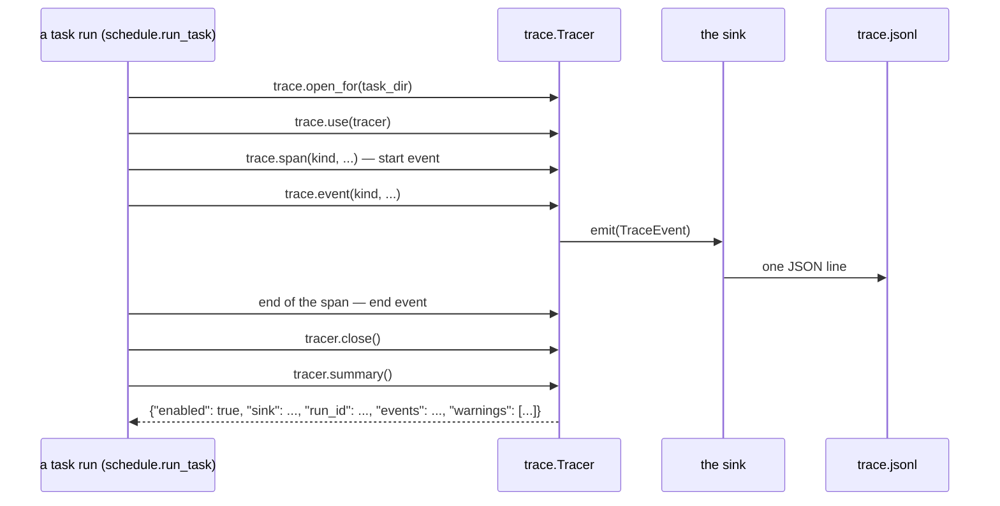

# Trace sinks

A trace records what one task run did, in the order it did it. Each run writes one event per
line to `trace.jsonl` in its task run directory, the same directory as `summary.json`, so a
person or a later tool can follow the stages, the rollouts, the model choices and the cost
without reading the prompts or the artifacts. The default sink writes that file. A package can
replace the sink, and harness2 needs no change to use it.

Tracing is on by default. `HARNESS2_TRACE=0` turns it off. A sink that fails never stops the
run: the failure is kept in `summary.json` under `trace.warnings`.

The code is in `harness2/core/trace.py` (the event, the sink contract, the registry and the
per-run `Tracer`) and `harness2/core/trace_file.py` (the default `file` sink, which writes
`trace.jsonl` and reads it back).

## Overview

A task run opens a tracer for its directory, makes it current, and emits events through the
module-level functions. The tracer cleans each event and hands it to the sink. At the end the
run reads the tracer's summary into `summary.json` and closes it.



## What is left behind

- **Where.** Each task run directory, the one that holds `summary.json`, gets a `trace.jsonl`.
  A resumed task appends to the same file with a new `run_id`; it never overwrites the file.
- **Format.** One JSON object per line, UTF-8. The default sink appends each line under an
  exclusive lock, so events written by another process (a parallel task) never interleave
  inside a line.
- **Reading it.** `harness2.core.trace_file.read` returns the events in file order. A missing
  file reads as an empty list, and a line that is not a complete event (for example, one
  another process is still writing) is skipped.

```python
from pathlib import Path

from harness2.core.trace_file import read

events = read(task_dir / "trace.jsonl")
```

Each event is a `TraceEvent` with six fields:

| Field | Type | Meaning |
|---|---|---|
| `run_id` | `str` | The task run; the `Tracer` makes a uuid4 hex, and every event of that run carries it |
| `span_id` | `str` | The span this event belongs to (a uuid4 hex, first 16 characters) |
| `parent_id` | `str` or `null` | The parent span; `null` on the task span, which is the root |
| `kind` | `str` | The kind of event, one of `trace.Kind` |
| `ts` | `str` | UTC time in ISO 8601, from `datetime.now(timezone.utc).isoformat()` |
| `attrs` | `object` | JSON-ready attributes; `{}` when there are none |

`TraceEvent.to_dict()` returns the six keys and `TraceEvent.from_dict(d)` reads them back;
`read` uses the latter.

A **span** is two events that share a `span_id`: the first has `attrs.phase == "start"`, the
second `"end"`. The end event adds `status` (`"ok"` or `"error"`), `dur_s` (seconds, rounded
to three decimals) and, when the `with` body raised, `error`. It also carries whatever the body
passed to `Span.set(...)`; a later value of the same key wins. A **point event** is one-off
and has no `phase`; it has its own `span_id` but no second event.

## Kinds and attributes

The kinds are constants on `trace.Kind`; never write the string values by hand. Kinds that
start with `judge.` are reserved for the grading side (see below) and are not emitted by the
method side. The attributes column lists what harness2 writes on the start event of a span and
on a point event; every span's end event also has `status` and `dur_s`, and `error` when it
failed.

| Kind | Value | Shape | Attributes |
|---|---|---|---|
| `TASK` | `task` | span | `task_id`, `domain`, `k`, `seed`, `modes`, and `resumed` (`false` on the start event; `true` on the end event when the run resumed) |
| `ROLLOUT` | `rollout` | span | `role` (`base` / `candidate` / `final`), `mode`, `label`, `run_id` (the rollout's run id, not the trace's); on the end event `ok`, `delivered`, `usd`, `error` |
| `STAGE` | `stage` | span | `label`, `dim` (`INV` / `DOM` / `compose`), `mode`; on the end event `kept_base`, `fell_back`, `attempts`, `cached`, `usd`, `error` |
| `TREE_DIFF` | `tree.diff` | point | `label`, `files`: a list of `{path, sha256, change}`, where `change` is `added`, `changed` or `removed` |
| `SELECTION` | `selection` | span | `mode`, `pool` (the candidate labels); on the end event `chosen_label`, `ok`, `usd`, `error` |
| `REFLECTION` | `reflection` | span | `mode`; on the end event `chosen_label`, `ok`, `usd`, `error` |
| `MEMORY_RECALL` | `memory.recall` | point | `connector`, `task_id`, `chars`, `sha256` of the recalled text; never the text |
| `MEMORY_STORE` | `memory.store` | point | `connector`, `task_id`, `label`, `stored` (bool), `path` (may be `null`) |
| `MODEL_ROUTE` | `model.route` | point | `role`, `candidates`: a list of `{runner, model, effort}`; the executor also has `skipped_other_runners` |
| `MODEL_SWITCH` | `model.switch` | point | `role`, `from` and `to` as `{runner, model, effort}`, `reason`; `to` is `null` when no candidate is left |
| `MODEL_FENCE` | `model.fence` | point | `role`, `fenced`, `runners`, `problems`, `model` |
| `COST` | `cost` | point | `mode`, `usd`, `rollout_usd`, `session_usd`, `R`, `P`, at the end of each mode |
| `ERROR` | `error` | point | `where`, `message` |

## Parent and child

`parent_id` links the events into a tree:

- The `TASK` span is the root; its start event has `parent_id: null`.
- A span's parent is the span that was current when it started, and a point event's parent is
  the span that is current when it is emitted. The current span lives in a context variable,
  so a helper does not have to receive it as an argument.
- This puts `ROLLOUT`, `STAGE`, `SELECTION`, `REFLECTION`, `COST`, `ERROR` and the `MEMORY_*`
  events under the `TASK` span (or under an enclosing span when one is added), a `TREE_DIFF`
  under its stage, and the `MODEL_*` events under whichever span is current.
- `trace.use(tracer)` makes a tracer current and drops any span carried in, so a new run never
  attaches to the span of an earlier one. It does not close the tracer; the caller that opened
  it does.
- In a thread pool, wrap the function with `trace.bind(fn)`: the wrapper carries the tracer
  and span of the caller, and each call enters a fresh copy of that context, so the same
  wrapped function can run on several threads at once.

## Recording your own events

A module calls the functions without adding a tracer argument:

```python
from harness2.core import trace

with trace.span(trace.Kind.STAGE, label="demo", dim="INV", mode="parallel") as sp:
    span_id = trace.event(trace.Kind.MEMORY_RECALL, connector="file", chars=0,
                          sha256=trace.digest(""))
    sp.set(attempts=1, usd=0.0)
```

`trace.event(kind, **attrs)` returns the new span id (an empty string when nothing is
recorded). `trace.span(kind, **attrs)` ends the span as `status="error"` and re-raises when the
body raises. Outside `trace.use`, both do nothing, and tracing failures are swallowed by the
`Tracer`, so the caller does not wrap them in `try`. To build a tracer yourself, use
`trace.open_for(task_dir)` and close it when the run is done.

## Keeping bodies out

A trace is metadata, not a copy of the work:

- Prompts, artifacts, harness contents and improver replies are never stored. A file is a
  path and a sha256; `trace.digest(data)` returns the sha256 hex (a `str` is hashed as UTF-8).
- The `Tracer` cleans every attr value before it reaches a sink. A JSON-ready value is kept; a
  string longer than 512 characters (`trace.MAX_ATTR_CHARS`) is replaced by
  `{"sha256": <hex>, "chars": <length>}`, including inside nested dicts and lists. A value that
  is not JSON-ready becomes its `str()` (and then follows the same length rule), a non-finite
  float becomes a string, and nesting deeper than 32 is stringified. Handing over a body by
  mistake therefore still does not trace it.
- Grading stays out of the method's trace: no scores, verdicts or private criteria. Kinds
  starting with `judge.` (`trace.JUDGE_PREFIX`) are reserved for the grading side. The method
  side never emits one; grading code may append its own events (for example, `judge.score`) to
  the same `run_id`, with the `span_id` of the `ROLLOUT` it graded as the `parent_id`. The
  events can be read back with `harness2.core.trace_file.read`.

## Turning tracing off

Tracing is on unless `HARNESS2_TRACE` is exactly `"0"`; any other value, or none, leaves it on.
When it is off, `open_for` returns a `Tracer(None)` that does nothing: no `trace.jsonl` is
written, and `summary.json` records `{"enabled": false}`.

## Choosing a sink

A sink is any object with `emit(event)` for one `TraceEvent` and `close()` for the end of the
run; that is the `TraceSink` protocol. A sink must hand every event on in the order it receives
it, accept emission from several threads, and allow `close` to be called more than once.

The name of the sink is `HARNESS2_TRACE_SINK` when set, else the default `file`; harness2 has no
command-line flag for it. The name is looked up in this order:

1. a built-in registration (`trace.register(name, factory)`);
2. an entry point of that name in the group `harness2.trace_sinks`;
3. for a name containing `:`, a `module:Attr` import path (`Attr` may be a dotted chain).

`trace.names()` lists the built-in and entry point names. A name found nowhere raises
`ValueError` listing the names that exist.

The lookup returns a factory, which is called as `factory(root=Path, **options)`. `root` is the
task run directory. The factory must return a `TraceSink`; anything else raises `TypeError`.
`options` holds the sink-specific settings and must not contain `root` (harness2 supplies it,
and an option named `root` raises `ValueError`). harness2 calls `open_for(task_dir)` without
options, so a sink chosen through the environment receives only `root`; code that builds its
own tracer can pass sink options with `trace.open_for(task_dir, options={...})`.

A package installs a sink with an entry point:

```toml
[project.entry-points."harness2.trace_sinks"]
my-sink = "my_package.trace:make_sink"
```

After `pip install`, select it by name. Before installing, pass the `module:Attr` import path
directly:

```bash
HARNESS2_TRACE_SINK=my-sink harness2 --bench jb --k 1 --mode parallel
HARNESS2_TRACE_SINK=my_package.trace:make_sink harness2 --bench jb --k 1 --mode parallel
```

The factory keeps the shape harness2 calls:

```python
from pathlib import Path


class MySink:
    def __init__(self, root: Path, url: str = "") -> None:
        self.root = Path(root)
        self.url = url

    def emit(self, event) -> None:
        # Hand event.to_dict() to wherever the events go (for example, a database
        # or an observability backend).
        ...

    def close(self) -> None:
        ...


def make_sink(root: Path, **options) -> MySink:
    return MySink(root, **options)
```

The `file` sink is the only built-in one. It uses `root / "trace.jsonl"`, opens the file in
append mode for each event, takes an exclusive lock, writes one line and flushes, so `close`
has nothing to do.

## When a sink fails

A broken sink costs warnings, not the run:

- `emit` raising is swallowed and kept as `emit failed: <type>: <message>`.
- `close` raising is kept as `close failed: <type>: <message>`.
- A sink that cannot be built (an unknown name, an import or factory error, a result that is
  not a `TraceSink`) leaves a `Tracer` that does nothing, with `sink failed: <type>:
  <message>`.
- The same message is kept once, and at most 20 warnings are kept. They are all in
  `summary.json` under `trace.warnings`.
- `Tracer.close()` calls the sink's `close` once; a second call does nothing.

## What summary.json records

At the end of the run, `summary.json` gains a `trace` object built by `Tracer.summary()`:

| Key | Value |
|---|---|
| `enabled` | `true` |
| `sink` | The sink name that was selected |
| `run_id` | The run id on every event of this run |
| `events` | How many events reached the sink |
| `warnings` | The sink and event failures, as above |

With tracing off the whole object is `{"enabled": false}`. A task that resumes keeps the
`trace` block written by the run that wrote the summary; the resumed run's events go into
`trace.jsonl` with a new `run_id`, without rewriting that block.

## Costs and the Ledger

The `usd` on a `ROLLOUT` end event and the Ledger's rollout amounts come from the same value.
`spec.rollout_cost_usd(adapter, run_id, run_dir)` asks the adapter for it through the optional
method `rollout_cost_usd(run_id, run_dir)`, which is not part of the `BenchmarkAdapter`
protocol. An adapter without it reports `0.0`; so does a method that raises, or returns a
negative number, a bool or a non-finite number, so a broken cost never stops a run. The
bundled intake adapter reads the same executor usage for this method as it records for the
executor, so the Ledger's `rollout_usd` and the executor's record agree.

Each mode's `COST` event carries the Ledger totals at the end of that mode: `usd`,
`rollout_usd`, `session_usd`, `R` and `P`.

## Checking a sink against the contract

`harness2.testing.trace_contract` has the checks for a sink author to run from their own tests.
It does not depend on harness2's own tests.

- `check_trace_sink(sink)` raises `AssertionError` when `emit` or `close` is missing or not
  callable, or when the object does not satisfy the `TraceSink` protocol. The message names
  the member that is missing or invalid.
- `TraceSinkContractTests` is a unittest mixin. Subclass it with `unittest.TestCase` and
  implement `make_sink(root)`; each test passes a fresh temporary directory. The checks are:
  the protocol; events read back in the order they were emitted, with one start and one end
  per span; `close` callable twice; four threads emitting at once with every event arriving
  and a unique span id; and a 600-character attr arriving as
  `{"sha256": <hex>, "chars": 600}`.
- `RecordingSink` keeps every event in `events` and counts `close` calls, so a test can inspect
  what a `Tracer` emitted without writing a file.

```python
import unittest
from pathlib import Path

from harness2.testing.trace_contract import TraceSinkContractTests
from my_package.trace import make_sink


class MySinkContractTest(TraceSinkContractTests, unittest.TestCase):
    def make_sink(self, root: Path):
        return make_sink(root=root)
```

The mixin reads events back with `read_events(sink, root)`, which returns `sink.events` when the
sink keeps that list and otherwise reads `root / "trace.jsonl"`. A sink that stores its events
elsewhere (for example, a database) overrides `read_events`. `check_trace_sink` can also be
called on its own:

```python
from harness2.testing.trace_contract import check_trace_sink

check_trace_sink(my_sink)
```

`RecordingSink` is handy when the test is about the events, not the storage:

```python
from harness2.core import trace
from harness2.testing.trace_contract import RecordingSink

sink = RecordingSink()
tracer = trace.Tracer(sink)
with trace.use(tracer):
    with trace.span(trace.Kind.TASK, task_id="t1"):
        trace.event(trace.Kind.COST, usd=0.02)
tracer.close()
# sink.events is the TASK start event, the COST event and the TASK end event, in that order.
```

## Troubleshooting

- **No `trace.jsonl`.** Check `HARNESS2_TRACE`: only `0` turns tracing off. If it is on, read
  `summary.json`'s `trace`: `{"enabled": false}` means the tracer was built disabled, and a
  `warnings` entry beginning `sink failed:` means the sink could not be built.
- **Warnings in `summary.json`.** The run finished and the trace may be incomplete. The entry
  names the failing step (`emit failed`, `close failed`, `sink failed`) and the exception. Fix
  the sink, or switch to `file` by unsetting `HARNESS2_TRACE_SINK`.
- **`ValueError: unknown trace sink ...`.** The name is not a built-in, not an installed entry
  point in `harness2.trace_sinks`, and not a `module:Attr` path. The message lists the
  registered and entry point names; check the spelling, install the package, or add the
  missing attribute.
- **`options must not set ['root']`.** harness2 passes `root` itself; drop that key from the
  options the tracer is built with.
- **Events from a worker thread are missing.** The thread pool does not carry the context
  variable. Wrap the worker with `trace.bind(fn)` before handing it to the pool.
- **A note on parallel processes.** Sink authors do not need a lock for `file`; the default
  sink takes one per line. A custom sink that appends to a shared place needs its own
  serialisation if several processes can write to it.

## See also

- `harness2/core/trace.py`: `TraceEvent`, `Kind`, `Tracer`, the sink registry and `digest`.
- `harness2/core/trace_file.py`: the `file` sink and `read`.
- `harness2/testing/trace_contract.py`: the contract checks and `RecordingSink`.
- [Model connectors](MODEL_CONNECTORS.md): the same name lookup and factory pattern, for the
  models of the executor and the improver.
- `docs/specs/trace-port.md`: the design note this port follows.
