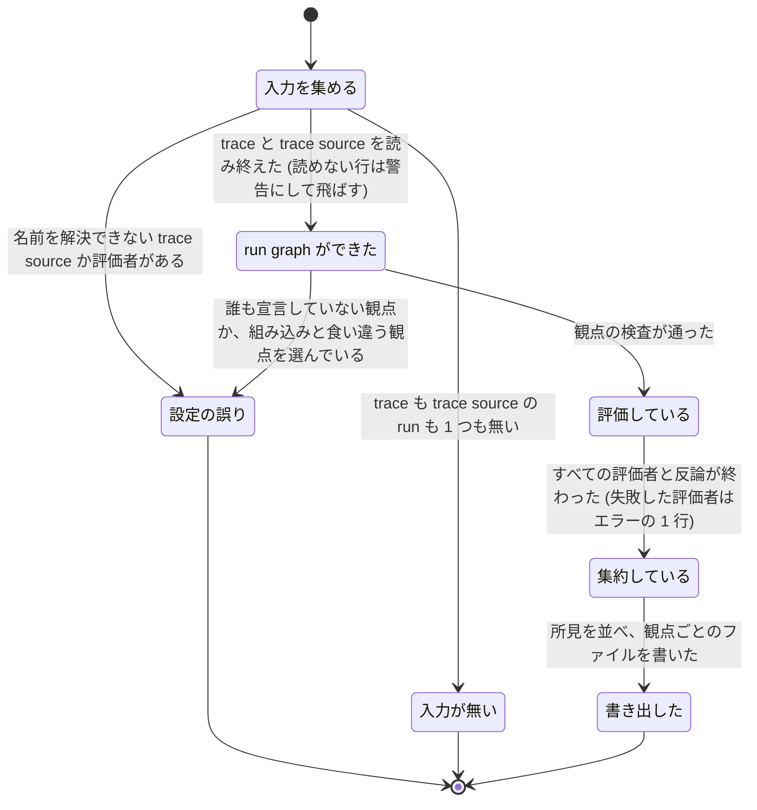

# 外部のシステムの記録を評価する (trace sources) と、層の図

元: 2026-11-20 の依頼「harness2 に omm を導入して、依存の層を見ながら、外のエージェントのシステムが取っているログの観点も評価できるように、必要な (汎用な) 改修を」。同じ日の grilling (Q1〜Q16、すべて推奨どおり) で決めた。前提は PR #15 (評価の土台、`docs/specs/eval-graph.md`)。用語はリポジトリ直下の `GLOSSARY.md` に従う。

## Problem Statement

harness2 の評価 (`harness2-evaluate`) は、harness2 自身が書いた `trace.jsonl` しか読めない。ほかのエージェントのシステム (PBI を回すオーケストレーターなど) の記録を同じ評価者・同じ集約にかけたいとき、今は外のパッケージがその記録を一度 `trace.jsonl` に変換してディスクに書き、それを `--runs` で読ませるしかない。変換したファイルが元の記録と二重に残り、所見の根拠も元の記録の行ではなく変換後のファイルを指す。

また観点は組み込みの 6 つ (cost・budget・effect・safety・reproducibility・generalization) に固定で、評価者は新しい観点を名乗れない。外のシステムの記録には「工程や問いかけの順番が守られたか」のように、どの組み込みの観点にも当てはまらない問いがある。今の外付けの評価者は、それを safety や reproducibility に押し込んでいる。

外のシステムの run を評価にかけると、同梱の `rules` は台帳やモードが無いことを harness2 の誤りとして報告してしまう。

最後に、harness2 には依存の層の決まりが書かれておらず、守られてもいない。`core` の評価の受け口が `evaluators` の `rules` を import していて、下の層が上の層を知っている。構成を図で追える文書 (`.omm/`) も無い。

## Solution

1. **trace source の差し込み口**: 名前で選ぶ trace source を足す。trace source は、あるシステムの記録の場所を受け取り、trace と同じ形のイベントを返す。`harness2-evaluate --source <名前>=<場所>` で渡すと、その run が run graph に入る。`--runs` と一緒に渡せば 1 つの run graph にまとまり、`--source` だけなら `--runs` は要らない。名前の解決は評価者と同じ順 (組み込みの登録 → entry point のグループ `harness2.trace_sources` → `module:Attr`)。
2. **external run の形**: trace source は run ごとに根の `task` span を 1 つ出し、その attrs に `system` (システムの名前) を持たせる。ほかの種類は `<system>.<種類>` の名前空間を付ける。各ノードは出どころ (trace source の名前・ファイル・行) を持ち、所見の根拠から元の記録の行までたどれる。
3. **declared viewpoint**: 評価者は組み込みの 6 つのほかに、自分の観点を宣言できる。名前の規則は組み込みと同じで、組み込みと同じ名前は名乗れない。グラフの設定で選べるのは、組み込みの観点と、グラフの中のどれかの評価者が宣言した観点だけ。
4. **rules の範囲**: 同梱の `rules` は harness2 の run (`task` の `system` が無いか `harness2`) だけを検査し、external run には所見を出さない。
5. **層**: 層を `config` などの土台 → `core` → `evaluators`・`substrate`・`testing` → `benchmarks` → `cli` と決め、逆向きの import で落ちるテストを足す。`core` から `rules` への import をやめ、`rules` は `evaluators` の側から登録する。
6. **図と文書**: oh-my-mermaid で `.omm/` に harness2 全体の構成と層を描く。README の構成図 (d2) を arch-diagram で描き直し、trace source を足す。`docs/EVALUATION.md` と日本語版、`docs/TRACE.md` と日本語版に trace source と declared viewpoint の節を足す。

## User Stories

1. 外のエージェントのシステムを運用する人として、その記録を `harness2-evaluate --source <名前>=<場所>` で評価にかけたい。変換したファイルを別に置かずに済ませたい。
2. 同じ人として、所見の根拠から元の記録のファイルと行にたどり着きたい。どの出来事が問題だったかを元の記録で確かめるため。
3. harness2 と外のシステムを比べる人として、`--runs` と `--source` を同時に渡し、両方の run を 1 つの run graph で評価したい。
4. trace source を作る人として、entry point のグループ `harness2.trace_sources` に登録するだけで、名前で呼べるようにしたい。
5. 同じ人として、インストールする前でも `module:Attr` で trace source を試したい。
6. 同じ人として、harness2 の契約テストを自分のテストで継承し、自分の trace source が決まりを守るかを確かめたい。
7. 同じ人として、壊れた行や親の無いイベントがあっても評価が止まらず、警告に 1 行ずつ出てほしい。どこを飛ばしたかが分かるため。
8. 評価者を作る人として、組み込みに無い観点 (例: 工程や問いかけの順番) を自分で宣言し、その観点で所見を出したい。
9. 同じ人として、宣言した観点の所見が `findings/<観点>.json` に分かれて出てほしい。
10. グラフの設定を書く人として、宣言された観点を名前で選びたい。誰も宣言していない名前を書いたら、何も動く前に設定の誤りとして止まってほしい。
11. 同じ人として、評価者が組み込みと同じ名前の観点を宣言したら、設定の誤りとして止まってほしい。2 つの意味が混ざらないため。
12. 評価の結果を読む人として、external run に台帳が無いことを harness2 の誤りとして報告されたくない。
13. harness2 を直す人として、下の層が上の層を import したらテストで気づきたい。
14. harness2 を読み始める人として、`.omm/` の図で層とモジュールの関係をたどりたい。
15. 同じ人として、README の構成図で、評価が trace と trace source の両方を読むことを一目で知りたい。
16. ライブラリとして評価を呼ぶ人として、`harness2.evaluators` を import すれば `rules` が名前で使えるようにしたい。

## Implementation Decisions

### trace source

- 新しいモジュールを `core` に置く (評価者の受け口と同じ形)。プロトコル `TraceSource` は `read(location)` を 1 つ持ち、イベントの列と警告の列を返す。イベントは今の trace のイベントの形に、出どころ (trace source の名前・ファイル・行) を足したもの。
- 解決は `register(name, factory)`・entry point のグループ `harness2.trace_sources`・`module:Attr` の順。ファクトリーは `factory(**options)`。この PR では CLI から options を渡す口は作らない (Out of Scope)。
- 組み込みの trace source を 1 つ登録する: `trace` (場所の下の `trace.jsonl` を読む、今の `--runs` と同じ読み方)。`--runs DIR` は `--source trace=DIR` と同じ意味になる。
- run graph を作る関数は、`trace.jsonl` のパスの列に加えて trace source の結果も受け取る。`Node` の出どころは、trace のノードでは今のパスのまま、trace source のノードでは名前・ファイル・行。
- 同じ (run_id, span_id) が 2 つの入力から来たら、後のものを捨てて警告を足す。

### external run

- trace source は run ごとに根の `task` span を 1 つ出す。attrs に `system` を必ず入れる。`task` 以外の種類は `<system>.<種類>` (例 `orchestrator.question.asked`)。
- `system` の無い `task`、名前空間の無い組み込み以外の種類、組み込みの種類 (`mode`・`rollout` など) を出す trace source は、警告を足してそのイベントを飛ばす。組み込みの種類は harness2 の run だけのもの。
- external run は `summary.json` を持たない。summary の辞書には入らない。

### declared viewpoint

- `Viewpoint` の形は変えない。評価者の `viewpoints()` が返す観点のうち、組み込みに無い名前を declared viewpoint とする。
- グラフの設定の検査は 2 段にする。読んだ時点で、名前の形と、組み込みの観点の名前を検査する (今と同じ)。評価者を作った後、どのノードも評価する前に、組み込みに無い名前がグラフの中のどれかの評価者に宣言されているかを検査する。どちらの違反も設定の誤り (CLI では終了コード 2)。
- 評価者が組み込みと同じ名前で別の説明・別の `reads` の観点を宣言したら、設定の誤り。2 つの評価者が同じ declared viewpoint を宣言したら、最初に宣言したものの説明を使う。
- `findings/<観点>.json` は declared viewpoint にも作る。

### rules の範囲

- `rules` は、`task` の attrs の `system` が無いか `harness2` の run だけを見る。external run のノードには触らず、所見も出さない。
- `rules` の登録は `evaluators` の側に移す。`harness2.evaluators` を import すると `rules` が登録される。`harness2-evaluate` はそれを import する。pyproject の entry point にも `rules` を足し、インストール済みなら import しなくても名前で解決できるようにする。`core` から `evaluators` への参照は無くす。

### 層

- 層は下から: 土台 (`config` などパッケージ直下の共通モジュール) → `core` → `evaluators`・`substrate`・`testing` (互いに import しない) → `benchmarks` (`substrate` を使ってよい) → `cli`。`plugins` と直下の `demo`・`install`・`preflight` の置き場所は omm-scan の結果を見て決め、テストの表に書く。
- 層の表は層のテスト 1 か所にだけ持つ。テストはパッケージの各ファイルの import を構文木で読み、上の層への import を名指しして落とす。関数の中の遅延 import も数える。
- `.omm/` の図はこの表と同じ層で描く。

### 図と文書

- `.omm/` は oh-my-mermaid の omm-scan で作る。
- README の構成図 (`assets/architecture/`) は arch-diagram で描き直す。評価の部分に trace source を足す。SVG を直接は直さない。
- `docs/EVALUATION.md`・`docs/EVALUATION.ja.md` に「trace source」と「declared viewpoint」の節、`docs/TRACE.md`・`docs/TRACE.ja.md` に external run の決まり (`system`・名前空間・出どころ) を足す。
- harness2 には特定の外部システムの名前を書かない。例は架空の名前 (`orchestrator` など) にする。

## Testing Decisions

- よいテストは、外から見た振る舞いだけを確かめる。`harness2-evaluate` が書くファイル、run graph のノードと出どころ、設定の誤りの終了コードを見る。内部の関数の呼ばれ方は見ない。
- **合意済みの seam**:
  1. `harness2-evaluate` の CLI (一番上の seam)。`module:Attr` で渡す偽の trace source と偽の評価者で、`--source` だけ・`--runs` と併用・declared viewpoint の所見の書き出し・設定の誤りの終了コード 2・external run に `rules` が所見を出さないことを確かめる。
  2. run graph を作る関数。trace source の結果から作ったノードの出どころ、同じ span の重複、壊れたイベントの警告を確かめる。
  3. `harness2.testing` の trace source の契約テスト。偽の trace source で自分自身を試す (評価者の契約テストと同じ作り)。
  4. 層のテスト。今のコードで通り、わざと逆向きの import を足した一時的なファイルで落ちることを確かめる。
- 先例: `tests/` の評価者の契約テストと `harness2-evaluate` の CLI のテスト、`harness2/testing/evaluator_contract.py`。
- 検証は WSL の python3 3.12 で `python3 -m unittest discover -s tests` と `uvx ruff@0.17.1 check` / `format --check` (触ったファイルだけ)。

## 状態の図

1 回の評価が通る状態。

## Out of Scope

- 特定の外部システムの trace source。harness2 には入れず、外のパッケージが entry point で出す。今の変換のやり方からの移し替えは、その外のパッケージの側で、この PR がマージされてから行う。
- CLI から trace source に options を渡す口 (`--source-opt` など)。要る trace source が出てから足す。
- external run の summary に当たるもの (台帳・費用の集計)。
- 試運転で見つけた worktree 実行の `output/changes.diff` の混入。別の小さな PR で直す。
- モデルを使う評価者・反論。
- 層の決まりを CI の別のツール (import-linter など) で検査すること。今回は標準ライブラリのテストで済ませる。

## Further Notes

- 外部の記録を trace に変換してディスクに書く今のやり方は、この PR の後も動く (`--runs` で読める)。移し替えは外のパッケージの都合で進める。
- `rules` の登録の場所を変えるので、`evaluate.evaluator_for("rules")` を `harness2.evaluators` を import せずに呼ぶライブラリの利用者は、インストール済み (entry point がある) でなければ名前を解決できなくなる。CHANGELOG ではなく `docs/EVALUATION*.md` の「評価者を作る」の節に書く。
